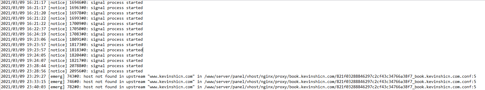
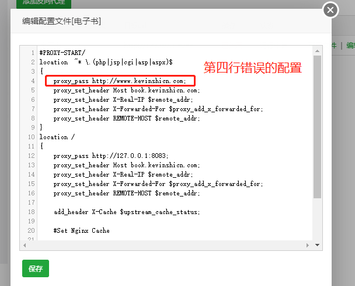
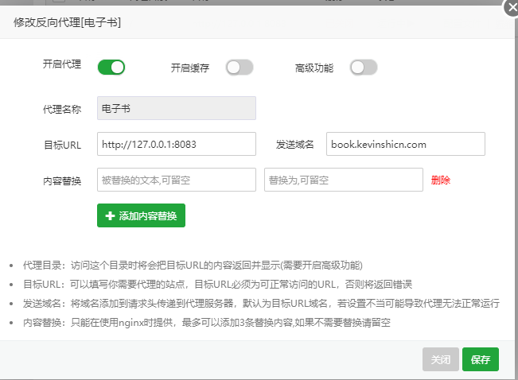
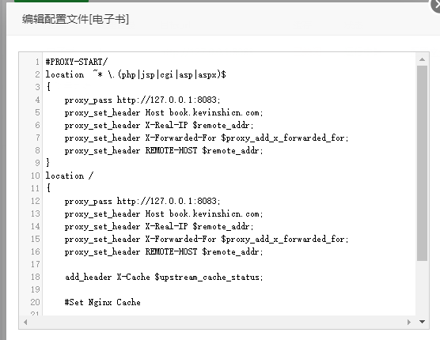

## 发现问题

我在**重启**阿里云 `ECS` 的时候发现宝塔**面板可以正常开启**，但是宝塔面板的 `Nginx` **服务**是**无法正常自动启动**的，这也就导致我的**项目无法正常访问**

**万幸**的是 `Nginx` **服务**此时仍然是**可以**通过面板**手动开启**的

但是**问题总是要解决的**，于是先看`log`

在

```text
/www/server/nginx/logs
```

找到`error.log`文件

发现**报错**如下

```text
2021/03/10 00:06:01 [emerg] 743#0: host not found in upstream "域名" in /www/server/panel/vhost/nginx/proxy/`目标子域名`/6678156071b816a639a265441e95cde1_`目标子域名`.conf:4
```



log截图

## 查明起因

当我在**宝塔面板**新建一个`网站`时

如果**手动修改**了某一个**站点**的`反向代理`

并且`目标URL`使用了`域名`而非`IP`

那么当你后面**再次**将`反向代理`的`目标URL`修改为`IP`之后

`反向代理`配置的**第四行**将会**维持原先**的`proxy_pass`值，也就是指向到`域名`

```nginx
proxy_pass http://域名.com;
```



第四行错误的配置

**尽管**此时你在**面板中设置的是正确的**



正确的面板设置

然而此时 `Nginx` 就是会在**启动的时候报错**导致**无法随服务器自动运行！**

## 解决问题

### 解决方案 1

如果能够**删掉**整个站点**重新创建**是**最稳妥**的，之后再创建`反向代理`记得使用`127.0.0.1:端口`（如果你要**指向别的服务器请不要**用`127.0.0.1`)

### 解决方案 2

这里我认为应该是**宝塔**的一个 `BUG`，因为我在**宝塔面板**已经将`目标URL`改成了`IP`，但在**反向代理配置第四行**仍然出现了**没有随着改动进行变更**的问题。

因此这里我们只需要**将这个第四行**（有些帖子反馈是**第五行**）的`proxy_pass`后面改到跟**第十二行**的**数值一致**即可！

```nginx
// 这里我将第四行与十二行的两个proxy_pass保持一致
proxy_pass http://127.0.0.1:端口;
```

只要**确保第四行**的`proxy_pass`与我<strong>们的目标地址相同，</strong>服务就是可以正常随服务器自动启动了



正确的反向代理设置

这里我**保存文件**后重启 `ECS` 服务器，`Nginx` 服务**终于可以正常启动了！！！**

## 总结

宝塔毕竟是一款**用来管理服务器**的控制面板，因此如果没有**看代码**以及**解决问题**的能力那么将会非常头疼

**看来还是要多学习啊！**

#### 推荐阅读

- [周记项目正式启动](https://mp.weixin.qq.com/s/AtHYksWbXnaJheWlNTLGXA)
- [我是如何 43 天内拿下 PMP 证书的](https://mp.weixin.qq.com/s/O_RHEhW6A6arUSvBxshTvg)
- [书籍分享《重新定义团队：谷歌如何工作》（1-3 章）](https://mp.weixin.qq.com/s/dzn8uJV-7lLvCyKyz3udAg)
- [书籍分享《重新定义团队：谷歌如何工作》（第 4 章）](https://mp.weixin.qq.com/s/ap_JhwgmfxgqFAIcTF3nKQ)
- [群辉 Synology NAS 实现 WOL(Wake On Lan)唤醒局域网内任意设备+siri 语音唤醒电脑](https://mp.weixin.qq.com/s/LbYA7X4w0vLo0Cz0Cdv9hg)

\---

欢迎关注我的公众号“**凯文有事找你**”，原创**技术**、**生活**、**经验教训**文章第一时间推送。


