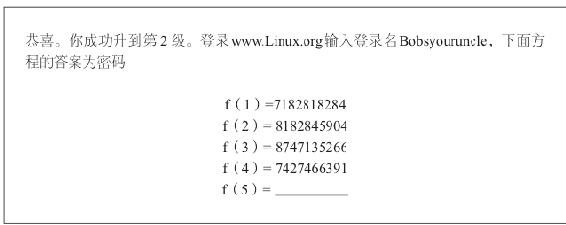
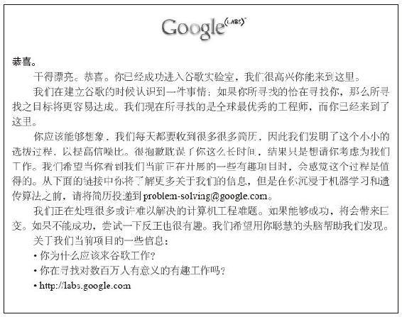

## 周记规则变动

### 排版

前面三篇周记写完之后我是**对周记的视觉效果是非常不满意的**，因此从本周周记开始将尝试使用 `Markdown` 编辑器来进行文章编辑。这里我使用的是[Doocs 开源组织研发的 Markdown 编辑器](https://doocs.github.io/md/)。这款编辑器实际**使用起来非常舒服**，尤其是可以像秀米一样**直接复制黏贴排版至微信公众号**，感兴趣的朋友可以点击前面的链接试一下。（目前以为不满意的地方就是无法通过Ctrl+B进行加粗，使得我只能在 `VS Code` 里面加粗之后再导回到编辑器）

\---

## 第四章 - 搜寻最优人才

### 谷歌“自我复制人才机器”的进化

2013 年的一次谷歌董事会召开结束之后，英特尔首席执行官、谷歌董事会成员保罗·欧特里尼总结道：

> “最令人钦佩的是，你们的团队打造了世界上第一台**自我复制的人才机器**。你们建立的体系**不仅能够招聘到非凡的人才**，而且这些**人才能够与公司同发展**，**使每一批员工都更加优秀。**”

\---

### 一切真的开始于创始人

谷歌团队从一开始规模很小的时候就开始实行了 **“招聘应该由委员会完成”** 机制，也就是认为**单一个体是无法通过自己的判断来招聘到合适的人才的。**

#### 招聘是一件很客观的事情，是有标准的，这个 **标准也应该由一位最终审核人对其进行把控。**

现在的谷歌将标准把控的责任**分至两名高级领导者团队承担**。一个团队由**产品管理**和**工程师**组成另外一个团队由**销售、融资和其他部门成员组成。**

最后对于**每一位应聘者都会由 CEO 拉里·佩奇进行审核。**

#### 我认为谷歌将对公司发展**非常重要的人力资源**安排在招聘环节**是有必有的。**

当你创立一家公司的时候，**你招募进来的人**可能会<strong>符合你的预期，</strong>最初的员工可能从你的角度来说非常的满意。

但当这些员工去负责招聘任务的时候，**招聘的质量往往会逐渐下降**，这并不是因为他们人不好或能力不行，而是因为他们**无法准确地理解你希望招募怎样的人。**

因此每招募的新一批员工都会比前一批差一些

同时随着公司壮大，就有更多的诱惑出现。不论是**想要招聘一位朋友还**是<strong>为了加强与客户的关系而招聘他们的孩子。</strong>这些举动都会带来**招聘质量下降。**

结果就是你的公司从一家只招聘明星员工的公司**变成一家平均水平的公司。**

#### **保证招聘的质量**不是这本书第一次提起了，招聘的质量是需要<strong>长期、合理地进行把控的。</strong>不应因为**长时间无法招到人而妥协**，也不应**为了达到特定目标而去招揽某人。**

对于初创公司来说，宁愿放弃两名人才也<strong>不要招进来一名有“毒”的人。</strong>这样的人**对环境的影响是致命的，初创公司无法承受这样的后果。**

\---

### 成立初期：龟速招募惊世人才

#### 谷歌公司除了常规的背景调查之外还建立起了**应聘者追踪系统。**

谷歌会将应聘者的简历与现有谷歌人的**简历做对比**，如果**二者有重叠**比如说**与一位谷歌人是同一所学校的同年级校友或同时在微软工作过。**

那么通常这位谷歌人就会收到一封自动邮件，**询问**他们是否认识这位应聘者，<strong>如何评价这位应聘者。</strong>此举是考虑到应聘者提供的应聘材料总是金光闪闪，而我们认为，这些 **“后门”参考资料会更加真实。** 这种方法能够**筛选掉“溜须拍马和狐假虎威”的人。**

谷歌会将包含上述信息的应聘资料汇总成一份**招聘信息包**，每一名应聘者的信息包都有 **50 页或以上。**

谷歌内部有很多招聘委员会，这些**应聘者的信息会发送给熟悉招聘的职位的委员会**，同时这些委员会成员又与职位**没有直接的利害关系。**

线上销售职位的招聘委员会**将由销售人员组成**，但是成员**不会包括招聘经理**和<strong>任何将与应聘者有直接工作关系的人。</strong>此举旨在确保客观性。

#### 谷歌对于人才的要求除了 `高智商` 外，更希望这名员工 `聪明且有好奇心` 。

2004 年的时候谷歌曾在一条高速公路旁立起了一个广告牌，希望**有好奇心和雄心**的计算机科学家能够解出这个问题。（在自然常数 e 的连续数字中找到第一个 10 位质数）当你成功的答对了这道题那么可以进入相应的网站查看第二道题目

答案是7427466391

如果你能够解出第二道谜题，自然常数 e 中相加等于 49 的 10 位数字

f（5）的结果是6819025515

奖励网页

这看起来是一个很有意思的测试，但这个测试最后**没有帮助谷歌招聘到任何一名员工**，实际也**仅仅只有 25 名谷歌人称其曾经看到过这条广告。**

实际情况是多数人**无法同时解出两道题。**

在面试**解出两道题的应聘者**时，我们发现这类在个人竞争中表现好的人**并不总能成为优秀的团队伙伴。**

#### 赢得这些个人能力挑战的**人或许很聪明**，但通常**只是在某一领域有所专长。**

谷歌招聘人的要求<strong>不仅能够解决今天的问题，更要能够解决未来可能出现的各种未知问题。</strong>因此对于这些习惯于解决有明确终点和确定答案的问题，而不是掌控现实世界中的复杂状况可能无法满足谷歌的应聘标准。

#### **谷歌认为任何单一方面的观点都可能是存在偏见的。**

谷歌认为要求提供成绩和成绩单有助于从侧面帮助<strong>寻找聪明人，</strong>此举也确实**淘汰了一些在成绩上作假的应聘者。**

但是在 2010 年，谷歌通过分析学业表现除了预测大学毕业后<strong>头两三年的工作表现外并没有更多的预测作用。</strong>因此自那以后也仅仅会要求刚毕业的学生提供成绩单了。

\---

### 大海捞针：从 70 亿人中找到最好的应聘者

谷歌成立初期及之后的多年时间里，<strong>最优质的应聘者源自现有员工的推荐。</strong>谷歌员工<strong>推荐的员工数量曾经一度超过了总员工占比的50%。</strong>然而从 2009 年开始，作者团队发现员工推荐应聘者的数量开始下降。因为员工推荐是谷歌前十年最重要的雇员来源，所以这种现象发生的时候不得不令人担忧。

团队起初尝试将推荐员工的奖励提高 `2000` 美元至 `4000` 美元，**但这并没有给推荐率带来任何的提高。**

因为现有工作的谷歌员工**已经很喜欢谷歌了，并且都会主动的邀请朋友和前同事入职。**

作者又问了一些谷歌人为什么不邀请朋友入职的时候这是部分回应。

> “你在开玩笑吗？这是最棒的地方！我非常希望朋友来这里工作。”

> “这里的人都酷毙了。我认识一个人很适合在这里工作。”

> “我在为一项伟大的事业奋斗。有多少人能有此等荣幸？”

#### **既然**谷歌人推荐朋友的<strong>热情一直都在，</strong>那么又是什么原因导致的**推荐数量下降呢？**

作者又认为尽管推荐过来的人**成功应聘的概率比其他渠道高**（成功聘用比例为 `5%` ）但这<strong>仍然是 20 选 1。</strong>再加上**过于复杂和次数多的面试流程**降低了谷歌人推荐朋友的概率。

> 为了解决这些问题，我们大幅减少了每一位应聘者的面试次数。我们还为被推荐人**提供了周到且质量上乘的服务**，推荐来的**应聘者将在 48 小时内接到我们的电话**，而推荐应聘者来的谷歌人<strong>每周都会收到关于应聘者的情况通报。</strong>相比而言，谷歌人和应聘者<strong>对这个流程更满意，但是推荐人的数量还是没有变化。</strong>至此，我们还是没有弄清为什么推荐的应聘者越来越少。

\---

### 我们的员工不可能认识世界上的每个人

作者团队后来又引入了 **“辅助回忆”** 方法来帮助谷歌人去**回忆适合的潜在应聘者。**

> “你共事过的同事中，谁是最优秀的财务人员？”

> “谁是最棒的 ruby 编程语言工程师？”

> “你知道我们应该雇谁吗？”

> “你认识什么人可以在纽约做一个不错的销售人员吗？”

这些方法使谷歌推荐人的**数量增加了三分之一，但这远远达不到招聘目标。**

在这个过程中，**谷歌发现**

> 最优秀的人<strong>并不在寻找工作。</strong>表现极为优秀的人在现在的工作岗位上<strong>很开心，满足感很强。</strong>他们不会进入人们的推荐人名单中，因为人们会想为什么要推荐一些在现在岗位上很开心的人呢？而且**他们肯定也不会考虑新的工作。**

#### 于是谷歌重建了招聘团队，从先前的**被动接受信息后筛选简历并安排面试**发展成一个**内部招聘公司，目标在于搜寻并培育出全球最优秀的人才。**

通过内部研发的产品 `gHire`（谷歌建立起来的一个应聘者数据库，辅以多种强化工具对应聘者进行筛选和跟踪）经过一段时间，甚至数年，数百名杰出的招聘人员发现并培育出这些优秀的个体。

最后结果是谷歌团队每年聘用的人数<strong>超过一半都是来自内部人才搜寻公司找到的，</strong>这种方式比外部招聘公司**成本低很多，对市场的认识更深入，同时为应聘者提供了一种更温暖舒适的经历。**

随着互联网技术的发展，谷歌也能够去<strong>索引几乎任何一家公司的任意一名员工。</strong>谷歌利用这个方法**对几家非常出色的公司进行了分析，汇总了一份名单，几乎包含他们的全部员工，评估了哪些人适合来谷歌工作。**

> 我们整理出一份名单之后，会与在该领域有专长或可能了解这些备选员工的谷歌人一同审阅部分资料。我们会在网上抽检一些资料，寻找可能帮助我们判断这些候选人能否在谷歌取得成功的信息。而后我们会去接触候选人的人际网络，建立关系——可能通过一封电子邮件或一个电话，甚至是在一次会议上见一面。通常，关系的建立由招聘人员完成，但有时最好的联络人是某一位工程师或主管。或许当时没有机会，但是总有可能备选应聘者在一年后遭遇不顺，忆起与谷歌招聘人员那一次愉快交谈。曾长期担任谷歌广告和应用程序工程高级副总裁的杰夫·胡贝尔——现隶属于 Google X，为谷歌研发下一代具有重大意义的产品——亲自招聘过超过 25 名高级工程师，其中有一位他跟踪培育了 10 年，历经 3 家公司，最后才被说服加入了谷歌。

谷歌除了**掘地三尺挖人才的能力**之外，也**愿意去为异乎寻常的优秀人才不惜一切的进行招揽**

> 在成为扬声器和智能手环制造商捷波朗的人力运营部副总裁之前，兰迪·纳福利克是谷歌人力资源部的核心领导者，负责整个欧洲、中东地区和非洲的技术人员招聘。他负责我们在丹麦奥胡斯的团队招聘，那个团队将继续带来浏览器速度的革命。“我们了解到奥胡斯有一个杰出工程师组成的小团队，”兰迪告诉我说，“他们卖掉了此前的公司，正在探寻下一步将要做的工作。微软听闻他们的情况，正在全力争取。微软想要聘用他们整个团队，但是要求他们搬到美国微软总部雷德蒙德。那些工程师说‘不可能’。于是我们乘虚而入，采取了一些非常积极的招聘努力，对他们说，**‘在奥胡斯工作，为谷歌建立一个新的办公室，创造伟大的产品’**。我们聘用了整个团队，正是这个团队编写了谷歌浏览器的脚本语言（`Javascript`）引擎。”

\---

## 谷歌工作法则：搜寻非凡的应聘者

### 要详细说明寻找人才的标准，依此找到最优秀的被推荐人

人们往往<strong>不是故意忽略某个人的，只是一下子无法想起来罢了，</strong>就好比谷歌用的“辅助回忆”方法就是一个非常好的**勾起员工回忆的办法。**

### 使招聘成为每个人的工作

人与人之间的关系是很复杂的，往往通过不同的人作为桥梁可能会给你**带来异常好的效果。**

### 不要害怕尝试疯狂的事情，以此引起最优秀人才的注意

\---

## 本周总结

对于新的排版我个人是**比较满意**的，只能说这**文章终于是能看了。**

不过还有一些问题出在内容上面，一部分<strong>内容我认为过长了，不易阅读，</strong>我将在下一篇周记继续迭代。

这次仅更新了第四章就达到了 `4000` 字，坦白来讲还是超预期了。

看一下下次是否有优化办法吧！

##### 推荐阅读

- [周记2021-01-周记项目正式启动](https://mp.weixin.qq.com/s/AtHYksWbXnaJheWlNTLGXA)
- [周记2021-02-我是如何43天内拿下PMP证书的](https://mp.weixin.qq.com/s/O_RHEhW6A6arUSvBxshTvg)
- [周记2021-03-书籍分享《重新定义团队：谷歌如何工作》（1-3章）](https://mp.weixin.qq.com/s/dzn8uJV-7lLvCyKyz3udAg)

\---

欢迎关注我的公众号“**凯文有事找你**”，原创**技术**、**生活**、**经验教训**文章第一时间推送。

