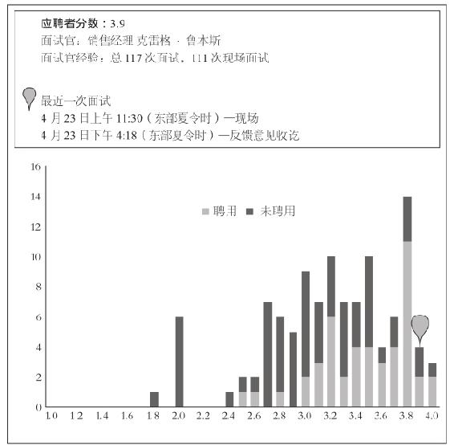
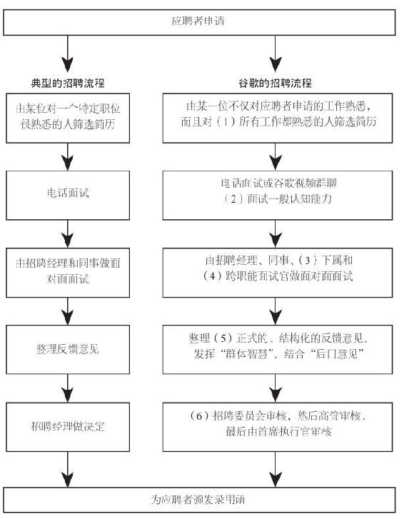
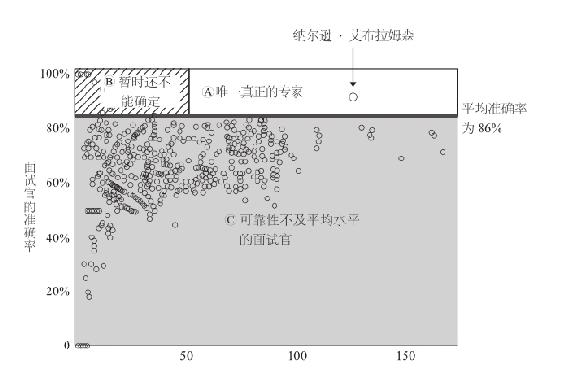
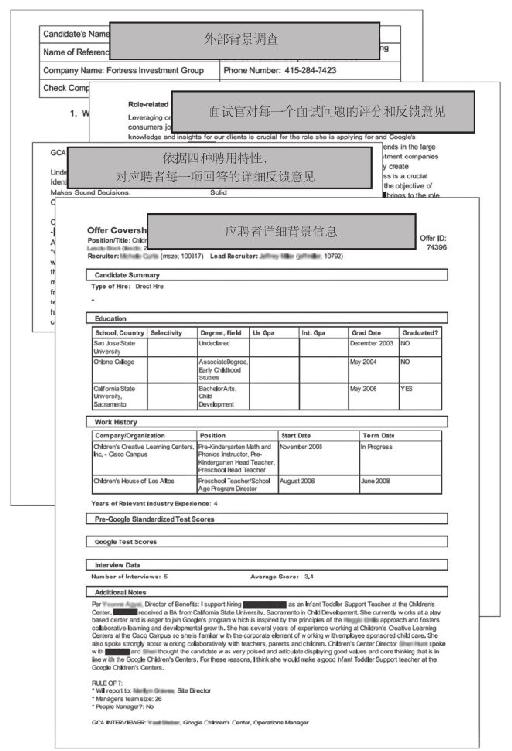

## 关于本周

### 回归读书笔记

因为这本书**第五章**的**内容非常多**，因此本篇周记**只会有第五章**的读书笔记。

我希望您可以将这**一万字**的**精华**进行**完整的阅读**，我相信您会获得**意想不到的收获**！

这是**充满**`干货`与`数据`的一章，我也正是因为**读了第五章**，**才决定**要去写这本书的读书笔记。

## 第五章 - 不要相信你的直觉

### 为什么依靠本能无法成为优秀的面试官以及如何提升招聘效果

**海飞丝**洗发水在**20 世纪 80 年代**的**广告宣传语**是这样的

> 你不会有**第二次机会**给人留下**第一印象**

大部分**面试也是如此**，面试官在面试的**头几分钟**就会对这名应聘者<strong>立下结论，</strong>之后的面试过程都是**在想办法证明其一开始就立下的结论。**

托莱多大学的两名心理学学生`特里西亚·普利克特`和`内哈·贾达姜`与其导师`弗兰克·伯尼瑞`合作，在 `2000` 年发表了一项研究成果，认为一次**面试**的**前 10 秒**钟做出的判断可以**预测整个面试的结果。**

实验的结果是如下**11 个**变量中**有 9 个**都被证明是与招聘结果<strong>有显著的相关性，</strong>这些变量包含：`受聘价值`、`竞争力`、`智力`、`雄心`、`可信度`、`自信心`、`紧张程度`、`热情`、`礼貌`、`亲切度`和`表达能力`。

#### 这 10 秒钟的印象是有意义的么？

答案**当然是错的**，心理学家将这种现象称为`证实偏见（Confirmation Bias）`即

> 倾向于`寻找`、`解释`或`优先考虑`那些能够**支持我们观点或假设的信息**

这种 `10` 秒就生成的判断是由**潜意识**在**严重受内在偏见和信念的影响**下生成的，使人在不经意间**从评估应聘者**转而变成**寻找证据证实自己**的最初印象。

`马尔科姆·格拉德威尔`与密歇根大学的心理学家`理查德·尼斯贝`探讨过我们**不自知的自欺欺人**：

> **错觉**的基础在于我们**不知从何处来的自信**，**认为**自己**掌握了状况**，**认为**自己能够**读懂一个人的品性**……你在面试某个人的时候，与他们相处一个小时，你不**认为**这个过程是在**提取一个人行为的样本**，更不会**认为**那是一个**存在偏见的样本**，但实际却并不如你所想。你**认为**自己看到的是全景，虽然小而模糊但却是完整的个体。

#### 同样毫无价值的还有很多公司采用的案例面试和智力题

> 你的客户是一名造纸厂商，正在考虑建第二座工厂。是否应该建？

> 估测一下**曼哈顿有多少加油站**。

> 一架`波音 747` 里**能放下多少颗高尔夫球**？

> 如果将你**缩小**到（美国）五分钱镍币大小，将你**放进榨汁机里**，你将**如何逃脱**？

能够回答这类问题**只能**算得上是<strong>会一些独立特定的技能，</strong>且这些往往是**可以通过锻炼**来得到提升的技能，这对**评估应聘者**的价值并**没有太大的帮助。**

**最差的情况**就是面试官会从应聘者身上获得一些<strong>琐碎的信息和洞察，</strong>这仅仅能让面试官**以为自己很聪明并得到自我满足。**

这些问题**对预测应聘者在未来工作中的表现**几乎**没有任何作用。**

因为这些问题首先<strong>与工作任务不相关，</strong>其次在于**真正**可以<strong>预测工作表现的`流动智力`</strong>与**智力题**等顿悟性问题<strong>毫不相干。</strong>且由于这些问题是**可以通过训练来提高**的，因此你也**无法区分**哪部分人是**天赋异禀**哪部分人是**通过练习**的。

#### 谷歌已经在尽量避免使用类似的问题

作者在书中说到**包括其在内的高管**每周在审阅应聘者材料的时候，都会**忽略对这些问题的回答。**

这就好比在[第四章](https://mp.weixin.qq.com/s/ap_JhwgmfxgqFAIcTF3nKQ)中**谷歌对待招聘网站投放岗位**的态度一样，认为**这样的方法是根本没有效果的。**

### 一个世纪的科学研究指明了方向

`1998` 年，`弗兰克·施密特`和`约翰·亨特`发表了一篇<strong>综合分析文章，</strong>总结了 `85` 年来关于**评估预测人才表现方面研究的成果。**

他们研究了 `19` 种评估技巧，发现**典型的、非结构化的测试**对于预测应聘者**受聘之后表现的结果很不理想。**

`非结构化`对员工未来表现的预测准确性为 `14%`

即便`非结构化`的方法准确性只有 `14%`

但是这也**远远高于**

`背景调查`的 `7%`

`工作年限`判断法的 `3%`

以及“`笔迹学`”或`笔迹分析`的 `0.04%`

#### 预测某人在工作中表现最好的方法是`样例测试` (准确性`29%`)

这种方法会**要求**应聘者**完成一项**与其将要**负责岗位**工作中<strong>类似的工作样例，</strong>以此**评估他们的表现。**

但即便这样的方法也<strong>不能做到十全十美，</strong>因为**实际的工作表现**还要取决于`与同事合作的能力`、`如何应对不确定性`、以及`学习`的能力。

同时很多工作中**变数较多**的岗位也**难以选取合适的工作样例进行测试。**

#### 预测工作表现准确率排名第二的是`一般认知能力测试` (准确性`26%`)

`一般认知能力测试`是真正的测试，<strong>有明确的正确或错误的答案，</strong>与 `IQ` 测试的**题目有些类似。**

`一般认知能力测试`能够有效预测工作表现是因为<strong>一般认知能力包括学习能力，</strong>而`高智商`与`学习能力`的结合**足以使大多数人在大部分工作中取得成功。**

然而这样的`标准化测试`都**有歧视非白种人和女性测试者的倾向**，这也因此**限制了这种方法的准确性**。

`菲利斯·罗塞尔`在`1989`年对`SAT`进行的研究中比较了**能力**和**大学表现相近**的<strong>高中女孩和男孩，</strong>发现**女孩**在`SAT`考试中的**成绩要低于男孩。**

具体的**原因**包括有在回答**选择题**过程中**男孩在排除一个选项之后更容易猜出正确答案**、**女性**在有关`人际关系`、`审美`和`人文科学`等类型的`SAT`问题上做得**更好**、**男性**在有关`体育`、`自然科`学和`商业`方面的问题上**表现更佳。**

#### 与一般认知能力测试效果相当的是`结构化测试`(准确性`26%`)

应聘者在面试中将被问及一系列问题，这些**问题都有明确的`标准`**，对其应答**质量进行评估。**

`结构化测试`的好处在于对应聘者的<strong>评估完全基于应聘者的表现，</strong>而**不是取决于面试官**的标准高低，或**问题的难易。**

`结构化测试`有两种类型：**行为测试**和**情境测试。**

`行为测试`要求应聘者<strong>讲述过去的成就，</strong>并将其**与当前工作的要求做对比**（比如，“**给我讲讲你曾经……**”）

`情境测试`会**虚拟一个与工作相关的场景**（比如，“**假如……你会怎么做？**”）

**面试官会深入评估**应聘者所讲故事背后的`诚实可信性`和`思考过程`。

`结构化测试`对`非结构化的工作`也**具有预测效果**

同时谷歌发现通过这种测试，`应聘者`以及`面试官`的<strong>面试体验都得到了提升。</strong>人们也**普遍认为**这样的**面试结果更加的公平。**

**限制**这个方法**大规模推广**的**因素**也很明显，那就是<strong>准备这样的测试成本太高了，</strong>你需要：`编写出试题`、`测试不同的试题`、`确保面试官能够按照设定来进行提问`以及`定期更新试题`（避免**面试题泄露**导致应聘者**有备而来**）。

尽管这是一个**成本较高的面试方式**，但我们如果**用常规的方法**去进行**面试**，那也会因为`主观性太强`或`存在偏见`导致**浪费所有人的时间。**

#### 研究显示评估技巧的组合比单一的评估技巧要更有效。

`一般认知能力测试`（预测未来表现的准确性为`26%`），与`尽责性评估`（`10%`）**相结合**对未来谁将在工作中取得成功**有更好的预测**（`36%`）。

以作者的工作经验来讲，在`尽责性评估`中得分高的人“**工作完成方休**”。同时对**团队**和**所处的环境**有<strong>更强的责任心。</strong>也就是说这些人更可能**表现得像主人翁而不是雇员。**

#### 谷歌都采用了哪些评估技巧

谷歌的`面试流程`旨在<strong>预测应聘者加入工作团队之后的表现。</strong>我们**以科学为依据**达成这个目标：结合`行为`和`情境结构化测试`，`评估认知能力`、`尽责性`和`领导力`。

面试问题举例如下：

> 给我讲一下**你的行为**对团队**带来积极影响**的一次经历。（追问：你**最初的目标**是什么，**为什么**？你的**队友如何反应**？**之后你有什么计划**？）

> 给我讲一下你**有效管理团队实现目标**的一次经历。你**采用了什么方式**？（追问：你的**目标是什么**？你是**如何面对团队的每位成员和整个团队的**？你在**对待不同的个体**时是**如何调整领导方式的**？这个**特定的情势**下**传递出什么关键信息**？）

> 给我讲一下**你与某人**（可以是同事、同学或客户）**共事遇到困难**的一次经历。什么原因**使你与这个人难以共事**？（追问：你**采取了哪些措施**解决这个问题？**结果如何**？你**可以采取哪些不同的做法**？）

这些<strong>问题看似很宽泛，</strong>但实际<strong>并不然。</strong>因为`极其优秀的人`所做出的<strong>答案是不非常一样的，</strong>作者讲到（**我深度赞同**）

> **极其优秀的应聘者**在做出选择的时候**会有好得多得多的前例和理由**。你可以看到`伟大`与`普通`之间**清晰的分界线**。

之后谷歌会**按照统一的标准**对面试<strong>进行打分，</strong>谷歌对`一般认知能力测试`的评分包括五个部分，**第一部分为应聘者对问题的理解。**

在每一部分中，面试官<strong>要说明应聘者的表现，</strong>而且**每个表现的等级都有明确标志。**

随后面试官要**明确记下应聘者**是**如何展示**他们的`一般认知能力`的，**以便后续**面试官**做出自己的评估。**

**部分面试官**可能<strong>对这样的方式不屑于顾，</strong>但作者提出了**这些问题**我认为我们**大家都应该进行反思**：

> 回想一下你最近为同一个职位面试过的五个人。你问这些人的<strong>问题很相似，</strong>还是问<strong>每个人的问题都有不同？</strong>你对他们每个人<strong>都问遍了该问的问题了吗？</strong>时间是不是够用了？**你**对他们都严格保持同样的标准<strong>，</strong>还是**因为**疲倦<strong>、</strong>暴躁**或**心情不**好而**刁难其中某个人？**你有没有**记下详细的笔记，**以便后续面试官**参考使用你的见解？

**招聘标准**应该<strong>涉及所有这些问题，</strong>因为这样可以**将纷杂**、**模糊且复杂的**工作环境**浓缩成可度量、可比较的结果。**

除此之外作者也会**在面试中**给应聘者留<strong>5-10 分钟的提问时间，</strong>这样<strong>有助于公司改善流程，</strong>并且**让应聘者感觉到被尊重。**

### 面试该问哪些问题？

> **仅仅**招聘**聪明**的人是**完全不够**的

谷歌意识到**除了**测试应聘者的**技术能力**之外，**更重要**的是以下**四种能力**

#### 一般认知能力

与**考试成绩**不同的是，`一般认知能力`指的是一个人的`学习能力`以及`适应新环境的能力`。

谷歌**更在乎**的是一个人**能否高效的学习**以及**解决生活中的实际问题**。

**考试成绩**并**无法说明**一个人的**一切**。

#### 领导力

`领导力`的**重要性**不言而喻，每一家公司都**渴望并缺少合格的领导者**。

**谷歌**更**想要**的是**一种特别的领导能力**，他们称之为`新兴领导力`。

**这种形式**的领导力**不关乎正式的头衔**，因为**在谷歌**工作**头衔是毫无意义的**。

作者认为无论他是否是“高级副总裁”，他与其他人都是一样的，他会像其他人一样**发表见解**、**做分析**并**协助得出正确的成果**。

谷歌**不喜欢唯我独尊的领导者**，希望更多的听到“**我们**”而不是“**我**”，**不希望**雇员**只关注自己的成就**而不是**取得成就的过程**。

#### “似谷歌人一般的”（“Googleyness”）

**谷歌希望**招到的人**能够在谷歌蓬勃发展**

“`似谷歌人一般的`”这个概念没有明确的定义，但是包括一些特性例如：`享受欢乐`、`谦逊`、`责任心强`、`能够接受模棱两可的状况`以及在`生命中经历过勇敢或有趣的道路`。

#### 职务相关的知识

心理学家`亚伯拉罕·马斯洛`写过的：

> “我认为，如果你**仅有**的工具只是**一把锤子**，那么就很容易想要**把一切都当成钉子**对待。”

谷歌认为**在之前**工作环境**常年依赖**成功地完成**同样工作的人**，在谷歌工作的时候很可能**会复制其以前的做法**。

**这种做法**的**坏处**在于会**使公司丢失创新的机会**。

谷歌认为`有好奇心`、`有诚意学习`的人在**绝大多数情况下都能想出正确的答案**，而因此**也更加可能创造**出**全新的解决方案**。

**在**工程技术或产品管理等**技术岗位**上，谷歌**会深度评估应聘者的计算机科学专业水平**。

但**即便**是在**这些重要的技术岗位**上，**相比**于**雇佣一名**具备**某一领域知识的人**谷歌**更愿意聘用**对计算机科学**达到专业水准基础**上**对整体有认识的人**。

谷歌确保公司内部`通才`和`专家`的**数量能够达到平衡**，确保在一些**深度专业化**的领域能够**随时补充新鲜血液，加入非专家的想法**。

#### 进行评估

确定了谷歌看中的**以上四种特性**之后，**谷歌不要求**一名面试官**针对所有特性**进行**评估**，但是应聘者的**每一项特性**都需要有**至少两名以上**的**独立面试官**进行**评估**。

**评估**的书面反馈包含：`对特性的评估`、`所问的问题`、`应聘者给出的答案`以及`面试官对答案的评估`。

这样的**评估体系**含**有极高的价值**，因为**能够保证后续每一位应聘者**的**评估人**都可以**独立地对应聘者进行评估**。

这样的**体系**不仅仅**能够保证准确的获取**到**应聘者给出的答案**，同时这也是**对面试官的一种考核机制**。

**通过**这些**回答**公司也**能够及时评估面试官**本身**是否善于评估他人**，如果发现面试官本身的**面试技巧不过关**。公司会**对其加以培训**或**停止其面试工作**。

### 不断核查招聘过程是否切实有效

#### 不断优化流程

**所有的产品**都是**不断变得更好**的，**招聘这件事情也是如此**。

**公司**应当**不断地核查调整**，**平衡公司**的`速度`、`错误率`以及`应聘者`和`面试官`的`招聘体验`。

谷歌的商务团队人力资源主管的`托德·卡里塞`之前是招聘团队的一名**博士分析员**

他的**研究发现**数量高达`25`次的面试**是极大的资源浪费**

**仅需**通过`4`次面试就可以拥有`86%`的自信**确定应聘者能够适应某个岗位**。

谷歌便开始有了“**四次准则**”，在**绝大部分情况**下将面试次数限制到`4次`。

单独就这一项改动就让**谷歌面试时间**的`中位数`从之前的`90`到`180天`降低到了`47天`，为公司**节省了**数以`十万小时计`的时间。

#### 承认自己的错误

谷歌**从来没有**认为自己**每次都是正确的**，谷歌会**重新查看**被**拒绝的应聘者**的**申请**以评估**是否在面试过程中犯了错误**。对于这些错误**加以改正**并**吸取经验**。

谷歌会**统计在职员工的简历**并**通过算法筛选出某一个岗位最常见的关键词**。

例如**软件工程师中** `IEEE`（the Institute of electrical and electronic engineers，`电气与电子工程师协会`）是**最常见的关键词**，那么他们或许**会将其他专业协会**的名称**加入到这个关键词列表**中。

在**获得最新关键词列表**之后谷歌会将其**通过算法代入过去六个月的申请者**中去。

之后**根据每个关键词**在`成功`和`不成功`的简历中**出现的频率**进行一定的**权重分配**。

随后谷歌**在之后的六个月**会**对新投来的简历按照**分配权重的**关键词**进行**评分**，并**重点标记**那些**被拒绝的高分应聘者**，**以便**招聘人员能够**再次核查**。

`2010` 年谷歌通过这个方法对 `300000` 名**被拒的软件工程师**简历进行了**筛选**，并对其中 `10000` 名应聘者**进行了再面试**。

最后聘用了 `150` 人。

**虽然**只聘用到了 `150` 人，且**做了这么多工作**显得有些**繁琐**。

但是 `1.5%`的**聘用率**是谷歌 `0.25%`**总体聘用率**的 `6` 倍！

#### 用数据说话

图解给面试官的反馈意见。版权归谷歌所有

谷歌**不仅从应聘者的角度**去**审视招聘工作**，**面试官**同样**也会收到反馈意见**，评价他们在**预测某人是否应该聘用**方面的**能力**。

**每一位**面试官都能看到过去他的**面试评分记录**以及被**面试人是否被聘用**。

这样**面试官**自己也**能知道**他们**使用的面试方法**是否**足够合理**，**督促**他们**发现问题**并**进行整改**。

同时也**方便其他审核人**来**判断这名面试官**的**面试意见**是`可靠`的还是`应该被忽略`的。

### 永远不要在质量上将就

谷歌有 `6` 个**独特的筛选过程**，目标在于**保证招聘的质量标准**，确保招聘团队**做出的决定尽可能不存在偏见**。

谷歌招聘流程对比

#### 1 - 评估工作不是由部门经理完成，而是由专职的招聘人员展开

##### 要考虑不同的背景

谷歌认为**审阅简历应该由专人完成**，这些人应该**具备非常强的简历分析能力**。

**例如**在**评估大学生**的简历时，`GPA` 将**作为非常重要的参考依据**。

**然而**针对**日本的大学生**这样的**规则可能并不适用**。

因为**日本大学生**在参加日本的**大学入学考试之前学习强度是非常高**的（**类似我国高考**）。

**一旦进入**到一所**名牌大学**，那么**日本的学生**往往**会享受**这**高中**到**工作**之间**最后一点自由**的时光。

因此**日本大学的成绩**作为招聘中的**指标可能就没有那么大的用处**。

**反而**这名学生**上了哪所学校**看似**更加重要**。

**这是**由**本书作者**总结出来**的经验**，我们只需要知道**审阅简历**是**需要根据**`不同背景`以及`不同情况`来**区分重要程度**即可。日本大学生的**实际情况**可能也不是这样了。

##### 专职招聘人员要熟悉不同的岗位

**由于**谷歌**有非常多不同的业务**，这就**需要**专职的**招聘人员**能够**熟悉这些岗位**。

**因为**一名**申请管理工作岗位**的**人才**可能**更适合负责另一个部门的市场营销**。

那么只有**专职人员**同时**熟悉**这**两个岗位**才能够**给公司创造更大的价值**。

#### 2- 远程面试

##### 降低双方费用并节省时间

通过`远程面试`来进行，可以**省下**一大部分**现场面试的费用**同时也可以**为面试官节省时间**。

##### 预先对部分重要特质进行筛选

通过`远程面试`，面试官可以**预先对最重要的招聘特性**进行`有效`、`可靠`的**筛选**。

**通常情况**下应聘者`解决问题的能力`和`学习能力`都是**在这个阶段进行评估**的。

**提早**完成**这部分工作**，这样**后续的面试官**就可以**重点关注其他特性**了，比如`领导力`和`适应不确定性的能力`

##### 化解尴尬的能力

**面试官**应该具有**化解尴尬的能力**，**作者**在书中提到**一个例子**是**一名面试者忘记束腰带**结果**导致每次转身**在黑板上写代码的时候**裤子都会掉**。

这时候**经验丰富**的招聘人员将自己的**腰带提供给了这名应聘者**。

**尴尬的情况**总会出现，**专业的招聘人员**应该要**保证应聘过程顺利进行**且**最好让应聘者感到舒适**。

#### 3- 下级对潜在的雇员做面试

**一般的公司**在面试过程中**应聘者有机会见到**`潜在的老板`和`同事`，但**大部分情况**你**不会遇到潜在的下级**。

而**谷歌**做的**不一样的地方**是谷歌会**安排今后将为你工作的同事**来对你进行面试。

这在**传达出**在**谷歌没有等级划分的强烈信号**的同时也可以**避免经理雇佣老朋友来组建新的团队**。

#### 4- 跨职能面试官

谷歌会**安排与应聘者岗位没有**`任何关联`或`关联很少`的面试官**来进行面试**。

这样的是**为了保证公平的评估**。

从**其他部门**来的**同事**并**不会在意这个职位是否空缺**，而是会**强烈期望**保持**高标准**的**招聘过程**。

又由于**跨职能面试官**与应聘者**共同点少于其他面试官**，因此不容易犯“`薄片`”错误。

> **如果**他们**喜欢你**，就会寻找**更加喜欢你的理由**。如果他们**不喜欢你**的**握手方式**或**拙劣的自我介绍**，那么**面试就已经基本宣告结束**，因为**面试官在余下的面试时间**里会**一直寻找拒绝你的理由**。此类**用于后续做出相对重大决定的细微瞬间**被称作“`薄片`”。

#### 5- 颠覆的方式编写给应聘者的反馈意见

**面试官**给应聘者的**反馈意见**都**必须包含几项重要的特性**。

**招聘团队**会**平等地**看待**每个人对应聘者的反馈意见**，这意味着`来自下级同事的反馈`与`来自招聘经理的反馈`**同等重要**，甚至**有的时候更加重要**。

##### 面试也需要大数据

如`托德`的研究显示，**面试的最优次数**是 `4` 次

**这一切是有数据支撑的**

每个面试官完成的面试次数与准确率散点图

如图可见

`A`组包括`纳尔逊·艾布拉姆森`，唯一一位**战胜群体智慧**的人（`纳尔逊·艾布拉姆森`在谷歌的数据中心工作，他所做的工作要求**具备非常特别的技能组合**，同时他也是一名**颇有资历的老员工**。这就导致他能够**远超**其他面试官获得**足够高的面试准确率**）。

`B`组中的面试官**看似**比一般人水平**高**，但是所做的**面试次数尚有不足**，**无法通过统计数据证明**是其**技能高超**还是仅仅因为**运气好。**

多数个体都要低于“**群体**”的平均准确率，落在`C`组。

**每一名应聘者**都会得到面试官的**评分**（从`0.0`至`4.0`）这个**评分的平均分数**对于应聘者来说**非常重要**。

#### 6- 依靠没有利益相关性的审核人

每一名**应聘者会面临至少三重审核**。

##### 第一重 招聘委员会

`招聘委员会`会首先审核，**决定是否推荐某位应聘者继续面试**，其中**对于要加入自己团队**的**招聘委员会成员**需要**主动退出评审**。

`招聘委员会`会审阅`应聘信息包`，**每个应聘者信息包**有`40`到`60`页长。

##### 第二重 高管评审

**如果**应聘者**获得了`招聘委员会`的支持**，那么`招聘委员会`的<strong>意见将被补充到`招聘信息包`</strong>中后递交`高管评审`

在`每周例会`上，高管中**某几位**会**对每周的应聘者**做**另一层次的客观评估**。

**此时**应聘者**可能会被拒绝**、**会被推荐聘用**或**被要求提供更多信息**。

在`高管评审`阶段**最常拒绝应聘者的原因是与谷歌文化不符**。

例如`杰夫·胡贝尔`对一位应聘者的评论所说：

> “这是一个**很了不起的应聘者**——技术**面试评分很高**，`非常聪明`，`完全能够胜任工作`——但是**特别傲慢**，面试官**没有一个希望他加入自己的团队**。这**是一个了不起的应聘者**，但是**不适合谷歌**。”

##### 创始人审核

如果`高管评审`之后**表示支持**，那么这些应聘者就会**作为每周推荐聘用人员**送交给`拉里`（`拉里·佩奇`，**谷歌联合创始人**）审核。

这份**报告**除了**包含一些链接之外**，还**包含了每位应聘者详细**的`招聘信息包`，以及**各级评审时对每位应聘者的总结**、**反馈意见**和**推荐意见**。

**来自创始人**的评价给出最多的**反馈意见**是应聘者<strong>或许没有达到谷歌的`应聘标准`</strong>或是**材料中体现出的`创造性`还不够好**。

**比**来自创始人的**反馈意见更为重要的是`拉里`向公司传达了信息**。

> 招聘工作**是最严肃的事情**，大家都**有责任继续做好这项工作**。

谷歌的应聘信息包。版权归谷歌所有

### 信息汇总：如何招聘最优秀的人才

#### 打造自我复制的招聘机器

以下是谷歌的**几种核心宗旨**。

##### 设定高质量标准

在**进行招聘之前**我们要**严格制定足够高的质量标准**。

**确定**我们**所期望的员工特性**。

**定义**怎样的团队才可称之为**伟大**。

并且**确保只聘用比你优秀的人**，**永远不要将就**。

##### 寻找你自己的应聘者

从**自身周边**的资源找起（`领英`、`Google+`、`校友录`以及`职业协会`等可能会**找到潜在应聘者的平台**）将**使招聘工作变得更加简单**。

##### 客观地评估应聘者

**请下级和同事参与到面试中**。

**确保**面试官**做好记录**。

**最终**请一组**不带偏见的人**来**做招聘决定**。

**定期回顾**招聘中的**记录**，并**将笔记内容**与**员工实际入职之后的表现**作对比**以此来优化自身的评估能力**。

##### 给应聘者一个加入的理由

**我们要**向应聘者**清楚地解释**为什么**这份工作这么重要**。

**请应聘者了解将要与其共事的`突出人才`**。

`乔纳森·罗森博格`有一个**很特殊的方法**。

他会**在办公室内**放 `200` 份`谷歌人`的简历，每当应聘者对**是否加入谷歌**表现出**持观望态度**时他都会把这一堆简历放到这名应聘者面前并对他说：

> “你一定要与这些人共事。”这些谷歌人**教育背景各异**，有很多**来自全球最好的学校**；他们**开发出具有开创性的产品**和**技术**，比如`脚本语言（Javascript）`、`数据块定位（BigTable）`和映`射规约（Mapreduce）`；曾**在最具有开创性的公司供职**；他们中有**奥林匹克运动员**、**图灵奖**和**学院奖获得者**、**太阳马戏团表演者**、**魔方冠军**、**魔术师**、**三项全能选手**、**志愿者**、**老兵**，以及做过**你能想象的各种炫酷事情的人**。

而每当应聘者问道**是否刻意挑选**了这一批简历时，`乔纳森`则会**真诚地告诉应聘者**，这些简历是**从那些制造谷歌产品**的谷歌人中**随机挑选的**。

这样**他每次都能留住招聘者**。

我非常认同“**给应聘者一个加入的理由**”这一点。

**对于应聘者**来说，**加入一家公司**是**非常重要的决定**。

这**决定了这个人的前途，甚至可能是一辈子**。

**如果**公司**无法提供足够好的工作环境**、**无法使你与优秀的人共事**，那么**对于大部分**应聘者来说**可能都会略微迟疑**。

此时**向这些应聘者展示**他们**将要共同工作的优秀同事**将会**增大他们进入公司的概率**，毕竟**有追求的人都会愿意与强者共事**。

## 总结

**写出**这些内容**对作者来说很简单**，但**根据他的经验**，**这些准则**要真正**落实到行动**上**并执行下去是非常难的**。

**经理恨**死了**不能自行聘用团队成员**。

**面试官**也**很难忍受他人指指点点**，他们不**希望按照某种特定的形式进行面试或写反馈意见**。

在出现**违背直觉的数据面前**，**人们**都**会有不同意见**，**会争辩是不是每一份工作都需要设定如此高的标准**。

**不要屈服于压力**。

**要为品质而坚持**。

这个例子我觉得非常好，作者说**他经常会遇到别人这样说**：

> 我**只是**想要**一名行政助理**，只要`能接电话`、`安排会议日程`就可以——**我不需要聪明人**，只**要一个能干活的就行**。”

作者认为**这是非常糟糕的逻辑**，我是非常赞同的。

**没有任何一份工作是简单的，总有人会把它们做的比别人更好**。

**一名出众的行政助理能对经理产生强大的影响力**，帮助他们`更好地安排时间`，`优化任务顺序`，`作为经理的脸面`**应对所有来访的宾客**。

**这些角色很重要**，而一名`普通的行政助理`与一位`卓越的行政助理`之间**有着天壤之别**。

**如果**你致力于**带领团队**或**所在组织**走上**转型升级之路**，那么**把招聘工作做得更好**是**唯一最好的出路**。这**需要有`意愿`和`耐心`**，但**确实行之有效**。要**愿意使员工在招聘工作上投入时间**。

**永不止步**。

在一般的公司你需要**先加入公司**之后**才能证明自己**。

而谷歌的**完整应聘流程下来**，一名员工**一旦加入团队**将**会得到完全的信任**成为**正式成员**。这就是**极致机制的魅力**。

##### 推荐阅读

- [周记项目正式启动](https://mp.weixin.qq.com/s/AtHYksWbXnaJheWlNTLGXA)
- [我是如何 43 天内拿下 PMP 证书的](https://mp.weixin.qq.com/s/O_RHEhW6A6arUSvBxshTvg)
- [书籍分享《重新定义团队：谷歌如何工作》（1-3 章）](https://mp.weixin.qq.com/s/dzn8uJV-7lLvCyKyz3udAg)
- [书籍分享《重新定义团队：谷歌如何工作》（第 4 章）](https://mp.weixin.qq.com/s/ap_JhwgmfxgqFAIcTF3nKQ)
- [群辉 Synology NAS 实现 WOL(Wake On Lan)唤醒局域网内任意设备+siri 语音唤醒电脑](https://mp.weixin.qq.com/s/LbYA7X4w0vLo0Cz0Cdv9hg)
- [解决宝塔的 Nginx 无法在服务器重启之后自动启用服务的问题](https://mp.weixin.qq.com/s/IL20KFrifVPQa_l3_FGv2A)

\---

欢迎关注我的公众号“**凯文有事找你**”，原创**技术**、**生活**、**经验教训**文章第一时间推送。

