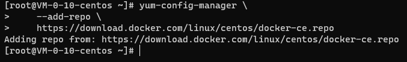
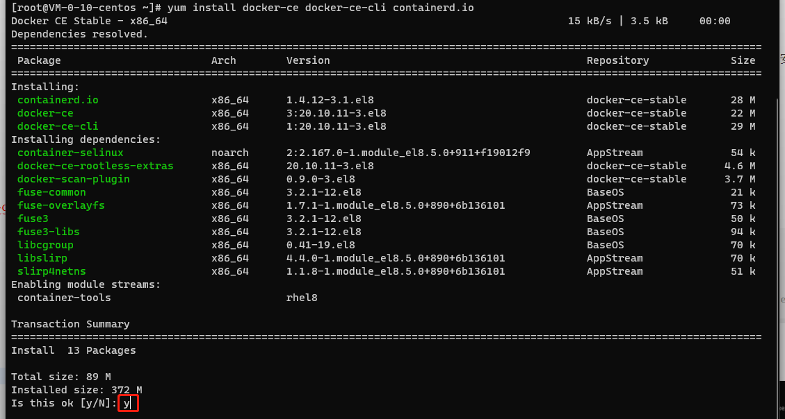
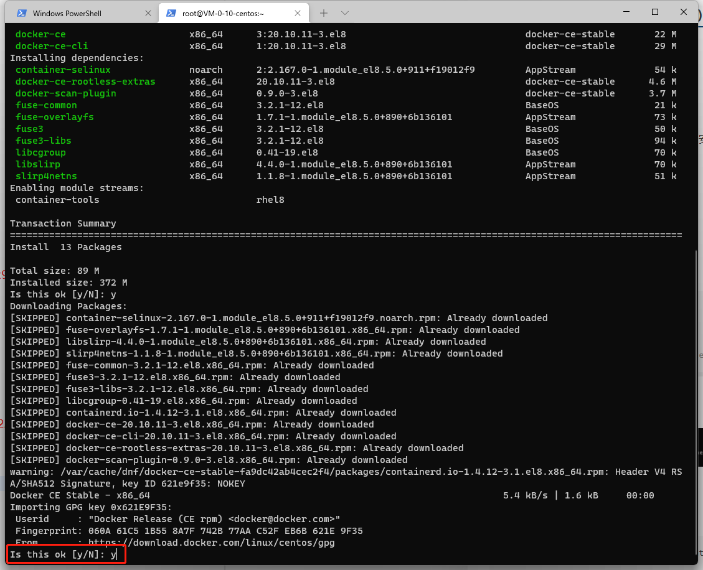
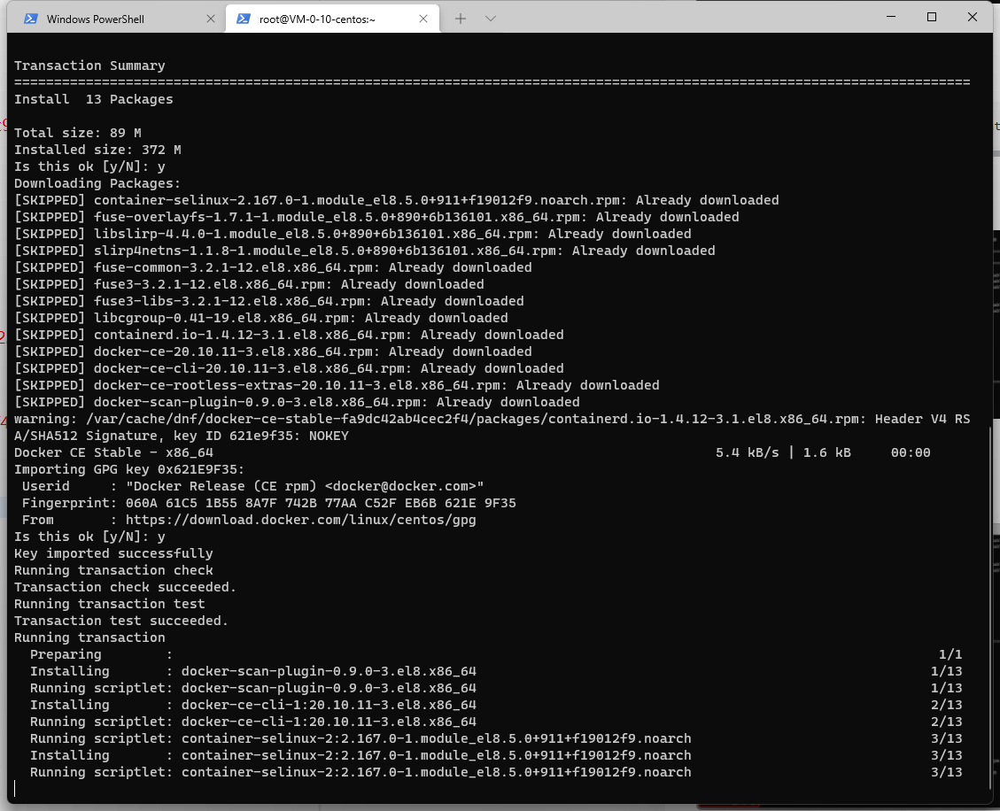
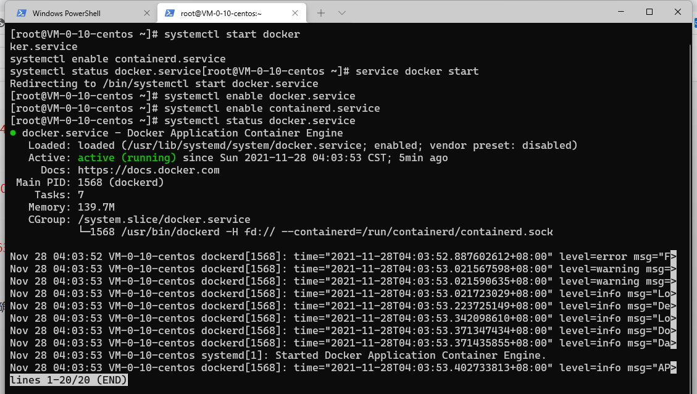
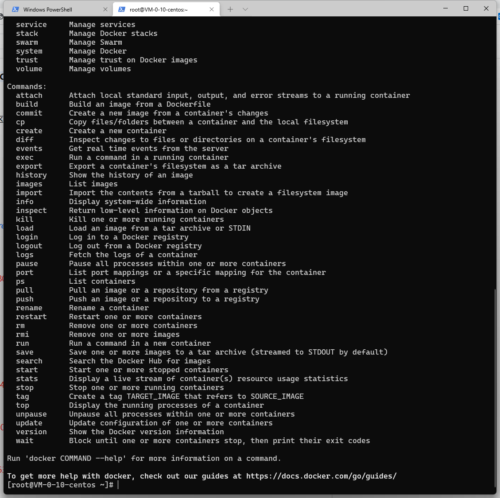
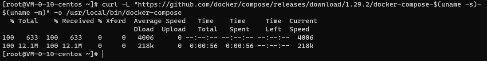
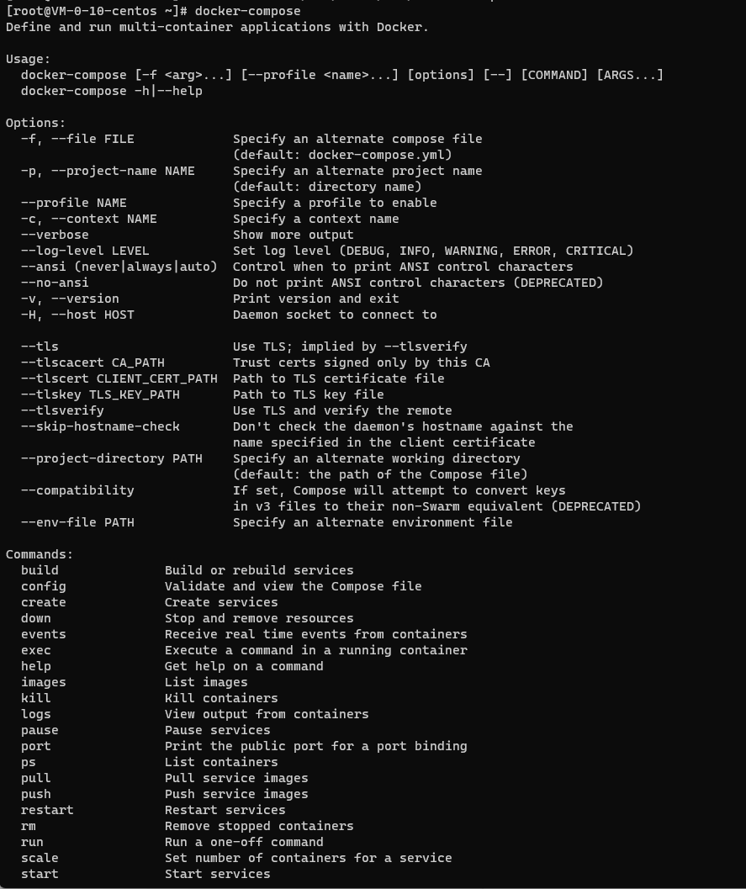

### 简介

分享自己这一套用于新 Linux 机器快速安装 Docker （CE 社区版本）的方法

### 安装 Docker

#### 安装 yum 依赖并添加 Docker repo

```bash
yum install -y yum-utils
yum-config-manager \
    --add-repo \
    https://download.docker.com/linux/centos/docker-ce.repo
```

会看到



添加repo成功

#### 通过 Yum 安装 Docker 程序

```bash
yum install docker-ce docker-ce-cli containerd.io
```

输入指令后需要输入 y 回车确认安装



安装Docker

注意一次安装需要两次确认



二次确认安装

安装过程



Docker安装过程

#### 启动 Docker 服务并设置为自动启动

确保安装完成后使用下方指令开启 Docker 的服务，这样可以确保 Docker 能够始终被正常开启

```bash
systemctl start docker
service docker start
systemctl enable docker.service
systemctl enable containerd.service
systemctl status docker.service
```



Docker服务状态

#### 验证

```bash
reboot
```

重启后查看 Docker 服务

```bash
docker
```

能看到帮助列表弹出代表安装成功



Docker Help

### 安装 Docker Compose（可选）

#### 下载 Docker Compose

我这里使用的是 1.29.2 版本的 Docker-Compose，这已经是 Docker Compose V1 的最后一个版本了

如需使用 v2 版本的 Docker Compose 可参考 [v2 版本的 Linux 官方教程](https://docs.docker.com/compose/cli-command/#install-on-linux)

```bash
curl -L "https://github.com/docker/compose/releases/download/1.29.2/docker-compose-$(uname -s)-$(uname -m)" -o /usr/local/bin/docker-compose
```



下载完毕

#### 给 Docker Compose 添加权限

```bash
sudo chmod +x /usr/local/bin/docker-compose
```

#### 检查安装

```bash
docker-compose
```

能看到帮助列表弹出代表安装成功



Docker Compose Help

#### 推荐阅读

- [敏捷项目管理之一页纸搞懂 Scrum 方法](https://mp.weixin.qq.com/s/68ZKXayNNzqdAIYpOfYSzg)
- [书籍分享《重新定义团队：谷歌如何工作》（第 5 章）](https://mp.weixin.qq.com/s/yvw7ZqkSef8sntiQXHvR0A)
- [解决宝塔的 Nginx 无法在服务器重启之后自动启用服务的问题](https://mp.weixin.qq.com/s/IL20KFrifVPQa_l3_FGv2A)
- [群辉 Synology NAS 实现 WOL(Wake On Lan)唤醒局域网内任意设备+siri 语音唤醒电脑](https://mp.weixin.qq.com/s/LbYA7X4w0vLo0Cz0Cdv9hg)
- [我是如何 43 天内拿下 PMP 证书的](https://mp.weixin.qq.com/s/O_RHEhW6A6arUSvBxshTvg)

\---

欢迎关注我的公众号“**凯文有事找你**”，原创**技术**、**生活**、**经验教训**文章第一时间推送。


