## 前言

通过带 `GUI` 的**第三方工具**对**数据库**进行**增删改查**想必大家已经用的**炉火纯青**了，但是仍然有**部分人**（比如我）在**创建完宝塔服务器后**不知道如何**通过第三方软件连接服务器的数据库。**

今天这篇文章主要**分享**一下**通过第三方数据库管理工具连接宝塔服务器**的方法。

发出这篇**文章**的**初衷**也是因为看到网上的**教程帖**大部分**内容都断断续续**的，尤其是**百度排名前几的搜索结果**更是让人看的**云里雾里**的。

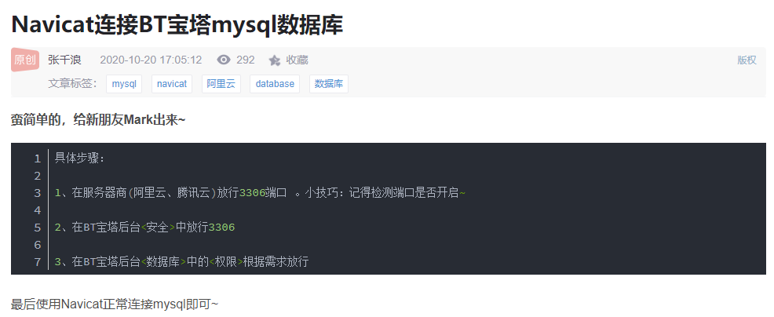

三言两语大部分人根本看不懂

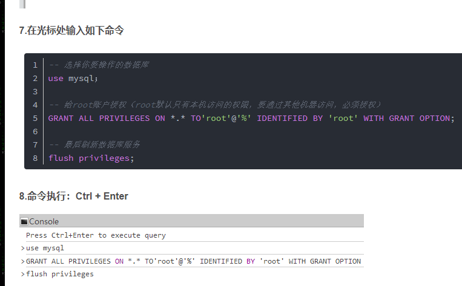

执行代码而非界面操作对小白不友好

想着说还是**自己发一篇写的详细一点的教程**，这样以后**自己回顾**或**分享给他人**也更清晰易懂一些。**（其实为了水一篇文章数量\~\~\~）**

## 正文

### 前置条件

**首先**我们要**确保服务器**以及**宝塔**的**安全设置**是**允许数据库端口**（默认`3306`）能够**通过外网访问**的。

#### 开放宝塔端口

在**宝塔后台控制面板**左侧列表找到`安全`板块

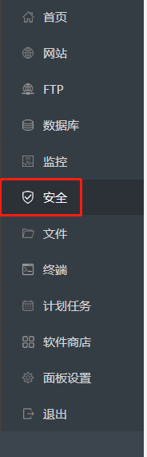

进入安全设置

可以看到我已经将`phpMyAdmin`以及`MySQL`数据库对应的**端口打开了**（**默认的端口**分别为`888`以及`3306`）。

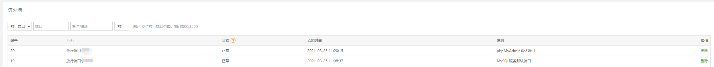

已经开放必备端口

如果此时你**没有在防火墙设置中找到对应的端口**，那么这里需要**手动将端口放行**，方法很简单。

在**如图所示**地方**添加端口号**以及**对应的备注**并**点击执行**即可**添加对应端口的放行规则**（`phpMyAdmin`是`888`，`MySQL`数据库默认是`3306`）

添加放行

此时如果能**像上面图片一样**看到**对应端口均为正常状态**，则代表**服务正常开启并已正确放行**。

#### 开放云服务器安全规则

**宝塔控制面板**的**端口放行**之后我们还需要**在云服务器后台设置端口安全规则**。

这里我用`阿里云`为例：

首先我们需要进入到阿里云 `ECS` 服务器的`实例控制台`找到`网络与安全`-`安全组`并点击**正在使用的安全组**。

这里我们**按照截图**方式**手动添加**`入方向`的`访问规则`即可（**除非**你设置了出方向规则，**不然出方向是默认端口全开的**）

**添加的时候**可以**通过英文逗号**隔开**同时授权多个不同的端口**，这里我就授权了`888`和`3306`

之后`授权对象`记得输入`0.0.0.0/0`（**允许所有 `IP` 访问**）。

同时建议**填写描述**方便后期查阅。

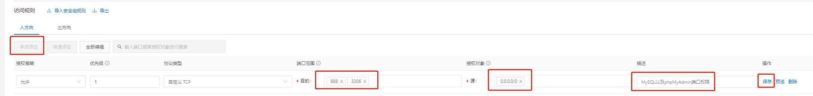

阿里云放行端口示意图

点击保存之后应该就会生成 `888` 以及 `3306` 的**端口放行规则**，至此**与端口有关的设置已经全部处理完毕。**

#### 宝塔必备应用

##### phpMyAdmin

要想**不通过命令行**设置**数据库用户权限**，那么宝塔是**必须要安装**`phpMyAdmin`（一款**非常好用**的图形化 `web` **数据库管理工具**）的。

我们打开宝塔的`软件商店`搜索`phpMyAdmin`，找到`phpMyAdmin`之后点击**右侧的安装**即可**快速安装**好`phpMyAdmin`。（我安装的是`phpMyAdmin - 5.0`，不同版本**没有明显区别**）

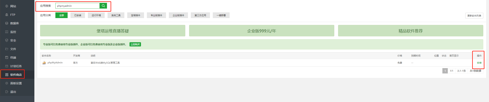

文章图片

### 通过 phpMyAdmin 新建数据库外部访问账号

在**完成以上准备步骤之后**我们来到**宝塔的数据库管理页面**，此时能看到我们**所有的数据库以及对应的账号。**

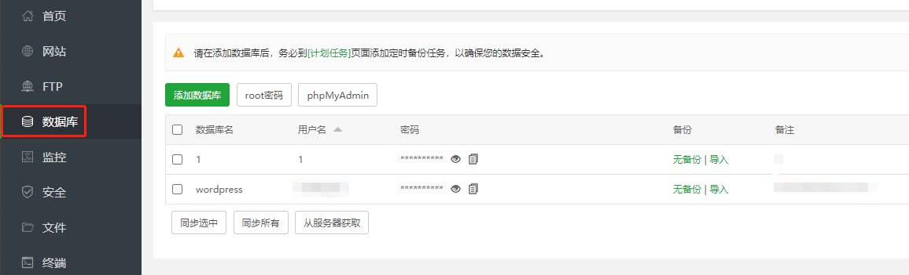

wordpress是我的博客所用的数据库

#### 登录 phpMyAdmin

我们点击`root密码`之后会出现一个**弹窗**，弹窗中会出现数据库`root`账号对应的**密码**，这个密码需要**复制下来**以便后续登录到`phpMyAdmin`。

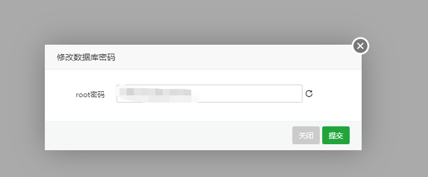

密码弹窗复制密码

复制之后我们`点击phpMyAdmin`

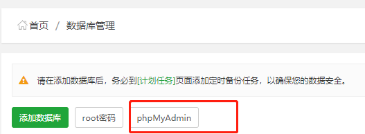

点击phpMyAdmin

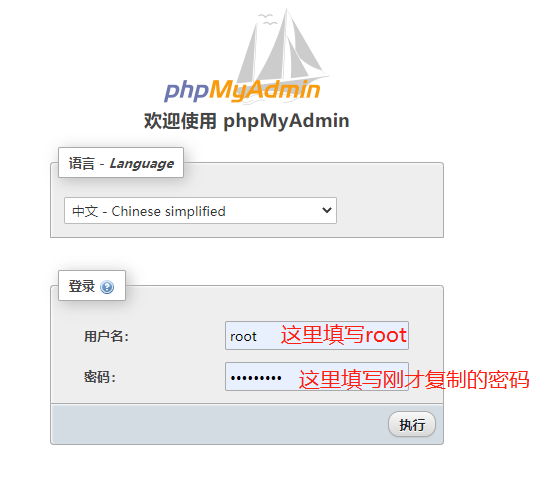

phoMyAdmin登录页面

将刚才的 `root` **账号**以及**密码**填写之后点击`执行`我们就能够登录到 `phpMyAdmin` 的`后台`了。

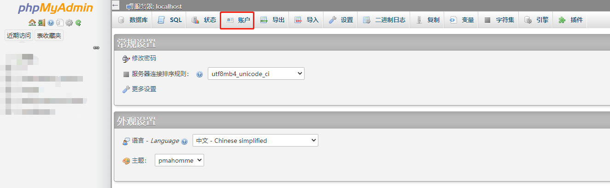

在后台点击账户

我们**点击顶部**的`账户`，可以在`账户管理页面`看到**所有数据库中存在的账户。**

`宝塔`默认的`root`用户应该只有`主机名`为`localhost`和`127.0.0.1`的`账号`。

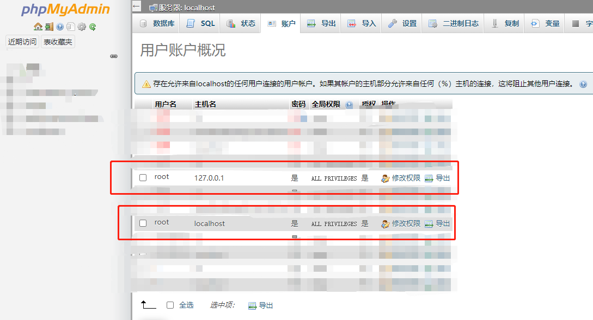

文章图片

这就是为什么我们**无法直接**通过`Navicat`**访问宝塔**服务器的**数据库**的**原因**。

因为数据库账号设置为`localhost`以及`127.0.0.1`意味着**我们只能通过服务器本地**访问（例如宝塔、例如 phpMyAdmin 应用），而我们需要做的就是将远程`IP`**访问的权限打开**即可！

为了确保用户可以**从外网访问数据库**，我们需要授权`root`用户一个`%`的主机名（允许用户从所有`IP`访问）。

这里我们点击下面图中的`新增用户账户`。

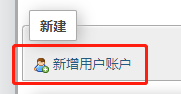

新增用户账户

之后我们**按照图中设置**。

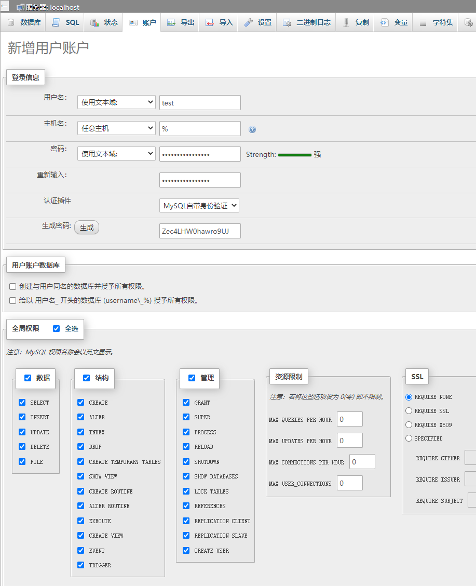

新增用户设置

这时我们**点击右下角执行即可生成账户。**

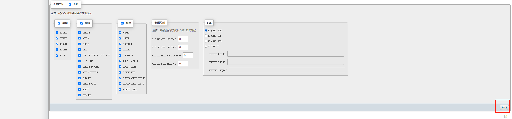

点击执行生成账户

**账户生成成功。**

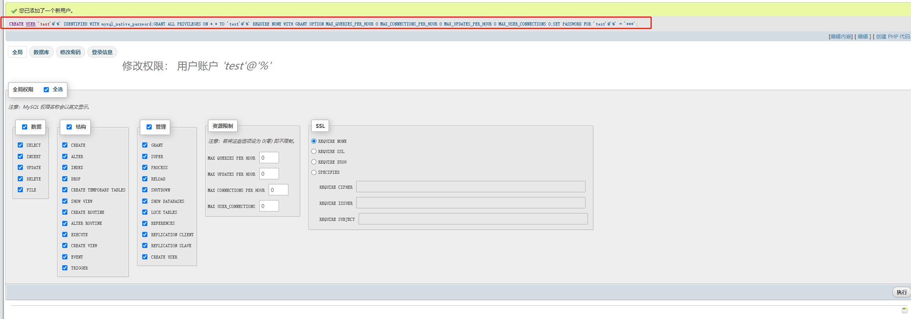

账户生成

我这样的**设置意思是**我**创建了**一名叫`test`的`用户`

`test用户`可以**从所有 IP 访问**服务器数据库。

`test用户`的**密码**是对应下面**自动生成的`Zec4LHW0hawro9UJ`**（**建议自动生成密码**，这样的密码**安全程度会高**一些！）。

我**授予了`test用户`全局权限**，意味着**拥有所有的数据库操作权限**（**这样是不安全的！请根据自己实际情况对权限进行不同程度而的授权！！**）

小感叹：`phpMyAdmin`真的是**数据库操作神器**，直接**通过界面点击**就能够用 `SQL` 语句**创建**了一个数据库的**账号**，**不要太爽！**

**这时候**我们就**可以用 test 用户**以及其**对应的账号密码**通过`Navicat`**连接服务器数据库**了。

### 连接成功

`Navicat`的**使用方法**我这里**不做深入解释**，我将**刚才生成**的`test`账号以及其**对应的**`Zec4LHW0hawro9UJ`密码输入之后**测试访问是连通的！**

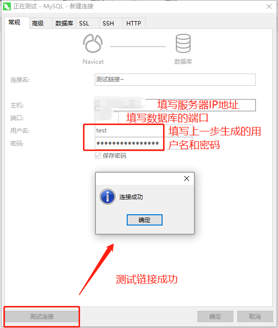

连接成功

## 总结

通过`Navicat`**连接宝塔数据库**的流程**真的很简单**，写这么多篇幅主要是**为了方便更多的刚接触宝塔以及数据库的用户**。

**数据库是服务器非常敏感的部件，千万要保证权限不要随意授权、密码不要随意泄露甚至数据库端口都不要轻易暴露出来！**

#### 推荐阅读

- [敏捷项目管理之一页纸搞懂 Scrum 方法](https://mp.weixin.qq.com/s/68ZKXayNNzqdAIYpOfYSzg)
- [书籍分享《重新定义团队：谷歌如何工作》（第 5 章）](https://mp.weixin.qq.com/s/yvw7ZqkSef8sntiQXHvR0A)
- [解决宝塔的 Nginx 无法在服务器重启之后自动启用服务的问题](https://mp.weixin.qq.com/s/IL20KFrifVPQa_l3_FGv2A)
- [群辉 Synology NAS 实现 WOL(Wake On Lan)唤醒局域网内任意设备+siri 语音唤醒电脑](https://mp.weixin.qq.com/s/LbYA7X4w0vLo0Cz0Cdv9hg)
- [我是如何 43 天内拿下 PMP 证书的](https://mp.weixin.qq.com/s/O_RHEhW6A6arUSvBxshTvg)

\---

欢迎关注我的公众号“**凯文有事找你**”，原创**技术**、**生活**、**经验教训**文章第一时间推送。

