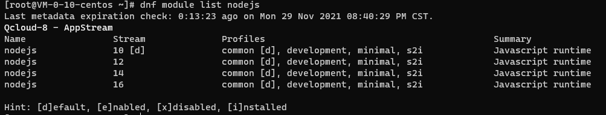
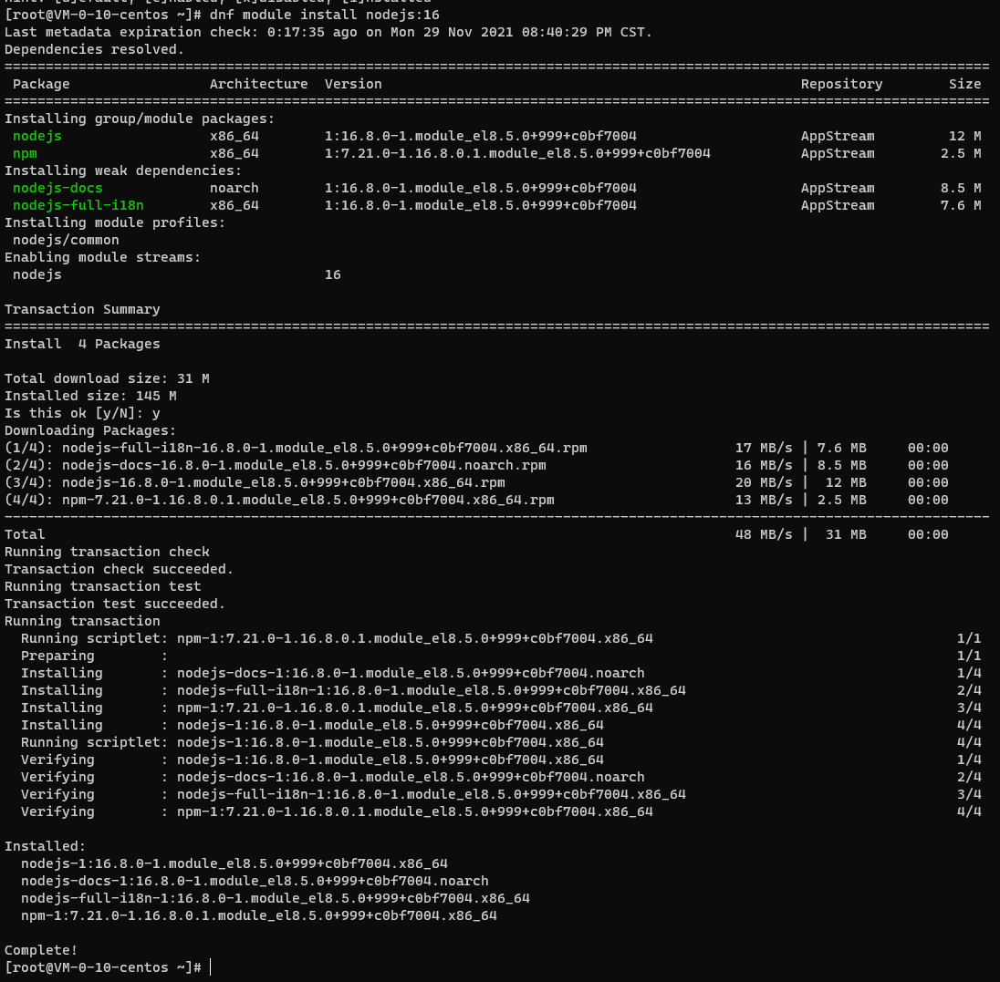
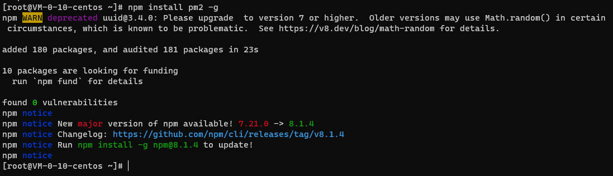
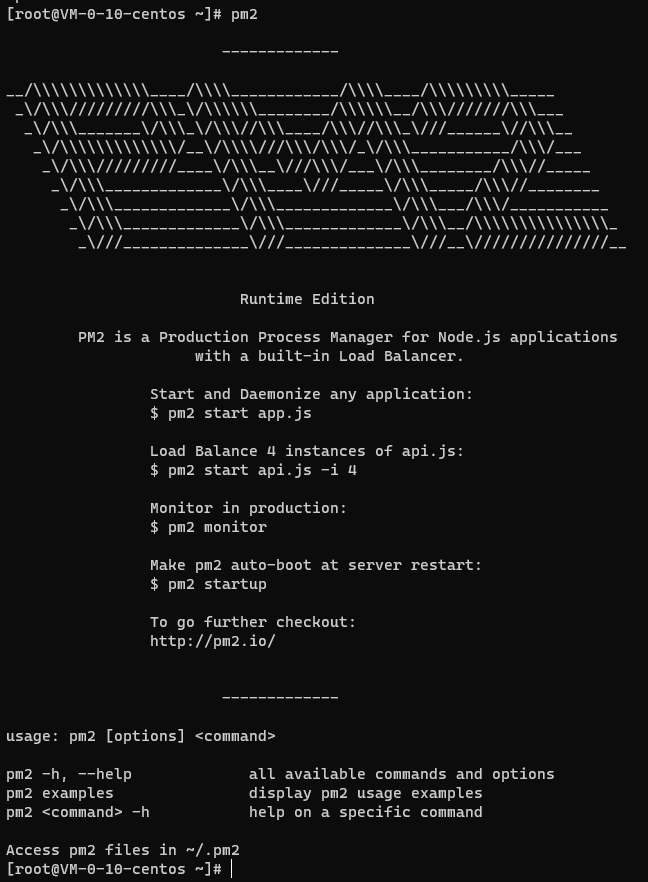
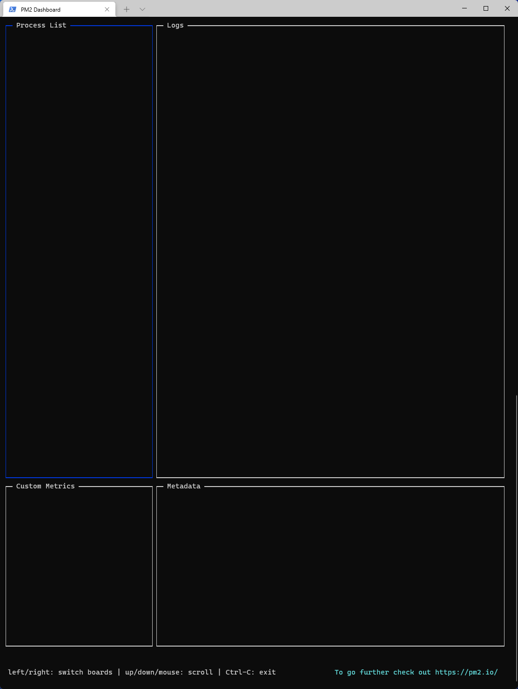

### 简介

[PM2 官网](https://pm2.keymetrics.io/)

[PM2Github 地址](https://github.com/Unitech/pm2)

[PM2 文档](https://pm2.keymetrics.io/docs/usage/quick-start/)

PM2 是一款基于 Node.js 的进程管理器，可以通过简单的方式去管理服务器的任务。

### 安装

#### 安装 Node.js（已安装可跳过）

##### 检查 Node.js 版本

```bash
dnf module list nodejs
```



Nodes.js版本

##### 安装对应版本

```bash
dnf module install nodejs:16
```



安装Node.js

#### 通过 NPM 安装 PM2

```bash
npm install pm2@latest -g
```



PM2安装

#### 运行测试

```bash
pm2
```



PM2运行界面

### 使用

#### 通过 PM2 启动进程（并置于后台）

```bash
pm2 start app.js --watch
```

#### PM2 监控进程

通过以下指令我们可以进入 PM2 自带的超酷炫控制台来监控 Node 项目的使用情况

```bash
pm2 monit
```



PM2监控

### 结论

PM2 可以极大简化 Node 项目的部署以及维护，更多更深入的例如负载均衡等方法请参考[官方文档！](https://pm2.keymetrics.io/docs/usage/quick-start/)

### 推荐阅读

- [敏捷项目管理之一页纸搞懂 Scrum 方法](https://mp.weixin.qq.com/s/68ZKXayNNzqdAIYpOfYSzg)
- [书籍分享《重新定义团队：谷歌如何工作》（第 5 章）](https://mp.weixin.qq.com/s/yvw7ZqkSef8sntiQXHvR0A)
- [解决宝塔的 Nginx 无法在服务器重启之后自动启用服务的问题](https://mp.weixin.qq.com/s/IL20KFrifVPQa_l3_FGv2A)
- [群辉 Synology NAS 实现 WOL(Wake On Lan)唤醒局域网内任意设备+siri 语音唤醒电脑](https://mp.weixin.qq.com/s/LbYA7X4w0vLo0Cz0Cdv9hg)
- [我是如何 43 天内拿下 PMP 证书的](https://mp.weixin.qq.com/s/O_RHEhW6A6arUSvBxshTvg)

\---

欢迎关注我的公众号“**凯文有事找你**”，原创**技术**、**生活**、**经验教训**文章第一时间推送。


