### 简介

Portainer 是一款非常知名的 Docker 容器管理软件，可以允许用户通过 Web 可视化的方式去管理主机的容器（不仅仅是 Docker，Portainer 同时还支持 Kubernetes 和 Docker Swarm）。

#### 官网地址

[Portainer 官网链接](https://www.portainer.io/)

### 安装

Portainer 支持众多平台，这里仅用 Linux (Centos 8.2) 做示例。

[Linux 用 Portainer 管理 Docker 官方安装教程地址](https://docs.portainer.io/v/ce-2.9/start/install/server/docker/linux)

#### 创建 Volume

首先创建用于存储 Portainer 数据的 Volume

```bash
docker volume create portainer_data
```

Volume 创建成功

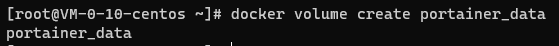

Volume创建成功

（如报错` docker: command not found` 请检查 Docker 是否安装正确。可[参考这篇文章](../2021-install-docker-and-compose-on-linux/)或通过如下指令快速安装 Docker）

##### 安装 Docker（可选）

```bash
yum install -y yum-utils
yum-config-manager \
    --add-repo \
    https://download.docker.com/linux/centos/docker-ce.repo
yum install docker-ce docker-ce-cli containerd.io
systemctl start docker
service docker start
systemctl enable docker.service
systemctl enable containerd.service
systemctl status docker.service
```

#### 下载并运行 Portainer

注：如需将 Portainer 改为其他端口（HTTPS 默认 9443）则记得将`9443:9443`改为`你想要的端口号:9443`

```bash
docker run -d -p 8000:8000 -p 9443:9443 --name portainer \
    --restart=always \
    -v /var/run/docker.sock:/var/run/docker.sock \
    -v portainer_data:/data \
    cr.portainer.io/portainer/portainer-ce:2.9.3
```

（注：Portainer 安装的 HTTPS 端口指向为 9443 而 HTTP 端口指向的是 9000。如由于特殊原因需要启用 HTTP 访问，请额外添加`-p 9000:9000` 到上方安装命令以开启 HTTP 访问）

安装成功界面

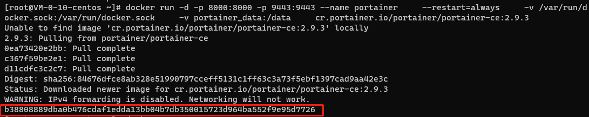

安装成功会显示一串数字

#### 初始化设置

##### 创建管理员账户

安装成功后通过 `https://服务器ip:9443` 即可访问你的 Portainer 管理后台

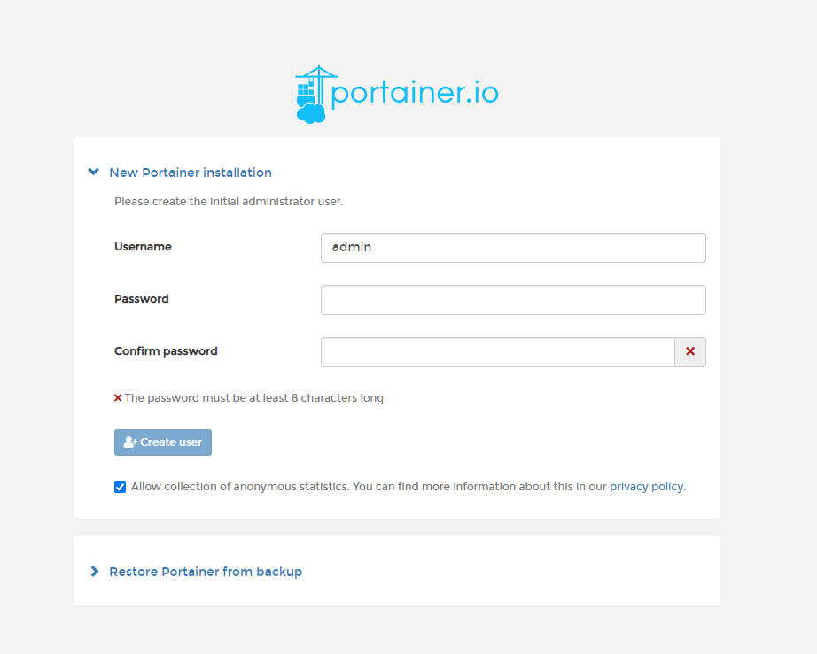

Portainer后台

##### 进入 Portainer

进入后选择左侧`Get Started`

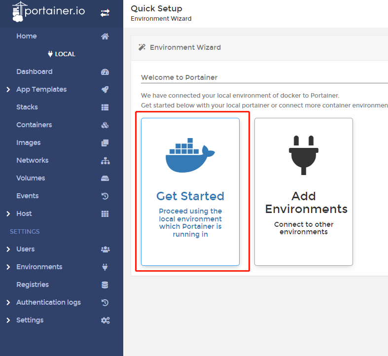

进入 Portainer

可以在 Home 看到你本地的 Docker 服务有 1 个 Container 正在运行（Portainer 本身也是一个 Docker 容器）

##### 查看 Cointainer

左侧菜单选择 Container 即可看到当前机器正在运行的 Docker 容器了！

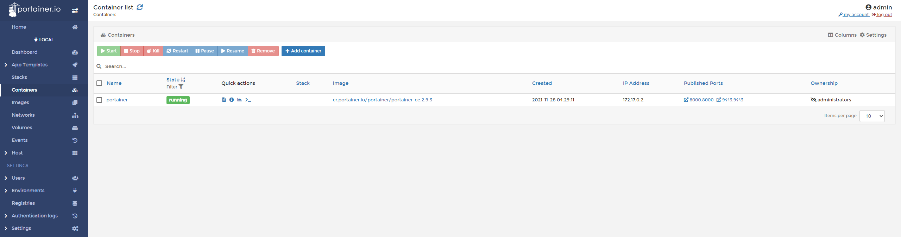

查看 Cointainer

`Portainer 安装教程到此结束`，其他 Portainer 功能我后续大概率不会再更新了，请移步 Portainer 官方文档！

\---

### 通过 Portainer Edge Agent 以实现跨主机的 Docker 容器管理（可选）

Portainer 支持从一处访问不同主机的 Docker 服务

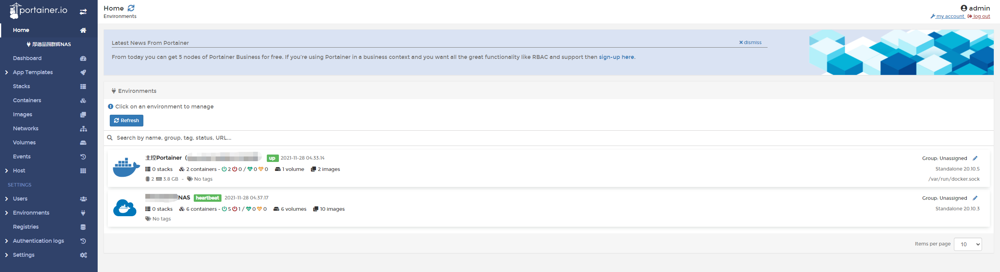

不同的Docker

#### 在主控机的 Portainer 创建 Environments

添加一个环境

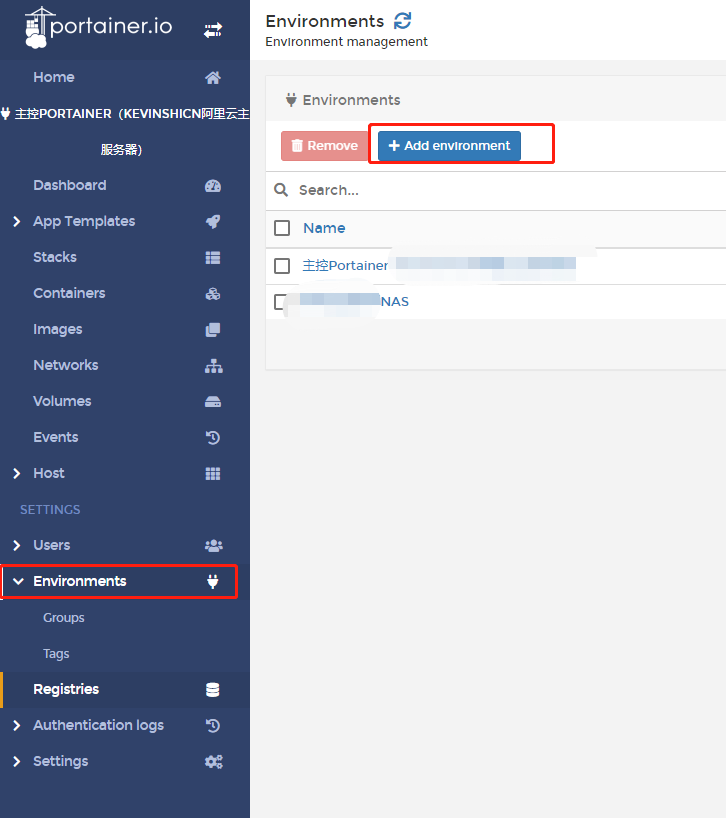

添加一个环境

具体设置参考图片

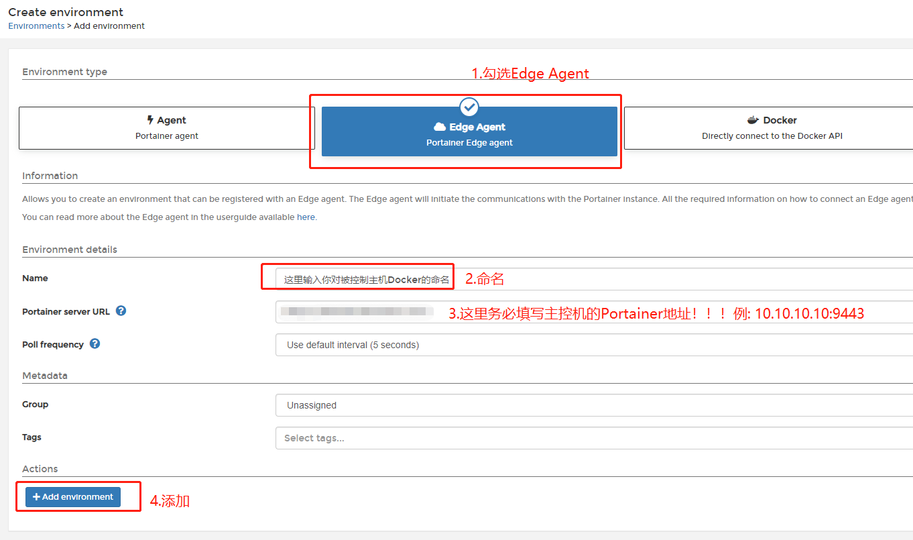

具体设置参考图片

#### 在被控机部署 Agent

##### 复制部署指令

在上一步添加完环境之后，我们会看到如下界面（请注意选择 Docker Standalone）

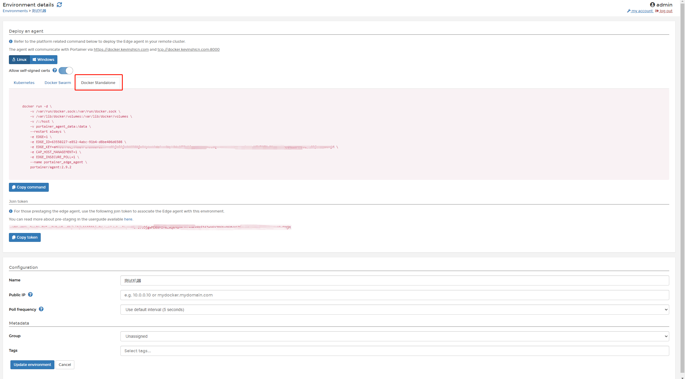

Agent部署界面

点击 Copy Command 复制 Agent 部署指令（这里会涉及到版本与 KEY 的差异，因此请自行从自己的主控 Portainer 复制部署代码）

##### 部署

在需要被控制的服务器输入上面复制的部署指令后 Agent 将会自动安装

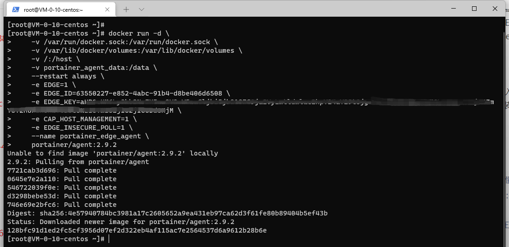

文章图片

##### 查看

安装成功后返回主控机的 Portainer 界面点击 Update Environment

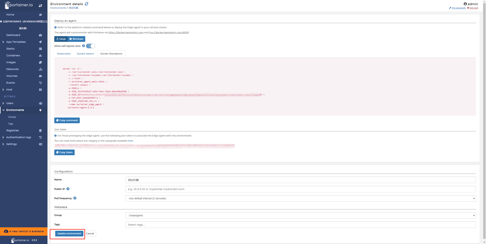

文章图片

可以看到这里多出来了一个之前没有的环境

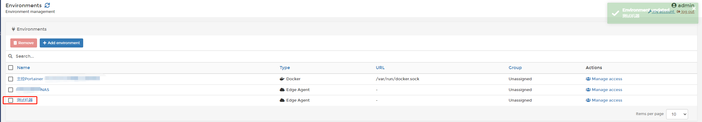

文章图片

返回首页后可进入被控机器的 Docker 管理界面

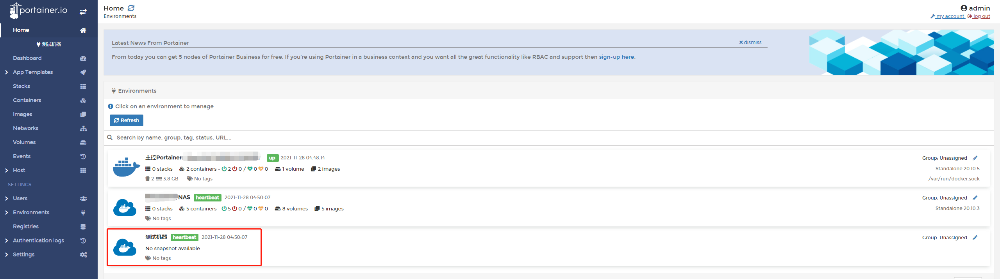

文章图片

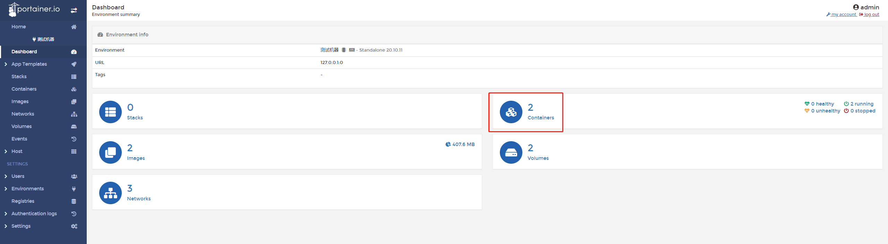

文章图片

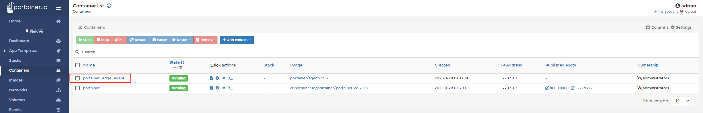

文章图片

图中的 `portainer_edge_agent` 容器就是我们安装用来被控的程序，另一个 Portainer 是我们早些安装在这台机器的 Portainer，如不需要可删除此 Portainer 容器

### 更新 Portainer

在确保下方端口正确的情况下，可以直接复制下方指令运行，将 Portainer 更新至最新版本

```bash
docker pull portainer/portainer-ce
docker stop portainer
docker rm portainer
docker run -d -p 8000:8000 -p 9443:9443 --name=portainer --restart=always -v /var/run/docker.sock:/var/run/docker.sock -v portainer_data:/data portainer/portainer-ce
```

#### 推荐阅读

- [敏捷项目管理之一页纸搞懂 Scrum 方法](https://mp.weixin.qq.com/s/68ZKXayNNzqdAIYpOfYSzg)
- [书籍分享《重新定义团队：谷歌如何工作》（第 5 章）](https://mp.weixin.qq.com/s/yvw7ZqkSef8sntiQXHvR0A)
- [解决宝塔的 Nginx 无法在服务器重启之后自动启用服务的问题](https://mp.weixin.qq.com/s/IL20KFrifVPQa_l3_FGv2A)
- [群辉 Synology NAS 实现 WOL(Wake On Lan)唤醒局域网内任意设备+siri 语音唤醒电脑](https://mp.weixin.qq.com/s/LbYA7X4w0vLo0Cz0Cdv9hg)
- [我是如何 43 天内拿下 PMP 证书的](https://mp.weixin.qq.com/s/O_RHEhW6A6arUSvBxshTvg)

\---

欢迎关注我的公众号“**凯文有事找你**”，原创**技术**、**生活**、**经验教训**文章第一时间推送。


