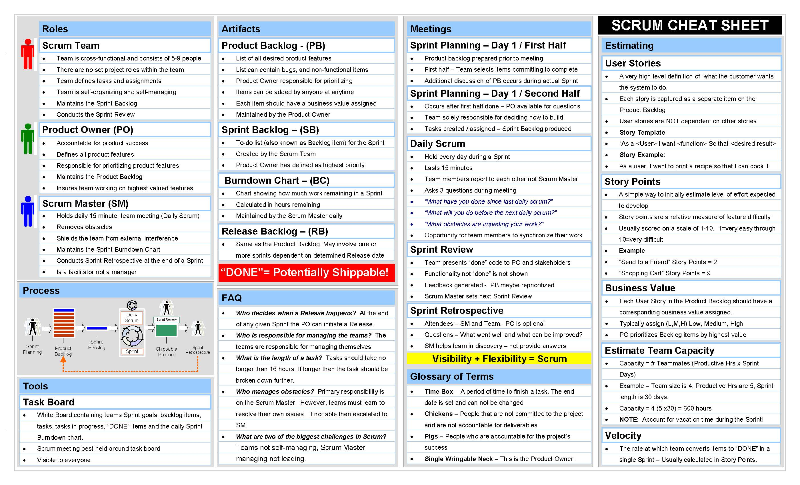
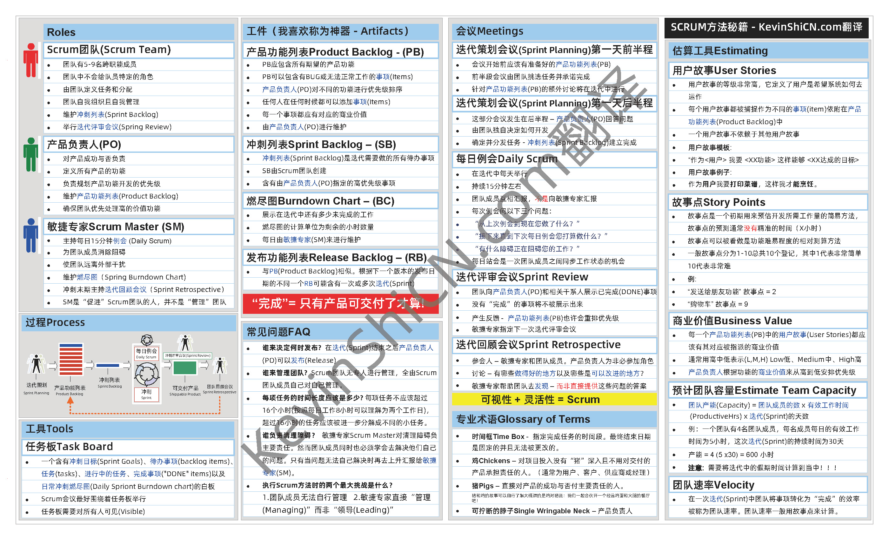

### 前言

#### 我的博客

由于微信公众号的限制，用户**无法**从`百度`等`搜索引擎`搜索到公众号文章。

因此我的**所有文章**将会在**除微信公众号**外**实时同步**至**本人个人博客**中进行更新。

个人博客地址: KevinShiCN.com (实际域名不区分大小写)

记忆方法：`Kevin`(我的英文名) + `Shi`(我的中文姓) + `CN`(中国！)

#### 周记规则改动

关于`周记`这两个字，我认为一般还是**更贴近个人生活**，而非`工作`和`学习`。**尽管工作和学习是我全部的生活**，但经过思考后我认为我**目前发文章**的形式不应该被称作`周记`。

`周记`项目一开始我也只是**将其作为**我每周**更新一次文章**的这个动作（**虽然现在没做到每周一次的频率，但今年数量肯定不会缺！**）

因此从本篇文章开始我将**从标题中移除**`周记`二字，随后的文章暂定仅包含“`年份`-`第几篇文章`”作为文章标题开头格式。

#### 关于本周

本篇文章主要是将**自己翻译**的一个很好用的**Scrum Cheat Sheet**分享出来，通过这一篇文章可以让您对**敏捷项目管理**中的`Scrum`方法有一个大概的认知，更深度的`Scrum`方法我后续如果有机会的话也会分享出来。

`Scrum` 的要素不多，如何执行好 Scrum **难点在于**如何根据`团队`以及`项目情况`进行**合理的调整**以**适应公司的目标**。

`单一的`、`无脑的`执行**Scrum**方法并不一定会给**您团队带来最好的效果**！！

### 正文

#### Scrum 秘籍

本 Scrum 秘籍由`KevinShiCN.com`负责翻译，以下是英文原版。

英文原版Scrum Cheat Sheet

[Scrum Cheat Sheet 英文原版下载](https://www.protechtraining.com/pdf/ScrumCheatSheet.pdf)

由于**微信压缩图片**，因此**请公众号读者**前往**文章底部引用链接**下载`PDF`版本（公众号回复`Scrum`直接获得图片）

Scrum秘籍中文KevinShiCN.com翻译版本

[Scrum 秘籍中文翻译 PDF 版本下载](https://oss.kevinshicn.com/zhouji/08/Scrum%E7%A7%98%E7%B1%8D%E7%94%B1kevinshicn.com%E7%BF%BB%E8%AF%91.pdf)

#### 关于翻译

由于 Scrum 是国外发明的方法，因此所有的 Scrum 名词对应中文都没有公认的最准确的翻译。

就好比`Sprint`有些人称之为`冲刺`也有些人称之为`迭代`，**这实际上都是可以的**。

最好的方法是**团队所有成员**都将 Scrum 中的`专有名词的英文`及其`用法`**记忆下来**。

#### 重要参考资料

[腾讯 TAPD 客户使用案例](https://www.tapd.cn/official/show_cases/)

[首度揭秘：腾讯敏捷研发和极速交付破局之道](https://tech.qq.com/a/20181120/012776.htm)

[阿里云敏捷项目管理学习资料](https://help.aliyun.com/document_detail/153476.html?spm=a2c4g.11186623.3.4.361e3ecbBgkAsS)

#### 产品功能列表(PB) 和 冲刺列表(SB) 对比

| 维度 | 产品功能列表(Product Backlog) | 冲刺列表(Sprint Backlog) |
| :------: | :---------------------------: | :------------------------: |
| 详细程度 | 比较详细 | 非常详细 |
| 估算单位 | 用户故事点(Story Points) | 小时 |
| 文档归属 | 产品负责人(Product Owner) | 开发团队(Scrum Team) |
| 更新频率 | 一次每周 | 每工作日一次 |
| 持续长度 | 整个项目周期 | 每次冲刺(Sprint) |
| 文档名 | Product Planning Workbook | Iteration Backlog Workbook |

#### 鸡和猪的故事

> 一只鸡和一头猪走在路上，
>
> 鸡对猪说：“你想不想和我一起开家餐馆？”
>
> 猪想了想答到：“我很乐意。那餐馆准备卖什么呢？”
>
> 鸡回答道：“`火腿`和`鸡蛋`！”
>
> 猪停住脚步，犹豫了一下，说：“我决定不和你开这家餐馆了。因为我得全身心付出，而你只是简单参与而已。”

我们从这个故事中了解到`猪`和`鸡`最直接的**区别**就是猪和鸡对这个**项目（餐厅）付出的程度**是不一样的。

**猪为项目付出了全部**（猪身上的肉）而**鸡**所付出的**仅仅是每天下的鸡蛋**。

在项目中，`鸡`通常代表的群体为`用户`、`客户`、`供应商`或`经理`。

猪通常代表的是 Scrum 团队中的`产品负责人(PO)`、`敏捷专家(Scrum Master)`以及`Scrum团队成员`。

#### 关于带领团队

Scrum 方法多次强调团队不是“管理”出来的，而是需要各位互相鼓励通过 Scrum 专家带领大家走向成功的。

### 总结

本篇文章**主要用途**为**分享翻译后**的`Scrum一页纸秘籍`，这个一页纸的 Scrum 秘籍可以**帮助大部分初学者**对**Scrum 有个大体框架的认知**。

具体的`Scrum方法`以及`注意事项`需要大家**自行深入学习**。

后续如果有机会我将分享一些**敏捷项目管理的实践**以及**个人经验**。
