## 关于本周

### 插播一篇技术周记

连续更新了两篇读书笔记加起来有一万两千字，本想**轻量化完成周记任务**的我整个人都不好了。于是决定这一篇周记改为**技术周记**，主要讲述我是如何**不花一分钱**解决**在外唤醒家中休眠电脑**问题的！！（令我**没想到的是**这篇周记**写完之后也达到了 4600 字！**）

### 研究远程唤醒的起因

我前段时间重装了一遍电脑系统，之后有一天在公司想远程家里电脑的时候发现**由于忘记设置电源管理配置导致电脑进入休眠了**，于是当时就想如何**把这个问题优化一下。**

**向日葵**是一个很好用的远程软件，可是他们的 **WOL 棒子卖的太黑了**（`168` \~ `198`元），我肯定是**不会花这么多钱**买一个**专门用来开机的硬件的**，对于我来说买这个**都不如买树莓派。**（当然，对于**没有技术基础的用户**来说，买一个**向日葵的开机棒确实是满足远程唤醒唯一的选项**）。

因为我的 `NAS` 是**全年通电的**，因此通过 `WOL` 的方法可以在能耗和使用体验上面进行比较好的平衡，我最终决定将**通过** `NAS` 作为桥梁来实现这个需求。

### 名词解释

这里我对一些英文缩写进行解释，至于后续文章中出现的 `pip` 、`Python` 以及 `SSH` 等词将不会做特殊解释，各位可以自行去我们的好伙伴[百度](https://www.baidu.com/) 进行查询。

> WOL - Wake On Lan 顾名思义，**通过局域网唤醒**

> NAS - Network Attached Storage 学名叫做“网络附属存储”，我的理解<strong>就是一个硬盘巨大的电脑（我的 NAS 有 4 张 8T 的硬盘）。</strong>这款群辉的 `NAS` 我用了有 3 年了，质量一直很坚挺，所用到的功能越来越多（`Aria2`、`Aliddns 自动解析`、`WOL` 以及 `Homebridge 智能家居`等等）

## NAS 配置

### 型号：DS918+（现 DS920）<br>内存： 4G<br>DSM 版本： DSM 6.2.3-25426 Update 3

## 通过 WOL 唤醒局域网设备的核心思路

**第一步** - 通过群辉的**任务计划**发送**指令**

**第二步** - **指令**通过 `root` 权限执行`wakeonlan`程序

**第三步** - `wakeonlan` **指令**通过群辉 `NAS` 发送至内网特定 `MAC` 地址设备

**最终** - **设备唤醒成功**

## 准备工作

### 被唤醒的设备开启 WOL 支持

开启 windows10 电脑的 WOL 功能**可以参考这篇文章**[Win10 系统打开 WOL 远程网络唤醒功能的方法](https://www.386w.com/jiaocheng/win10_article_41517.html)，本文将<strong>不做详细开启 WOL 功能的教程，</strong>遇到问题或需要帮助可**于公众号或文章底部留言。**

### 外网 IP

由于我在使用**远程唤醒**大部分时间<strong>是需要外网执行的，</strong>那么这里就需要我们**能够从外网**顺利的<strong>访问我们内网的设备。</strong>因为运营商的 `ipv4` 地址数量有限，因此对于家庭网络我们一般**需要向电信申请**外网的 `ipv4`，这样<strong>才能够从外网访问我们家里的设备。</strong>请看到这里的朋友首先**确保自己是外网** `IP`，我之前有一次由于忽略了外网 `IP` 这个事情导致我在另一个项目上面**浪费了**超过 `4` 个小时的时间！！！

#### 如何确认自己是否为公网 IP

确认自己是否为公网 `IP` 需要<strong>进入到路由器后台，</strong>进入路由器后台的方法不做阐述。

**进入到路由器之后找到**`WAN IP`

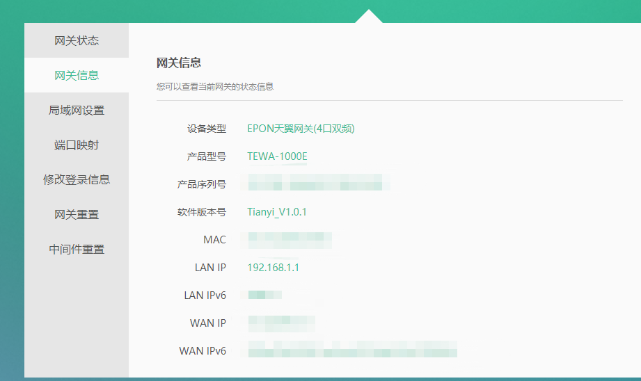

这里是路由器显示的WAN IP

这个是你目前网络分配的 `IP` 地址，那么此时需要你前往[iP 地址归属地查询](https://ip138.com/)来查看自己的**外网 `IP` 地址**


这里是你的IP地址

当你的`WAN IP`和`IP138`显示的**IP 地址相同**时，那么恭喜你，你的 IP 已经是**外网可访问状态了。**

如果`WAN IP`显示与 `IP138` 查询**结果不符**，那么**您现在还是电信的内网 IP。**

#### 申请公网 IP

<strong>申请公网 `IP` 非常简单，</strong>只需要**联系电信客服**（我是直接联系的附近电信师傅）提供**身份证、姓名以及电话号码**即可**很快获取到公网 IP（我申请过两次，分别为一天和七天申请下来）。**

### 自动解析域名至外网 IP（可选）

**即使**我们现在获取到了一个**公网** `IP`，但家用的 `IP` 地址**是非固定的**，其一般会在 `24-48` 小时内**被重新分配至一个不同的 IP 地址。**

因此这里建议通过 `NAS` 进行<strong>自动域名解析，</strong>即在 `IP` **重新分配之后**通过 `阿里云` 的 `API` 自动<strong>重新解析域名至本地公网 `IP`。</strong>这样可以保证仅需**配置一次域名地址即可随意访问家里网络。**

域名自动解析的方法我后续可能会更新作为一篇周记，但<strong>这是非常简单的一个流程。</strong>我是**通过 Docer 安装**`chenhw2`的`aliyun-ddns-cli`包直接启用的域名自动解析，可以通过`Dcoker`项目[chenhw2/aliyun-ddns-cli](https://registry.hub.docker.com/r/chenhw2/aliyun-ddns-cli/)进行配置。

**具体教程**可以参考[通过群辉 docker+阿里云简单实现 DDNS](https://www.woodmanzhang.com/%e9%80%9a%e8%bf%87%e7%be%a4%e8%be%89docker%e9%98%bf%e9%87%8c%e4%ba%91%e7%ae%80%e5%8d%95%e5%ae%9e%e7%8e%b0ddns/)

### 设置端口映射

由于我们的`NAS`并**没有直接暴露**在公网`IP`，实际上这是<strong>需要通过路由器进行端口映射的。</strong>这里端口映射的方法我不做详细描述，各位请自行百度。

我们需要的内部端口分别为

##### 22 - SSH 端口

##### 5000 - 群辉 NAS 默认 HTTP 访问端口

##### 5001 - 群辉 NAS 默认 HTTPS 访问端口

同时需要**将局域网`IP`设置为`NAS`对应的`IP`**

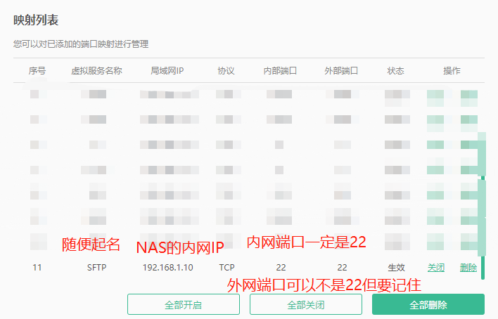

端口转发配置参考

注意，这里在端口转发的时候如果已经设置内网端口为`22`了，那么后面在设置`NAS`的`SSH`端口时也务必设置为`22`！！

## 正式开始请再次确认确认

**已获取公网 IP**

**已将公网 IP 自动解析至自己的域名（可选）**

**被唤醒的设备已开启 WOL 支持**

## 开始设置 WOL

### 安装 Python3

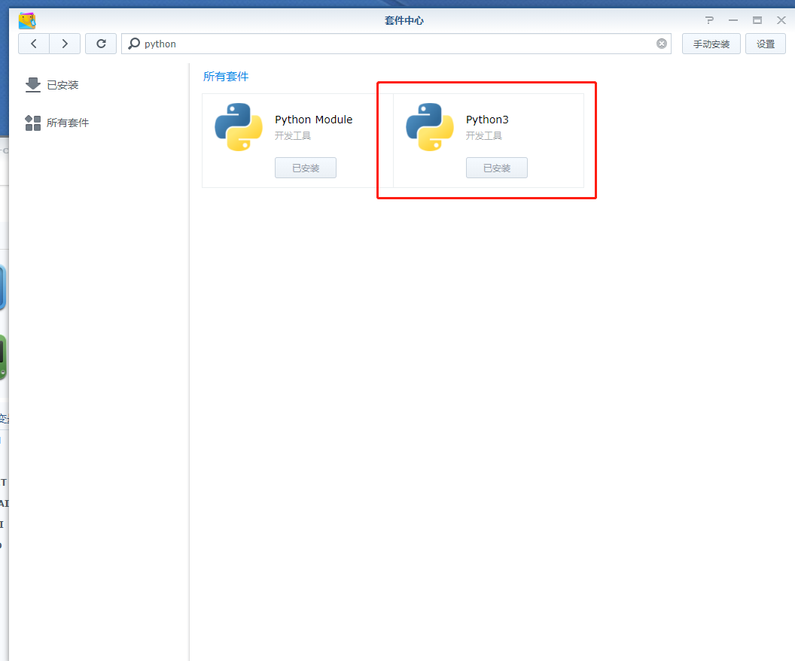

群辉套件中心的Python3截图

我们首先需要在群辉的`套件中心`安装 `Python3`

### 允许使用 root 账号登录

接下来我们需要开启 `root` 账号权限，这里我参考了这篇文章。[群晖 DSM 开启 ROOT 权限及 WinSCP 使用 ROOT 登录](https://www.myxzy.com/post-81.html)

#### DSM 开启 SSH

随后我们需要**进入群辉的控制面板**找到`终端机和SNMP`选项勾选`启动Telnet功能`以及`启动SSH功能`后**应用**

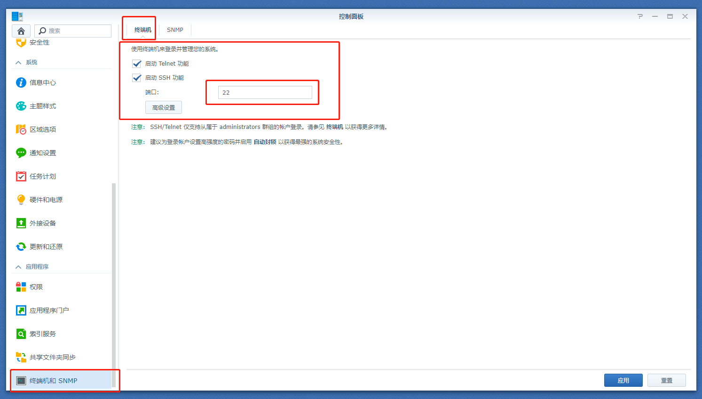

开启SSH示意图

### 获取 root 权限

#### 开启 ROOT 账号和修改密码

开启群辉的 `SSH` 功能**之后**我们需要一个 `SSH` 工具，这里我用的是[PUTTY](https://www.chiark.greenend.org.uk/~sgtatham/putty/latest.html)这里可以**自行百度或谷歌进行下载。**

下载完 `Putty` 之后我们打开 `Putty` 进行**链接**

按顺序输入

1.`NAS` 的内网 `IP`（我的是 `192.168.1.10`，**请务必替换为自己的 NAS 内网 IP**）

2.在 `NAS` 控制面板开启 `SSH` 时候显示的端口（默认都是 `22`）

3.确保连接模式调整为`SSH`

4.链接！

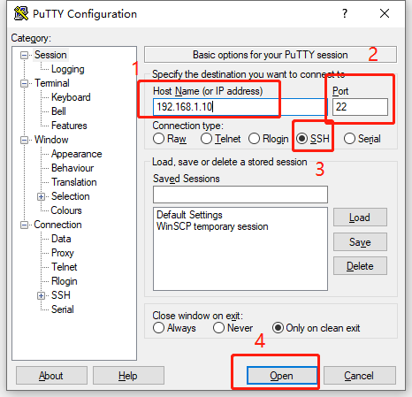

PUTTY链接设置示意图

*（原图已失效）这里可能会有安全警告，点是即可*

这里可能会有安全警告，点是即可

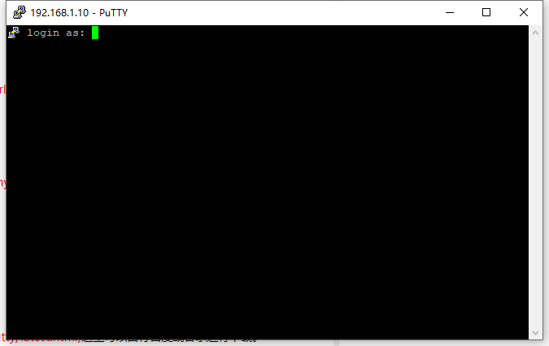

PUTTY成功链接服务器示意图

控制台显示

```text
login as:
```

这时需要输入你群辉 `admin` 账号的名称（一般应该是 `admin`）

```text
login as:admin
```

回车之后出现

```text
admin@192.168.1.10's password:
```

这时请输入 `admin` 账号的密码，注意这里**密码是不会显示的，因此请小心输入**

当提示

```text
admin@你的NAS主机名称:~$
```

即代表已成功登录 `admin` 账号

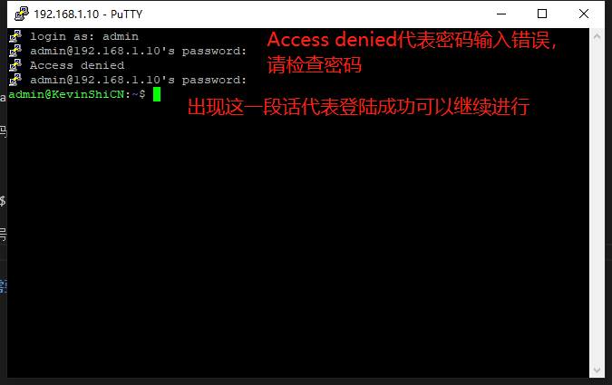

登陆成功截图

登录成功之后输入

```bash
sudo -i
```

这里会再次提示输入密码，这里继续使用刚才的 `admin` 密码即可。 密码正确之后显示如下

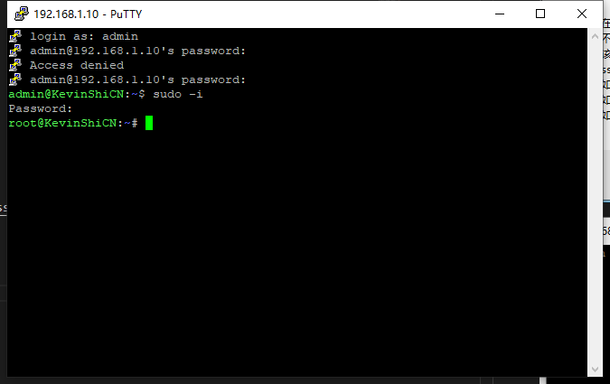

密码正确，已进入root账号权限

此时接着输入

```bash
synouser --setpw root 密码
```

这里的密码**建议**与之前的 `admin` **密码相同即可，避免后续搞混。**（**记得回车执行命令，确保命令正确执行！**）

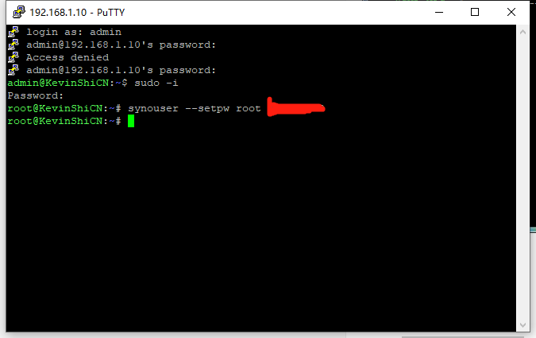

退出前界面应该长这样

#### DSM 版本 6.2 以上需要的额外操作

这里<strong>我们不用教程贴作者的做法，</strong>因为**直接通过命令行界面去编辑文件**对于不熟悉 `Linux` 的朋友**可能会造成误操作。**（比如说我当时就因为误操作导致差点无法恢复 SSH 服务！）

我们需要**回到群辉** `NAS` 的`套件中心`找到`Perl插件`并安装

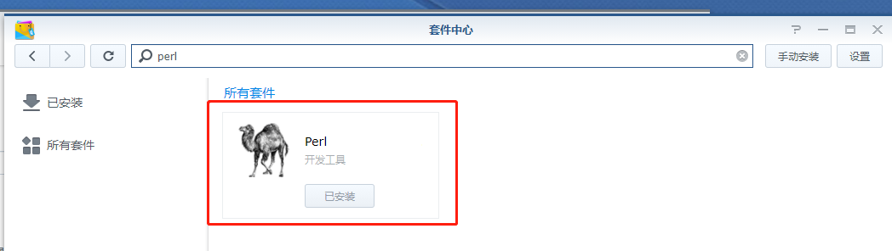

Perl插件

安装 `Perl` 之后我们还需要安装 `ConfigFileEditor-noarch-16.spk`

`ConfigFileEditor-noarch-16.spk` 的下载链接**可以在前面的教程文章底部找到。**

由于<strong>微信公众号无法直接上传文件 ，</strong>因此我也上传了一份至我的阿里云 `OSS` ，可以**复制此链接至浏览器**进行下载[https://kevinshicn.oss-cn-shenzhen.aliyuncs.com/zhouji/05/ConfigFileEditor-noarch-16.spk](https://kevinshicn.oss-cn-shenzhen.aliyuncs.com/zhouji/05/ConfigFileEditor-noarch-16.spk)

**下载完成之后**请在 `NAS` 的`套件中心`点击`手动安装`进行安装

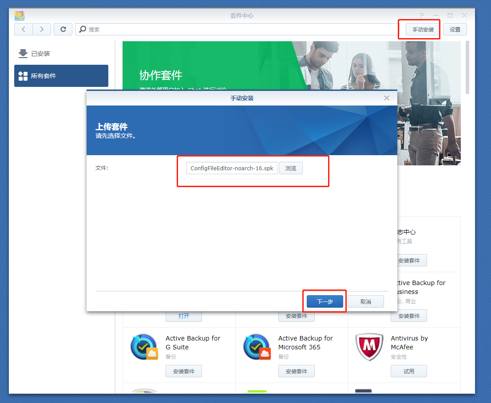

手动安装ConfigFileEditor

**安装完毕之后**在套件中心找到 `Config File Editor` 并**打开**

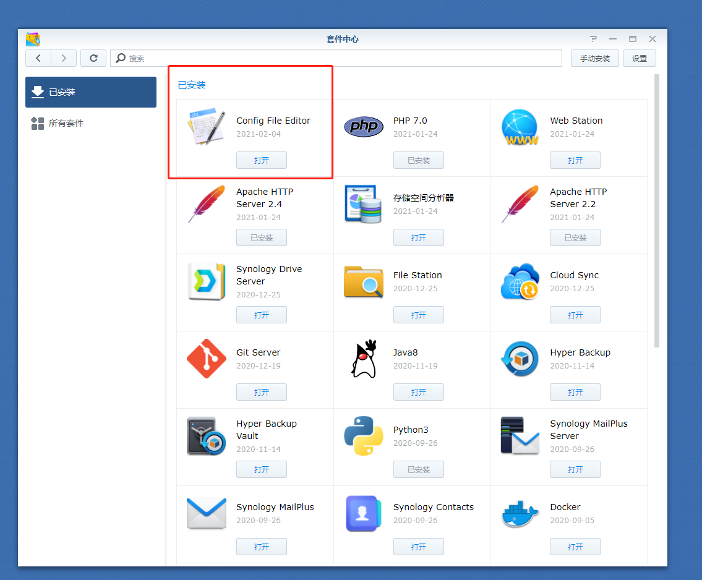

找到Config File Editor

随后选中 `sshd` 配置文件

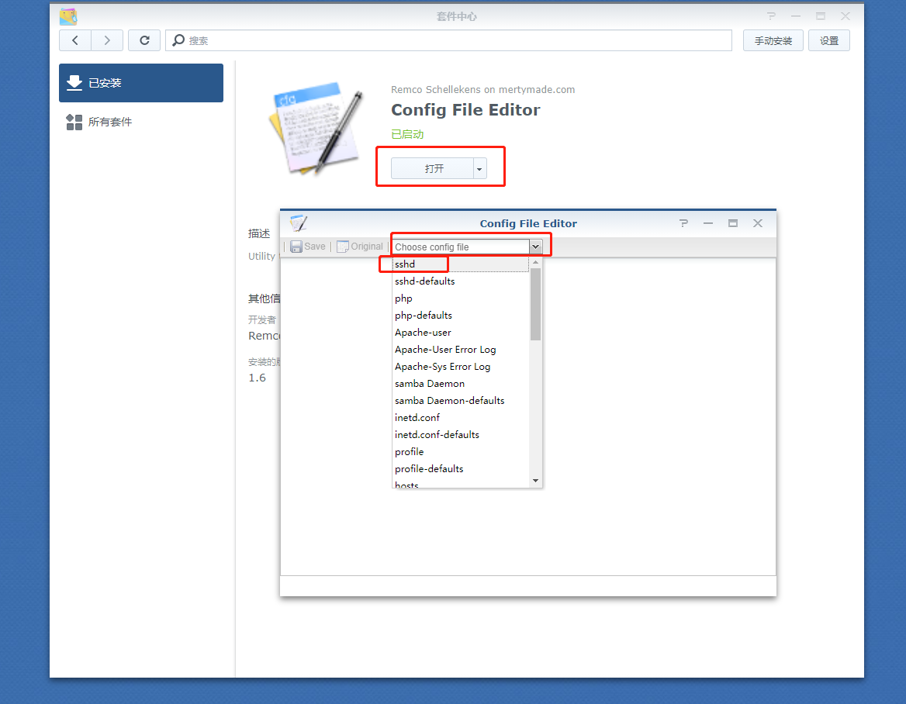

选中sshd配置文件

之后**找到**

```text
#PermitRootLogin prohibit-password
```

将其**替换**为

```text
PermitRootLogin yes
```

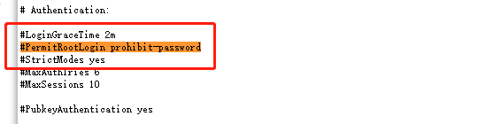

替换前

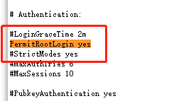

替换后

**保存之后重启 `NAS` 即可**

#### 错误的修改 sudoers 造成 sudo -i 命令报错

我参考的教程帖子底下<strong>有部分用户出现这样的问题，</strong>这是因为之前根据其他教程不小心改了 `sudoers`导致的。解决方法我这里不再阐述，请直接参考下图进行修改（看不清的话请去底部翻文章的参考引用\[6\]

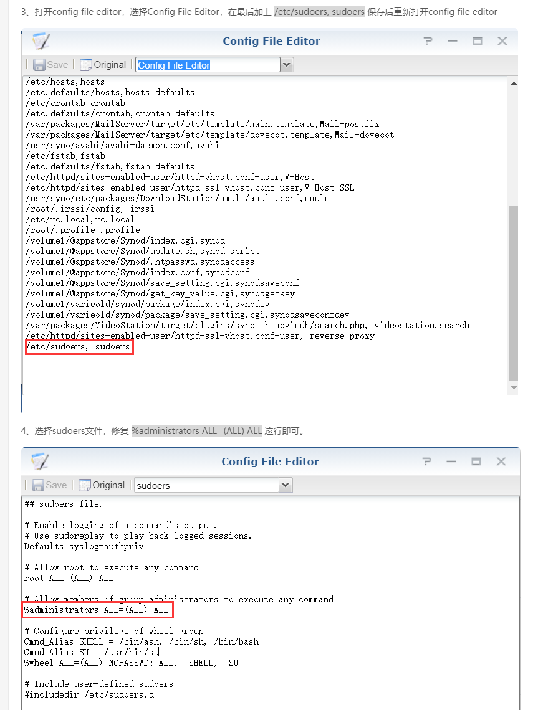

修复sudoers步骤

### 安装 pip

#### 重新通过 SSH 登录服务器

此时我们打开 `Putty` <strong>输入相同的地址与端口链接，</strong>此时记得使用 `root` **账号以及前面设置的密码进行登录。**

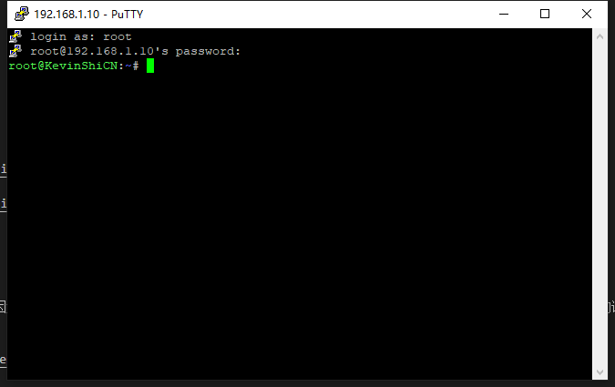

登录后界面如下

随后**输入**

```bash
sudo su
```

**回车**后**输入**

```bash
wget https://bootstrap.pypa.io/get-pip.py
```

即可开始从 bootstrap.pypa.io 网站下载 `get-pip.py`

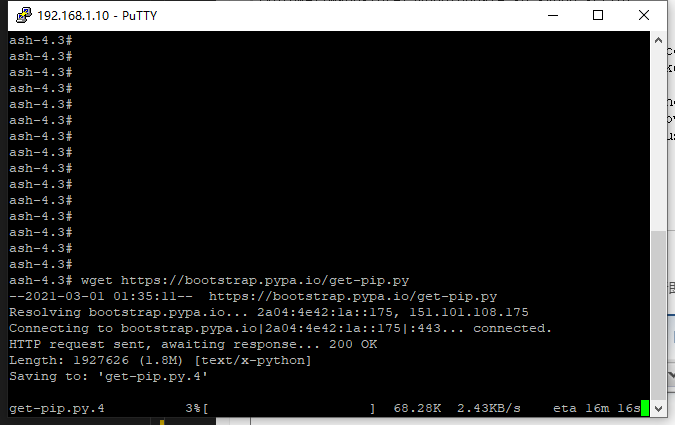

下载截图

这时候的下载速度可能会非常慢，因为服务器在国外。我是通过将`get-pip.py`文件**放到自己的服务器之后进行下载的**，这里我把我的**OSS 链接**分享出来供大家下载。

```bash
wget https://kevinshicn.oss-cn-shenzhen.aliyuncs.com/zhouji/05/get-pip.py
```

之后**通过**

```bash
python3 get-pip.py -i http://pypi.douban.com/simple/ --trusted-host pypi.douban.com
```

**指令**来安装 `pip`，这里**安装成功**后显示如下（注意这里我直接使用的<strong>豆瓣镜像，</strong>因为国内用户直接执行 `get-pip.py` <strong>下载会异常缓慢。</strong>如遇问题请改用下面这个**原版指令通过 pip 默认服务器安装！**

```bash
python3 get-pip.py
```

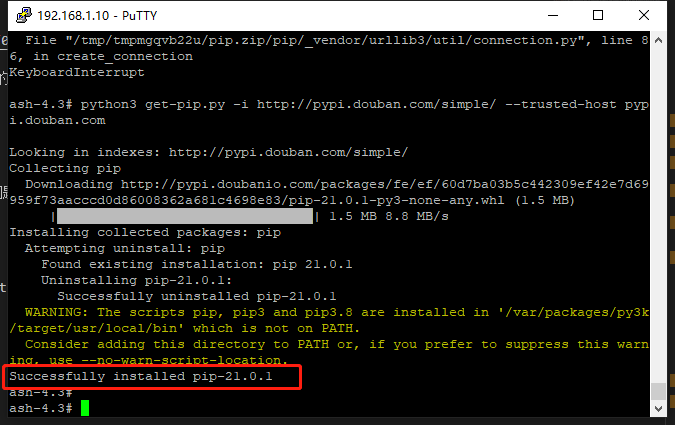

显示Successfully installed pip-21.0.1代表pip安装成功

### 通过 pip 安装 wakeonlan

我当时在**成功安装** `pip` 之后**遇到了大坑**，这个问题应该是<strong>由于环境变量导致的，</strong>因此这里我将**用我自己的方法来优化接下来的步骤。**

按照**原文**我们是**需要通过下面指令直接安装 `wakeonlan` 包的**

```bash
pip3 install wakeonlan
```

**然而**回车执行之后**我这里弹出了 `pip` 指令未找到的提示**

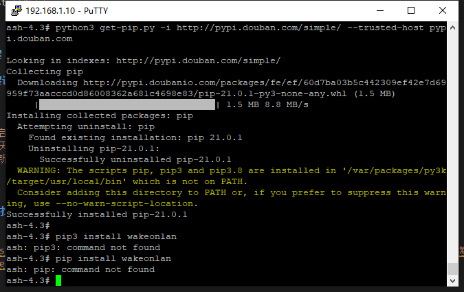

未找到pip命令，哪怕换pip install也不行

这个<strong>问题当时困扰了我很久，</strong>最后我找到的**解决办法**是<strong>在不更改环境变量的前提条件下，</strong>直接<strong>跑到`pip`的目录进行调用，</strong>于是我需要**先找到`pip`在哪**里。这里我们**输入**

```bash
find / -name pip
```

我这里**返回了结果**如下

```text
ash-4.3# find / -name pip
/tmp/pip-uninstall-yl447hvl/pip
```

其中

```text
/tmp/pip-uninstall-yl447hvl/pip
```

就是我们需要访问的 `pip` 路径

然后我们**改一下上面的命令**

```text
从
pip3 install wakeonlan
修改为
/tmp/pip-uninstall-yl447hvl/pip install wakeonlan -i http://pypi.douban.com/simple/ --trusted-host pypi.douban.com
```

回车之后进行 `wakeonlan` 的安装<strong>（同样这里我直接把豆瓣的镜像源带上了，不然直接执行的网速还是非常的慢）</strong>，这边可以看到 `pip` `正常执行了，wakeonlan` 的**安装也正常在运行了。**

随后我们用同样的方法**确定** `wakeonlan` 的**路径**

```bash
find / -name wakeonlan
```

返回**结果**

```text
ash-4.3# find / -name wakeonlan
/volume1/@appstore/py3k/usr/local/bin/wakeonlan
```

就是我们的 `wakeonlan` 路径！！

此时**证明**我们的 `wakeonlan` **安装成功！**

### 通过 ssh 发送指令执行唤醒

此时我们用不同的设备（手机、平板以及另一台电脑等）通过 `SSH` **发送以下指令**就可以**唤醒我们指定的设备**了

```bash
/volume1/@appstore/py3k/usr/local/bin/wakeonlan 需要被唤醒设备的MAC地址
```

### 将唤醒指令添加进群辉 NAS 的任务计划功能（备用选项）

此时我们已经可以通过 `SSH` 链接群辉 `NAS` 进行**局域网设备唤醒**了，但**不排除**有时我们的 `SSH` <strong>链接不稳定。</strong>那么这就需要我们**通过群辉的控制台**进行**指令的发送。**

#### 找到群辉控制面板的计划任务

#### 添加计划任务

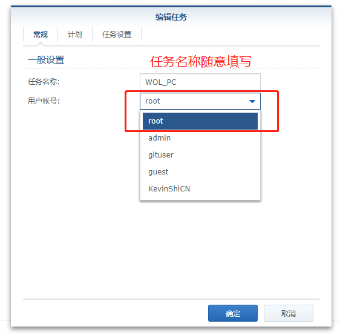

任务名称任意填写，用户账号记得选择root

#### 务必按图设置任务的计划

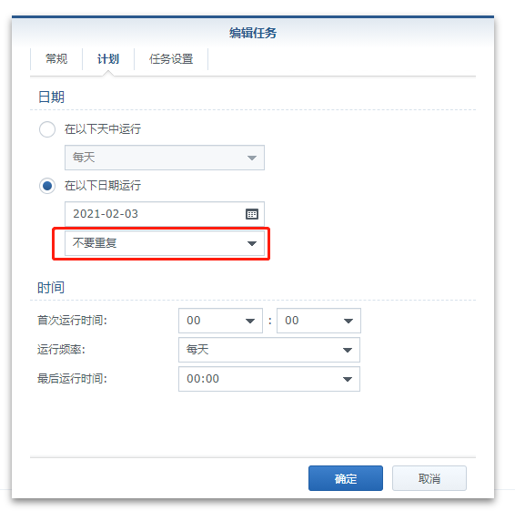

禁止任务自动执行

#### 任务设置

这里我们**输入前面测试成功的唤醒指令**，至于邮件提醒功能是**可有可无**的。

```bash
/volume1/@appstore/py3k/usr/local/bin/wakeonlan 需要被唤醒设备的MAC地址
```

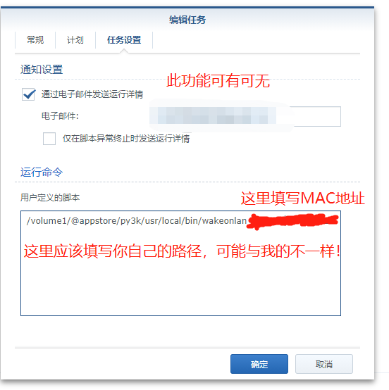

设置界面如下

点击**确定**即可<strong>完成任务的添加，</strong>随后从控制台**右键**即可**运行唤醒本地设备**


右键运行即可

### 通过 IOS 快捷命令语音唤醒设备（装逼选项）

**参考的文章**同时**给出了另一种很好玩的做法**那就是通过`IOS`的**快捷命令**连接`SSH`后**发送命令来进行唤醒。**

设置过程非常简单，只需要<strong>找到`通过SSH运行脚本`这个快捷指令即可，</strong>设置方法如下

#### 主机设置为你的公网 IP 或域名

#### 端口设置为对应的 SSH 端口

#### 用户设置为 root

#### 密码设置为 root 对应密码

#### 输入设置为前面测试可以用的唤醒代码

```bash
/volume1/@appstore/py3k/usr/local/bin/wakeonlan 需要被唤醒设备的MAC地址
```

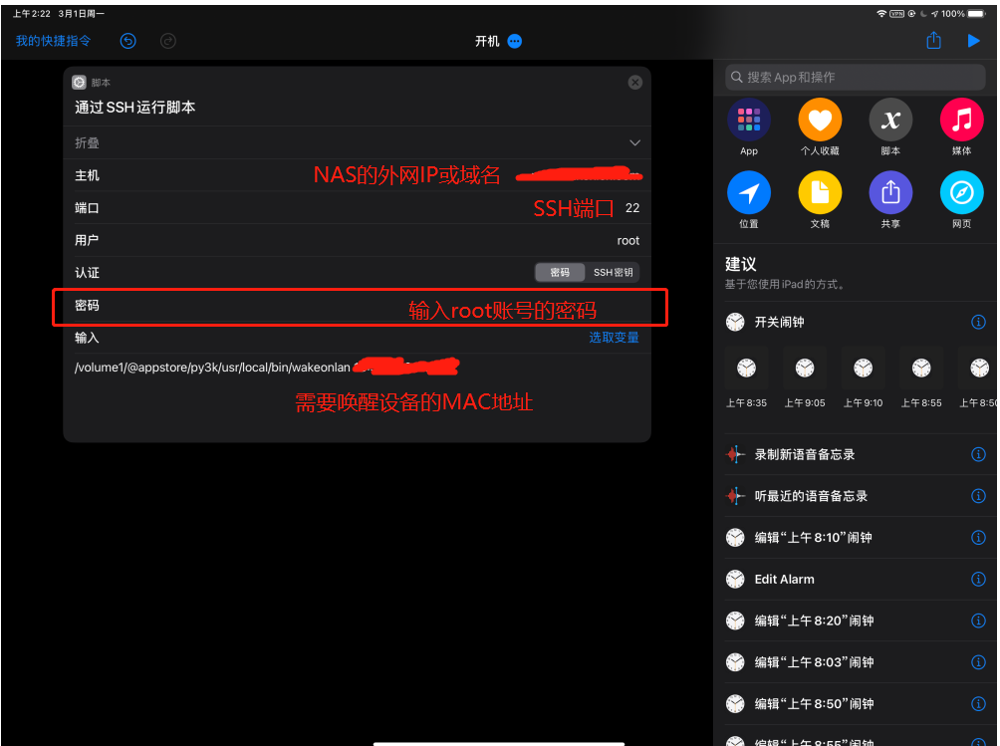

IOS快捷指令设置

之后就可以愉快的通过 `siri` 唤醒电脑了！

## 本周总结

### 可能写的太过于详细了

一篇**这么简单的教程**写下来<strong>篇幅达到了接近 4500 个字，</strong>我仍然认为**这对读者**以及<strong>对于作者（我）</strong>来说都<strong>并不是最完美的展现方式，</strong>下一篇技术类周记<strong>我将用更简洁的方法来写文章，</strong>并尽量**保证技术基础低的读者**理解并实现目标！

##### 推荐阅读

- [周记 2021-01-周记项目正式启动](https://mp.weixin.qq.com/s/AtHYksWbXnaJheWlNTLGXA)
- [周记 2021-02-我是如何 43 天内拿下 PMP 证书的](https://mp.weixin.qq.com/s/O_RHEhW6A6arUSvBxshTvg)
- [周记 2021-03-书籍分享《重新定义团队：谷歌如何工作》（1-3 章）](https://mp.weixin.qq.com/s/dzn8uJV-7lLvCyKyz3udAg)
- [周记 2021-04-书籍分享《重新定义团队：谷歌如何工作》（第 4 章）](https://mp.weixin.qq.com/s/ap_JhwgmfxgqFAIcTF3nKQ)

\---

欢迎关注我的公众号“**凯文有事找你**”，原创**技术**、**生活**、**经验教训**文章第一时间推送。


