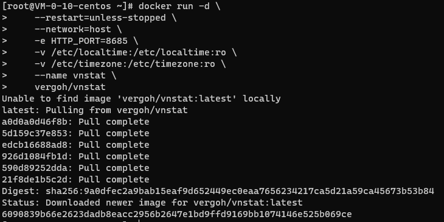
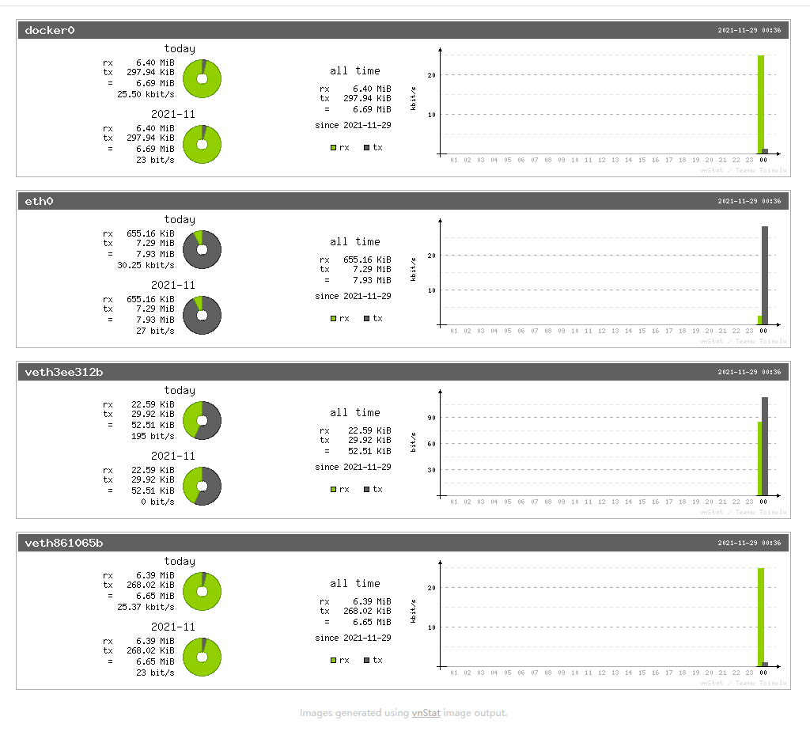
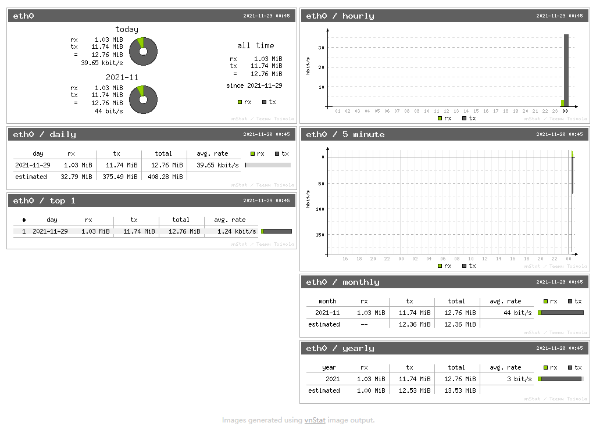
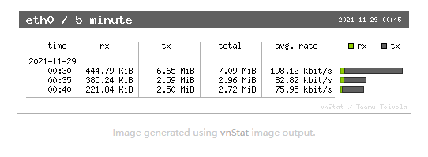
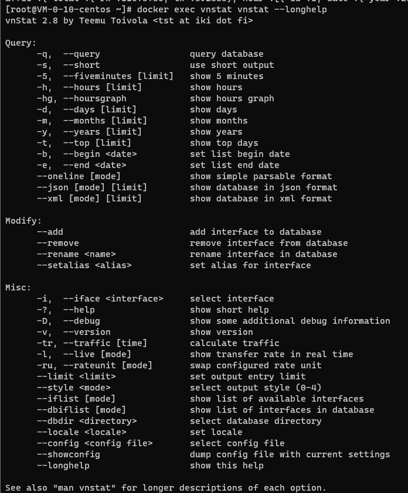
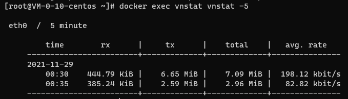
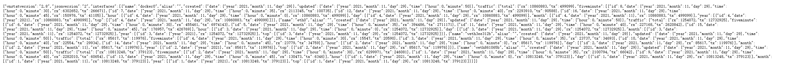
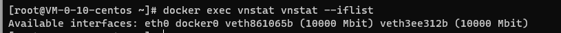
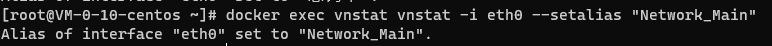
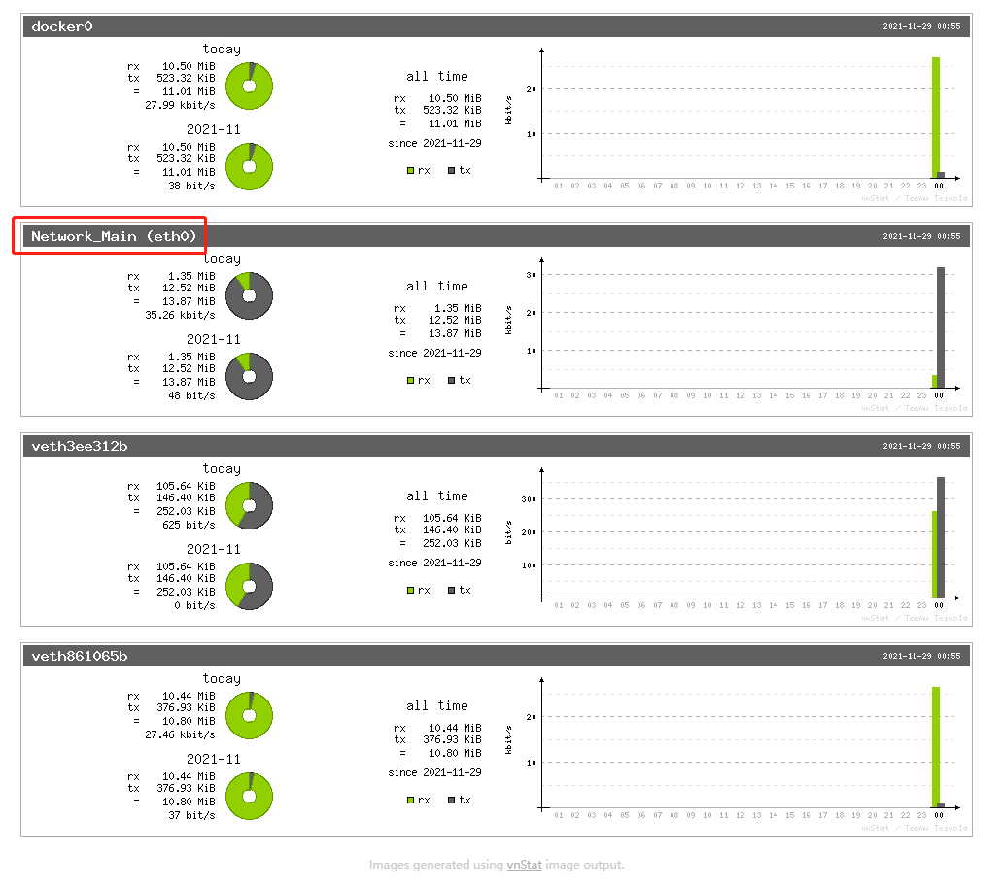

### 简介

[vnStat 项目地址](https://humdi.net/vnstat/)

[Docker 地址](https://hub.docker.com/r/vergoh/vnstat)

`vnStat` 是一款老牌的 Linux 系统流量监控工具。由于我之前做的一个项目需要监控服务器的流量使用，使我最后找到了它。

`vnStat` 的优点在于便捷部署加轻松使用。它不仅能够**从全局监控流量**，更能**监控不同的 Docker 容器使用的流量**。是一款**非常轻量的神器**。

### 安装

由于是 `Docker` 部署，这里跳过 `Docker` 相关安装步骤，如需要请移步我的[Docker 安装帖子](../2021-install-docker-and-compose-on-linux/)

```bash
docker run -d \
    --restart=unless-stopped \
    --network=host \
    -e HTTP_PORT=8685 \
    -v /etc/localtime:/etc/localtime:ro \
    -v /etc/timezone:/etc/timezone:ro \
    --name vnstat \
    vergoh/vnstat
```

很简单，一段这样的命令运行之后，`vnStat` 就能够运行了



vnStat安装

### 使用方式

#### 以图片形式输出数据

安装完成之后我们通过访问`http://你的服务器ip:8685`即可进入默认的 `vnStat` 界面



vnStat默认显示界面

其中

- `eth0` 代表着主网卡，可以将其理解为**所有外网流量**
- `docker0`代表 Docker 内使用的流量，包括了内外网使用流量
- `vethXXXXX`对应不同的 Docker 容器使用的网络，可以通过此来区分不同的 Docker 容器使用的流量

点击 `eth0` 我们就能够进入 `eth0` 这个网卡的详细流量数据



eth0网卡数据

之后我们还可以**点击不同区域**来进入不同的时间区间视图



eth0网卡的5分钟数据

#### 以控制台控制输出

在主机中，我们可以通过如下命令直接将指令传输到 `vnStat` 的容器中已实现通过控制台访问数据

```bash
docker exec vnstat vnstat --longhelp
```

这里可以通过修改`--longhelp` 来实现各种命令



longhelp界面

例-5 就是展示最近 5 分钟的流量情况

```bash
docker exec vnstat vnstat -5
```



通过控制台查看5分钟流量

#### 以 Json 形式输出数据

在我们原先访问的图形地址`http://你的服务器ip:8685`后面加入`/json.cgi`之后我们就能够以 Json 的形式返回响应的流量参数。



json字符串返回

跟控制台一样，如果需要看更详细的数据，是需要我们进一步更改访问地址的。

### 使用方法

#### 添加一个网卡

由于 `vnStat` 只会自动添加**首次部署**时候的所有网卡，因此新的 `Docker` 容器需要通过下面步骤将其添加进监控列表

##### 检查是否有新增的可添加的网卡

```bash
docker exec vnstat vnstat --iflist
```



查询网卡结果

##### 将尚未添加的网卡增加到监控

```bash
docker exec vnstat vnstat -i 网卡名称 --add
```

##### 重启服务

```bash
docker exec vnstat killall -HUP vnstatd
```

#### 移除一个网卡

对于不再需要监控的网卡，我们可以通过如下指令来移除

```bash
docker exec vnstat vnstat -i 网卡名称 --remove --force
```

#### 给网卡添加备注

如网卡开始多起来之后，查询名称会变得不方便，因此我们可以通过如下指令将原本为字符串的网卡名称改为可识别的叫法

```bash
docker exec vnstat vnstat -i eth0 --setalias "Network_Main"
```



更改备注名结果



更改备注名后效果

### 注意事项

#### 数据备份

在 Docker 运行的时候添加`-v 主机地址路径:/var/lib/vnstat`能够确保 vnStat 的数据直接保存到主机中。这确保我们能够在重装容器的时候保证数据连贯性。

### 推荐阅读

- [敏捷项目管理之一页纸搞懂 Scrum 方法](https://mp.weixin.qq.com/s/68ZKXayNNzqdAIYpOfYSzg)
- [书籍分享《重新定义团队：谷歌如何工作》（第 5 章）](https://mp.weixin.qq.com/s/yvw7ZqkSef8sntiQXHvR0A)
- [解决宝塔的 Nginx 无法在服务器重启之后自动启用服务的问题](https://mp.weixin.qq.com/s/IL20KFrifVPQa_l3_FGv2A)
- [群辉 Synology NAS 实现 WOL(Wake On Lan)唤醒局域网内任意设备+siri 语音唤醒电脑](https://mp.weixin.qq.com/s/LbYA7X4w0vLo0Cz0Cdv9hg)
- [我是如何 43 天内拿下 PMP 证书的](https://mp.weixin.qq.com/s/O_RHEhW6A6arUSvBxshTvg)

\---

欢迎关注我的公众号“**凯文有事找你**”，原创**技术**、**生活**、**经验教训**文章第一时间推送。


