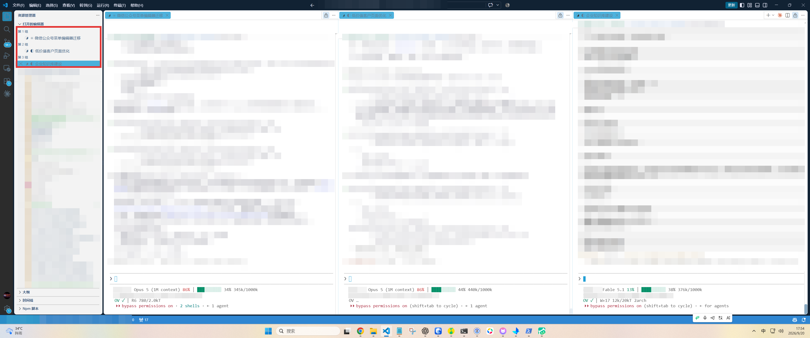
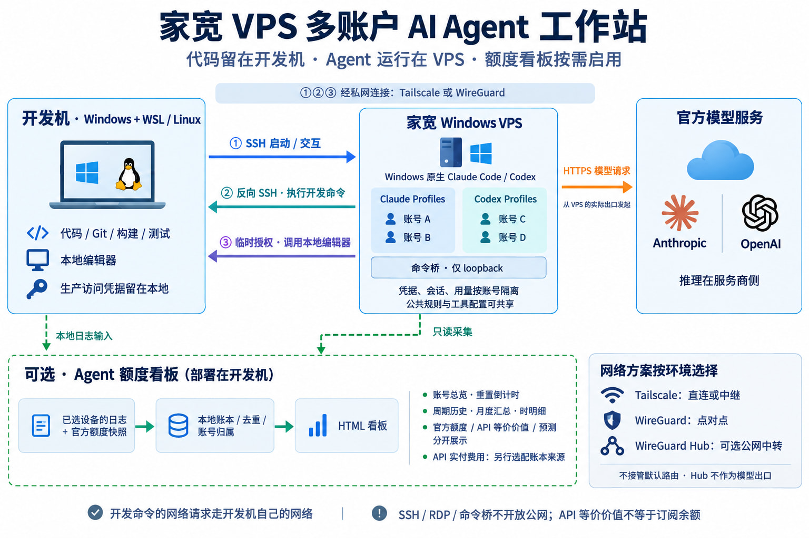
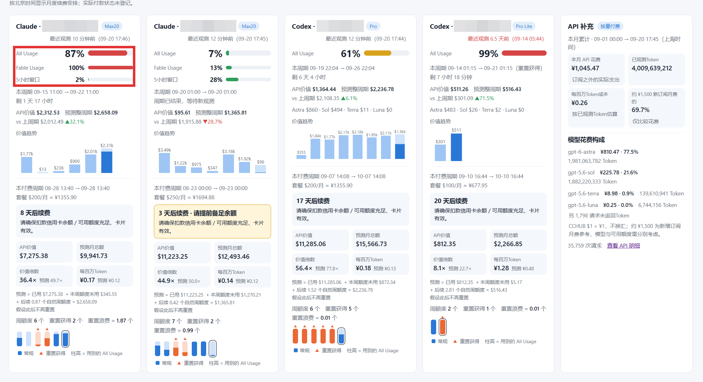

为了用 Claude，我不想把自己伪装成美国人。干脆让 Claude 去美国上班，再远程回来给我干活。

以前输入 `claude`，现在输入 `vpsclaude`。

我现在就是这样开工的。

左上角是会话列表，右边同时开着不同任务：公众号编辑器、客户页面、企业知识库。

看起来还是我原来的 VS Code。终端里启动的，却是家宽 VPS 上的 Claude。

**它去美国上班，我的文件夹没搬家。**

## 只换家宽代理，我还是不放心

我之前被 Claude 封过号。折腾了一圈，听到的建议绕不开“家宽”：家宽 IP、家宽代理、家宽 VPS。

开代理最省事，换个出口就行了。

但 Claude Code 的进程还在我自己的电脑上。时区、语言，还有其他环境细节，都跟着这台电脑。

我会担心，这些东西是不是还在透露我的使用环境？

我不想天天研究怎么把自己的电脑装成另一台电脑。干脆给 Claude 找一台真正的美国家宽 Windows VPS，让进程也过去。

然后问题来了：Claude 搬走了，我的项目怎么办？

## Claude 可以搬，我不想跟着搬

直接开远程桌面，在 VPS 里面写代码，当然可以。

但我的项目、编辑器、Git、测试、构建和部署，全在原来的开发机上。

我不想把这套环境重新搬一遍，更不想两边留两份代码，再去管同步、管冲突、管这次到底改了哪边。

我是卖大米的，也在用 AI 做自家的销售自动化中台。我想折腾的是这些业务，不想给自己增加一份“管理两套开发环境”的工作。

所以我给 Claude 安排的工作方式很明确：**你在那边运行，要动我的项目，就回来干活。**

## SSH 过去，再 SSH 回来

整套链路就在这张图里。

我在本机终端输入 `vpsclaude`，通过私网 SSH 到家宽 VPS，启动那边的 Claude Code。

Claude Code 从 VPS 向模型服务发请求。需要读文件、改代码、跑测试时，再通过反向入口 SSH 回开发机，在原来的项目目录执行。

Git 在本机，测试在本机，构建和部署也在本机。需要我手工编辑的地方，继续用本地编辑器。

看起来来回绕了一圈，但我每天面对的还是同一份项目。

**我宁愿让这条链路绕一点，也不想自己天天在两套环境之间绕。**

`vpsclaude` 是我的启动封装。私网、反向命令和编辑器桥配好以后，才有前面那种“新建终端，直接开干”的体验。

## 账号多了，就别让我靠脑子记了

我的 Agent 额度看板现在是这样。

Claude、Codex、API 补充放在一起看。哪个账号快用完，下次什么时候重置，这个月用了多少，不用到处翻。

前面开着几个 Agent 一起干活，后面就得把这些事管起来。用到哪一步，就把哪一步接起来。

对我来说，AI 已经是一套每天拿来干活的东西。我的精力应该花在它替我做什么，而不是围着工具转。

## 提示词在这里，直接拿去用

想照着搭，把完整提示词交给你的 AI。

[查看完整提示词 →](https://mp.weixin.qq.com/s/59TxqIfC4Y46sm9gnIMbJw)

先把你的开发机、家宽 VPS 和现有网络告诉它，让它跑通一个账号、一个项目。多账号和额度看板，需要哪个再加哪个。

我把这套东西折腾完，面前还是原来的编辑器。那台远端电脑，负责让 Claude 开工。
