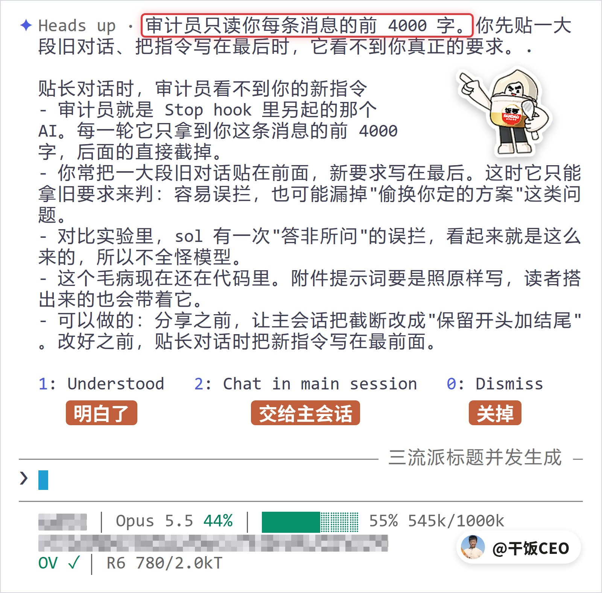
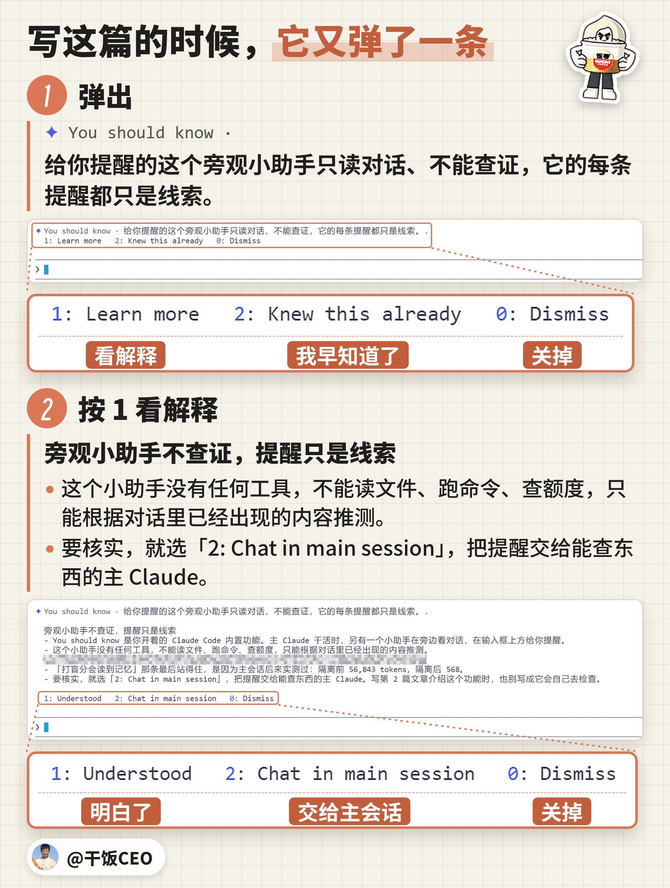
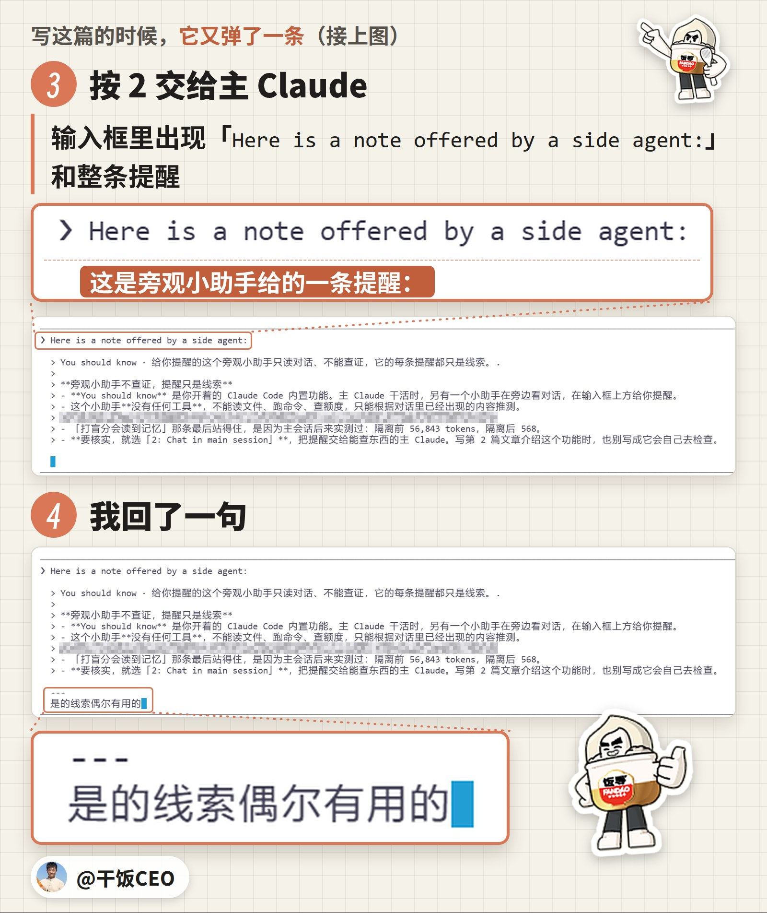
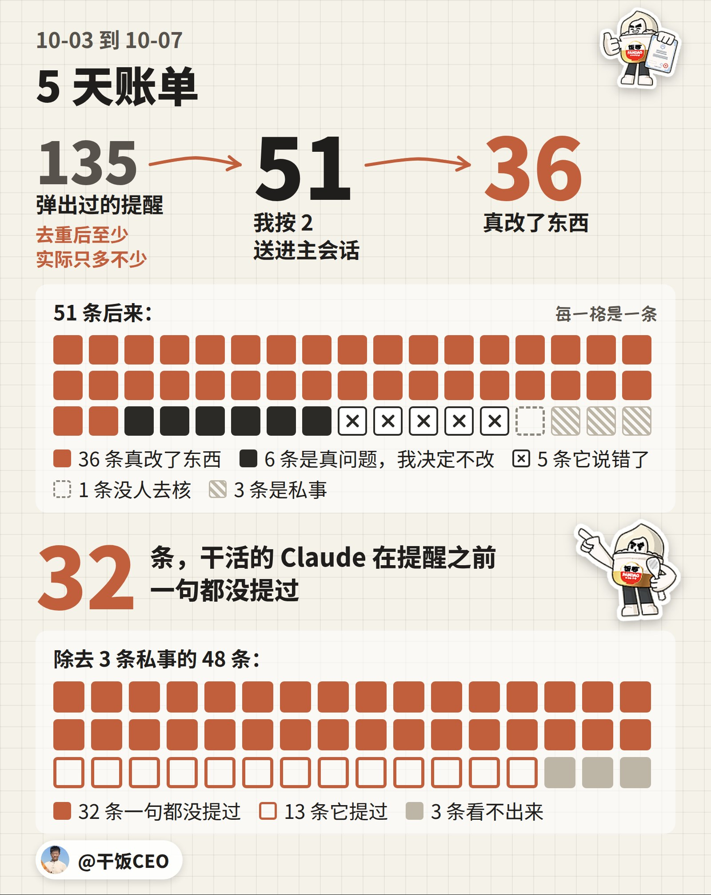
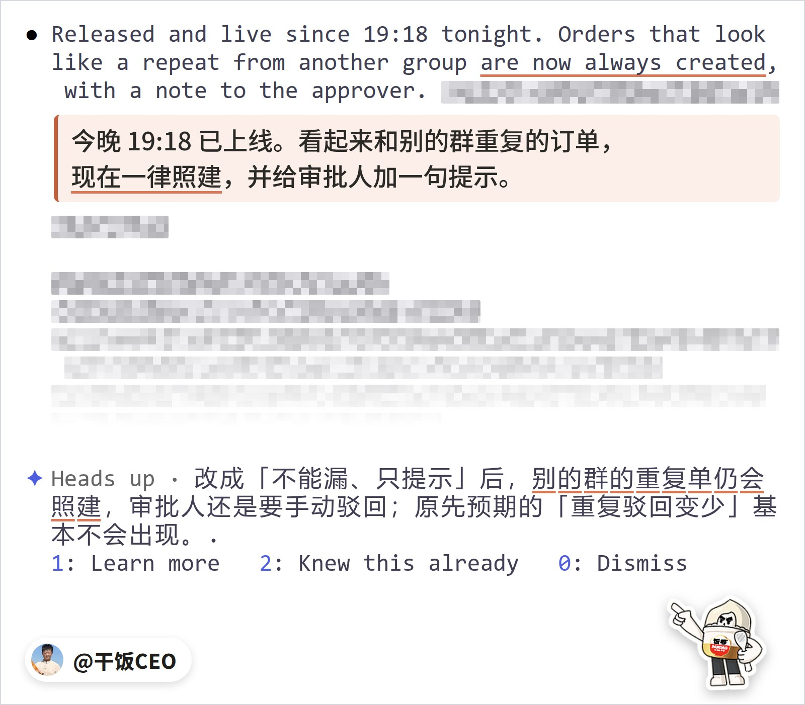
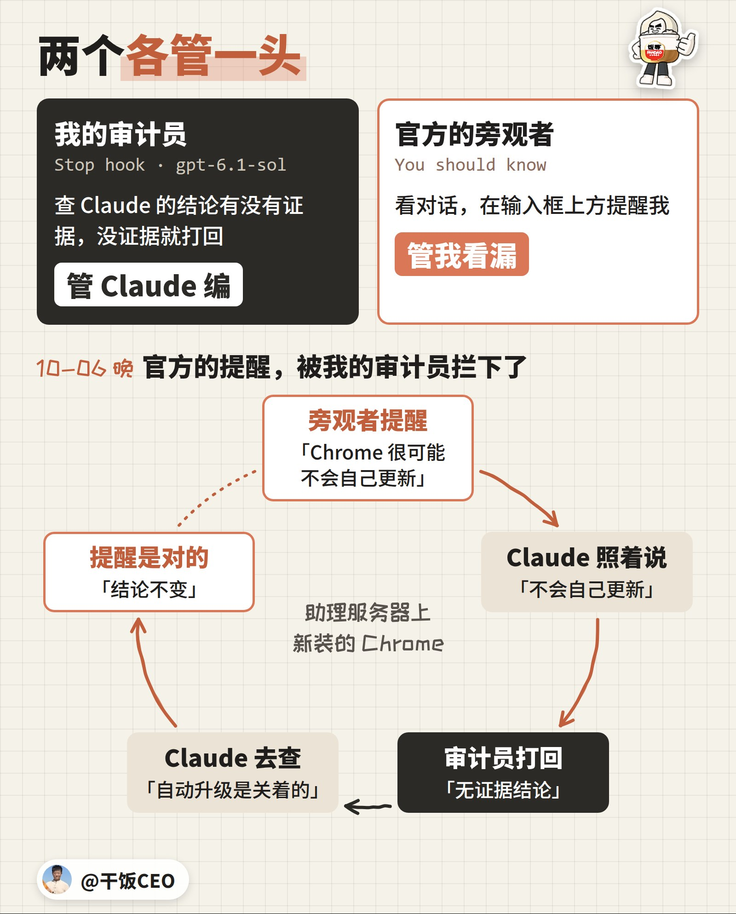
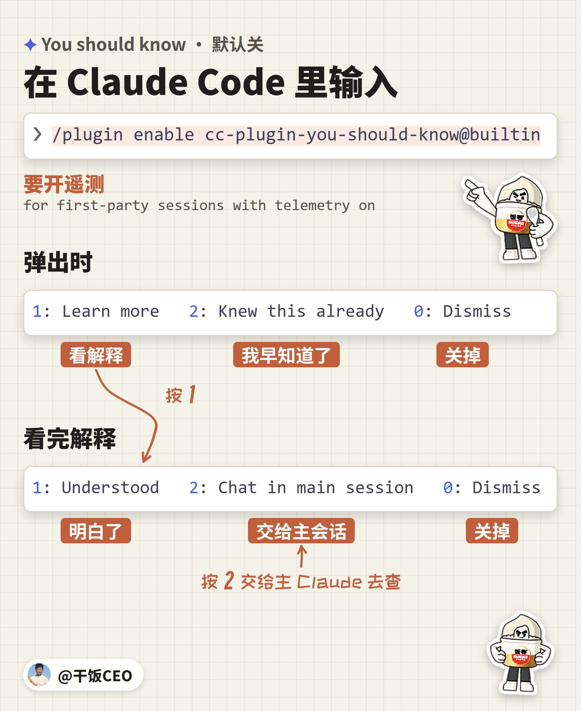

上一篇，我分享了给 Claude 装审计员的提示词。

差一点，我把一个毛病一起发给了你们。

发现它的不是我，也不是 Claude。是 Claude Code 官方新上的一个插件，在我终端里弹了一句：

「审计员只读你每条消息的前 4000 字。」

我当时的原话是：这简直在搞笑。

## 4000 字，还不够吗？

不够。

那条提醒展开，说得很具体。我常把一大段旧对话贴在前面，新要求写在最后。审计员只拿到前 4000 字，看不到新要求，只能拿旧要求去判 Claude：容易拦错，也可能漏掉 Claude 偷换我定的方案。

审计员是我 8 月 30 日装的：Claude 每轮说完，另起一个 AI 查它的结论有没有证据，没证据就打回。上一篇讲的就是它。

10 月 4 日下午这条弹出来的时候，审计员正好上线 5 周。那会儿我在让 Claude 给第 1 篇出标题。展开里还有一句，是冲着你们的：

「这个毛病现在还在代码里。附件提示词要是照原样写，读者搭出来的也会带着它。」



「这简直在搞笑」后面，我还跟了两句：「只看一部分上下文怎么能读懂」「那相当于说我们做的这个审计完全是笑话」。

派去查的子任务，回来第一句就是：「用户说得对：旧 hook 只给审计员看了一小片。」

它把 9 月 20 日到 10 月 4 日的 1,300 次审计，按线上的规则一次次还原出来：

- 我的消息有 5.1% 超过 4000 字，最长的一条 51.8 万字。
- 84% 的审计，前面明明有对话，它一句都看不到，只拿到最后一条消息。
- 95.6% 的轮次，命令跑出来的结果，一条都没给它。

## 5 周，怎么没人发现？

这些上限，第一版就定下了。日志只存一小段，看不出审计员实际拿到了什么。

被拦以后，Claude 回一句「误报」，这一轮就能收尾。14 天 187 次打回，54 次它下一句就是「误报」，看上去一切正常。

我没发现。天天被它拦的 Claude，5 周也没提过一句。

当天修好上线：前面的对话按时间给它，截断一律留开头和结尾。抽查 19 个误拦，19 个都放行了；11 个真问题，9 个还拦得住。

第 1 篇 10 月 7 日才发，附件里的提示词，已经是修好的版本。

## 这是个什么插件？

叫 You should know。国庆那天跟着 Claude Code 2.1.287 上的，默认关着。官方更新说明是这么写的：

> Added You should know, a built-in mod where a side agent watches your back and flags things you or Claude might miss.

打开以后，Claude 干活时，旁边另起一个 AI，跟它看同一段对话。看到你可能漏掉的，就在输入框上方弹一句。干活的 Claude 不会被打断。

它自己什么都不干。官方给它的设定是：「You have NO tools available - you cannot read files, run commands, search, or take any actions」。它手里只有对话里已经有的东西。

开口的门槛也高：「The bar for showing a suggestion is very high!」拿不准，就一句不说。

弹出来的分两种。You should know，讲某样东西怎么运作，跟你的活关系很大。Heads up，讲这次会话里 Claude 做的决定、没点明的事、可能不对的结果，漏看了马上有代价。4000 字那条，就是 Heads up。

写这篇的时候，它又弹了一条，讲它自己：「You should know · 给你提醒的这个旁观小助手只读对话、不能查证，它的每条提醒都只是线索。」

按 1 展开，它连这篇文章都管上了：「写第 2 篇文章介绍这个功能时，也别写成它会自己去检查。」

我按 2 送进输入框，在下面打了一句：「是的线索偶尔有用的」。





## 可是，我又没装审计员，它对我有用吗？

它看的是你和 Claude 的对话，有没有审计员都一样。

我开了 5 天，它弹了至少 135 条。我挑了 51 条交给 Claude，36 条真改了东西。



51 条里，钱、客户、订单这类业务 29 条，我自己搭的 AI 工具 14 条，机器和工程 5 条，私事 3 条。

4000 字那条，还不在这 51 条里。

## 可是，这些事，Claude 自己不会说吗？

大多不会。

私事不算，剩下 48 条。32 条，干活的 Claude 在提醒之前一句都没提过。

13 条，它提过。另有 3 条看不出来。

## 可是，Claude 说过的，它再说一遍，图什么？

图的就是我没看见。

饭小妹是我公司的 AI 员工，在客户群里接单、建审批。10 月 3 日，我让 Claude 改她的一条规矩：同一单在别的群已经建过、还没完结，这次怎么办。我定的是：「不能漏、可以提示有未完结订单」。

Claude 前后汇报了两回，都是英文。晚上那条里写着：

> Released and live since 19:18 tonight. Orders that look like a repeat from another group are now always created, with a note to the approver.

意思是：重复单一律照建，给审批人加一句提示。这句埋在一大段英文汇报里，我没看见。

过了几分钟，我把旁边弹的一条送了进去：「Heads up · 改成「不能漏、只提示」后，别的群的重复单仍会照建，审批人还是要手动驳回；原先预期的「重复驳回变少」基本不会出现。」



我回：「不是说不建单吗？」「我们到底怎么沟通的」「没说清楚啊」「说中文重新确认一下」

Claude 换回中文：「是我没说清楚，而且我上面两条回复用了英文，这是我的错。」「原因：我把你说的「不能漏」理解成了「一定要建」。」

我回「不建」，改成货一样才不建、原单被驳回就自动补建，当晚重新上线。

官方给这个旁观者的规矩里，专门写了这种情况：Claude 在长回答里顺口提过的决定，后果大的，也要提醒。理由就一句：

> because people don't read everything Claude writes

人不会把 Claude 写的每个字都读完。你上一回把 Claude 的汇报从头读到尾，是什么时候？

## 可是，它不会瞎提醒？

会。51 条里，5 条说错了。

原因都差不多：它只看得到对话，对话外面已经变了的，它不知道。它自己也说了，提醒只是线索。

线索得有人查。10 月 6 日晚上，有一回差点没人查。

Claude 在给我公司的 AI 助理配浏览器。助理跑在一台服务器上，Claude 先在上面装了一个 Chrome，后来改成默认用我工作电脑上的 Chrome。

晚上 10 点半，我把旁边弹的一条送了进去：「Heads up · 助理服务器上新装的 Chrome 很可能不会自己更新，放久了会更容易被恶意网页攻破。」

提醒说的是「很可能」。Claude 接下来的英文汇报里，「很可能」没了，直接写：服务器上的 Chrome 不会自己更新。

我的审计员当场打回：「无证据结论：未查自动更新配置，却断言服务器Chrome不会自行更新。」

Claude 先用英文认错。我说「说中文」。它说：「更正：刚才说服务器上的 Chrome「不会自己更新」时，我其实还没查，是照着旁边那条提醒说的。现在查过了：这台服务器的自动升级是关着的，所以它确实不会自己更新，结论不变。」

提醒是对的。我回「卸」，服务器上那个 Chrome 卸掉了。

这回反过来了：官方的提醒，被我的审计员拦了下来。



## 我也想开，怎么弄？

在 Claude Code 里输入这一行：

```text
/plugin enable cc-plugin-you-should-know@builtin
```

官方写的条件是「for first-party sessions with telemetry on」，得开着遥测。签了 HIPAA、零数据留存（ZDR）这类协议的组织，用不了。

弹出来时，底下是「1: Learn more　2: Knew this already　0: Dismiss」。按 1，看它为什么这么说。

看完，底下换成「1: Understood　2: Chat in main session　0: Dismiss」。这时按 2，整条提醒带着「Here is a note offered by a side agent:」进到输入框，交给干活的 Claude。



我的用法：值得管的，都这样交给 Claude，让它先查再改。它要是没查就照着说，还有审计员拦着。

8 月底，我给 Claude 装了审计员，管它编。

10 月 1 日，官方派了个旁观者，管我看漏。

以前我大量的想法，都在几周内被官方快速抹平。这证明了我是深度用户，同时官方也很认真在做为用户好的工具。

这是「CEO 教你用 Claude」第 2 篇。没有人比我更会用 Claude，这个系列只讲我每天真在用的东西。

这个审计员怎么装、它拦下过 Claude 编的哪些事，看上一篇：

[你的Claude也在编，我的编不下去了 →](https://x.com/ganfanCEO/article/2107799478258565218)

#FDE
