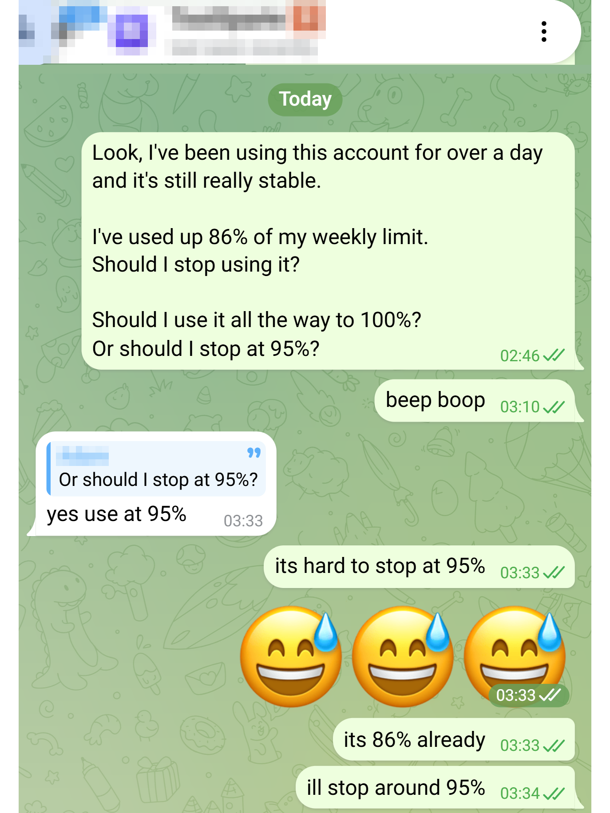
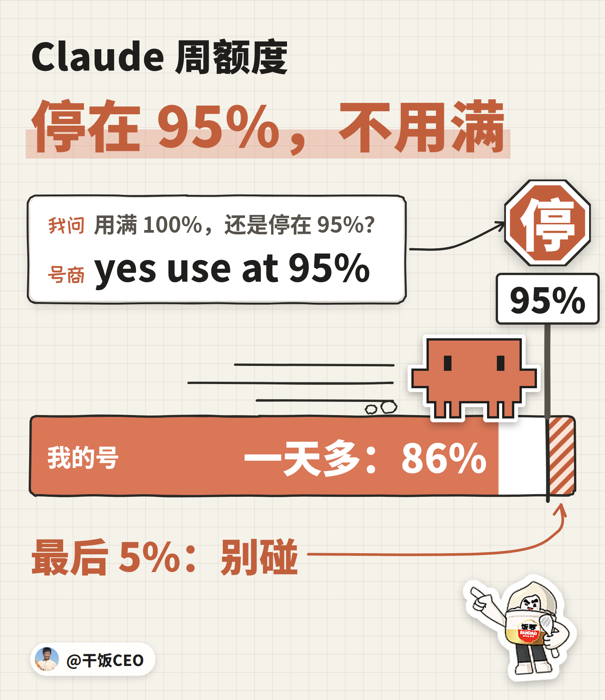
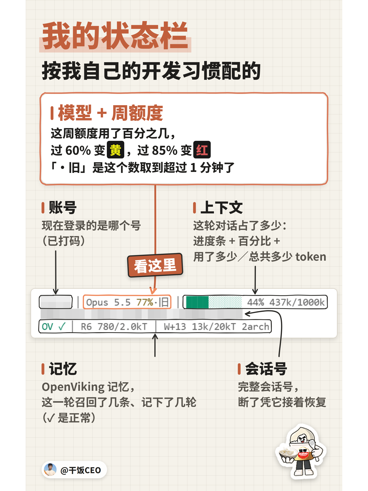

我的 Claude 用量，一般人难以企及。

可防封这件事，我是跟一个号商学的。

我发现了他的一个秘密：Claude 周额度，他的线划在 95%。用到 95%，就给你换号，不等用满。

额度是花钱买的，谁不想用满？他偏不。

他是靠卖 Claude 号吃饭的人，号就是他的货，封一个，少一个。

## 怎么发现的？

号商卖号，有的套餐带轮换：一个号的周额度用到线，他给你换下一个号。

这条线，是他自己带出来的。10 月 6 日，聊到另一个套餐，他提了一句：

> there will be no rotation when weekly limit reaches 95%

那个套餐，不带轮换。带轮换的，他建议用到 95%，到线就换号。

**我去，号商这个秘密，给我发现了。**

## 他自己认吗？

第二天，我拿手上这个号直接问他：周额度到 86% 了，该停吗？用满 100%？还是停在 95%？

他回了四个词：yes use at 95%。



为什么是 95%，他一个字没解释。

不解释，我也照抄。靠号吃饭的人给自己的货定的线，比网上哪篇防封攻略都实在。

## 留着 5%，不亏吗？

亏一周额度的二十分之一。号要是没了，亏的是整个号。



所以我建议你也这样：你的号，周额度用到 95% 就停。

## 怎么停得住？

要停在 95%，先得一直看得见周额度。复制下面这段，丢给你的 Agent，让它帮你把状态栏配好、美化好：

```text
帮我配一下 Claude Code 的状态栏（statusLine），让它一直显示：现在用的模型、这周额度用了百分之几、5 小时额度用了百分之几、上下文用了多少。周额度到 90% 变黄，到 95% 变红。数据从状态栏输入里的 rate_limits 取，脚本你来写，配进 ~/.claude/settings.json。
```

变黄就收尾，变红就停，等周额度重置。

这是我的状态栏，每一块干什么的都标好了。第一行中间那个百分比，就是这周额度用了多少。



它是按我自己的开发习惯配的。感兴趣的话，我再单独开一篇讲。

——————

## 往期 ·「CEO 教你用 Claude」

这是「CEO 教你用 Claude」第 3 篇。没有人比我更会用 Claude，这个系列只讲我每天真在用的东西。

- 第 2 篇：[我的审计员，被 Claude 官方审计了](https://x.com/ganfanCEO/article/2107897308960743660)。我给 Claude 装的审计员，被官方新插件抓出一个藏了 5 周的毛病。
- 第 1 篇：[你的Claude也在编，我的编不下去了](https://x.com/ganfanCEO/article/2107799478258565218)。Claude 编的时候，口气跟查过一模一样。我给它装了个审计员，让它编不下去。

#FDE
