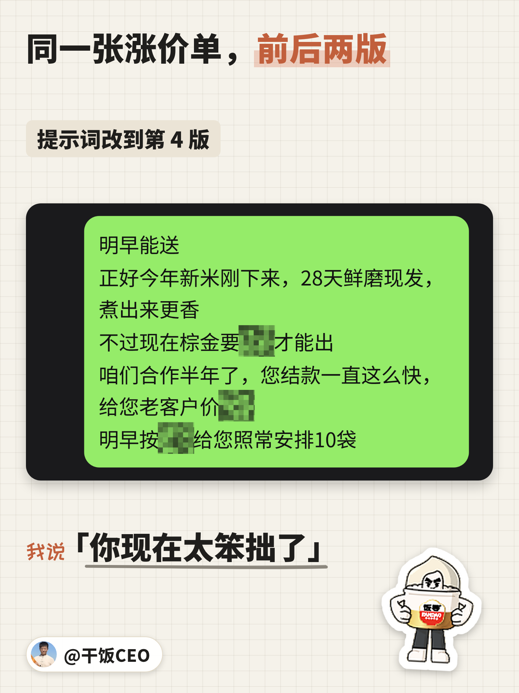
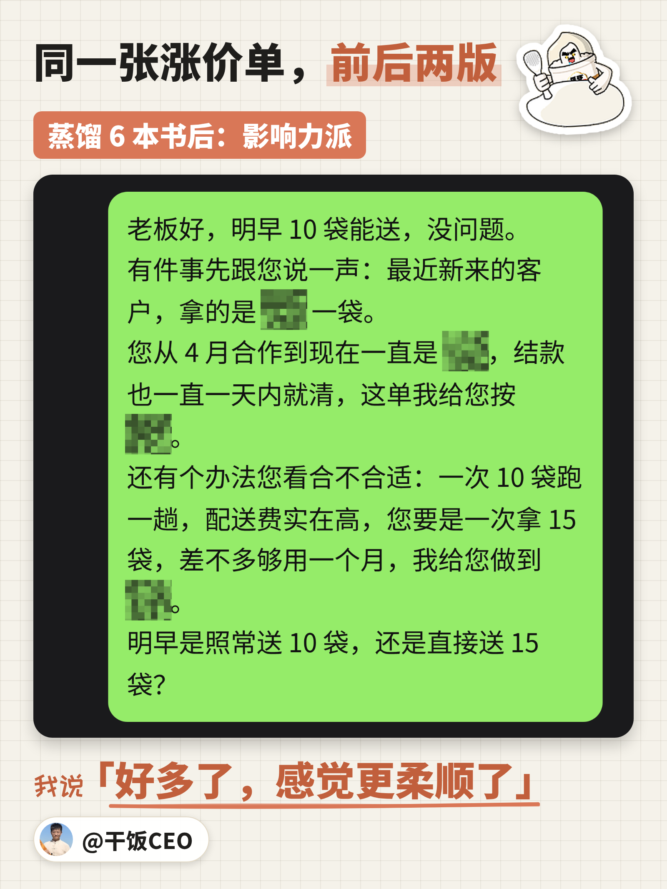
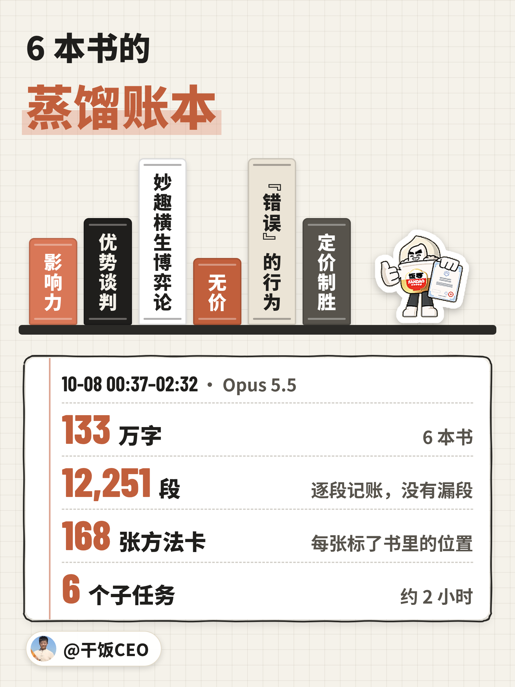
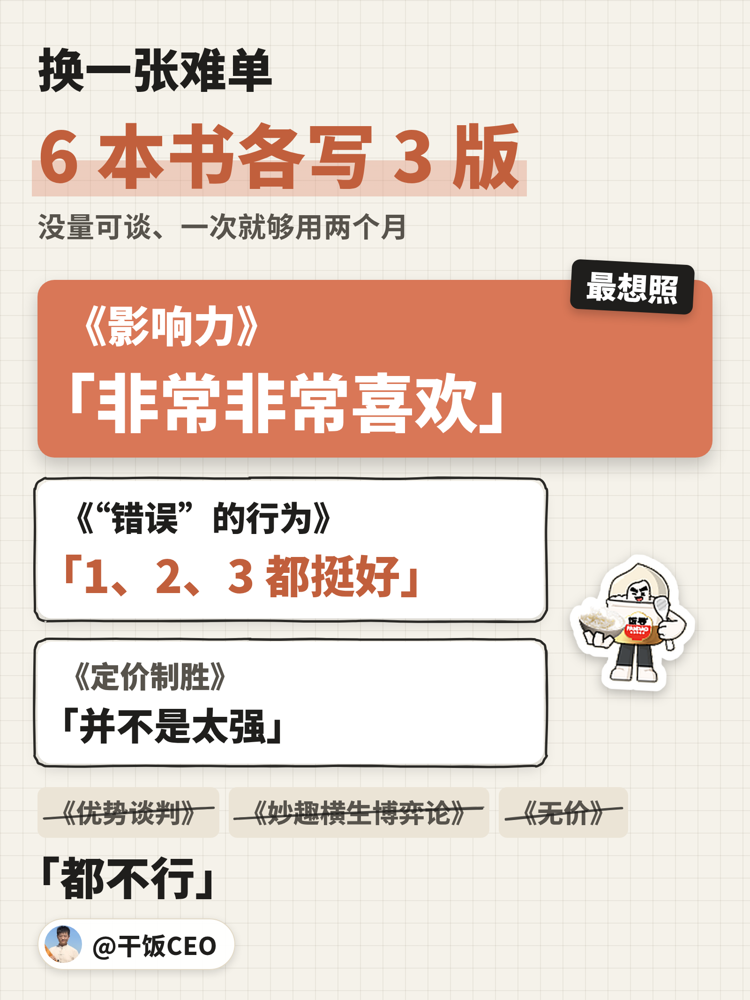
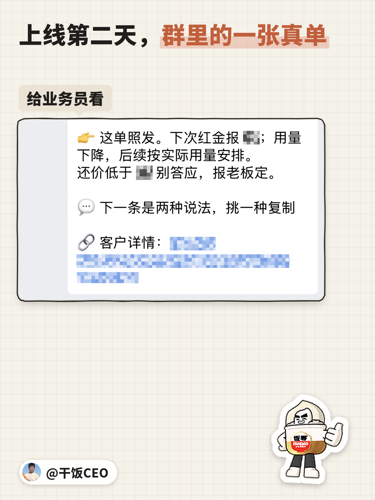
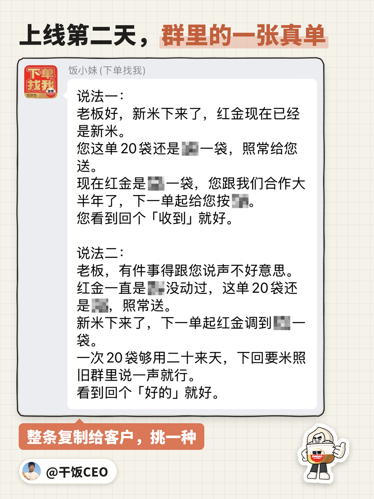

Claude，你真***蠢。

10 月 7 号深夜，它在帮我写涨价话术，提示词已经改到第 4 版。我回它：「你现在太笨拙了，再让你出我也不会满意的。」

你的 Claude 多半也这么蠢，只是你还没骂出口。

第二天凌晨，我把 6 本销售书蒸馏成 Skill。当天晚上，这套话术上线了。





## 第 1 版：「Agent 太基于事实了」

Opus 5.5 够聪明，规矩写进提示词，它条条都懂，就是太老实。

这一版的提示词只有我们自己的「说人话手册」，外加一条：涨价要有套路。它张口就把我们的底交了：新米刚下来，最近两周进价涨了约 2%。

我回它：「Agent 太基于事实了」「事实是给我们的」「不是给客户的」「要知道如何做一名销售」。

它懂规矩，不懂卖东西。

## 第 4 版：「比之前的差了一些反而」

第 2 版，我让它用上我之前蒸馏的销售课、文案课。我回了一句：「我去，非常好，更说人话了。」

然后我犯了所有人都会犯的错：往提示词里加规矩。先报高的，再给老客户价。「只给客户选择涨多少，而不是涨不涨。」「我们还是要低声下气一点。」多拿的量按 30 天算。

它一条不落，全照做了。

第 4 版，手法加到 14 条。同一张单 5 段话，3 段在夸我家的米「28 天鲜磨」。像个背熟了员工手册的新人，开口就推销。

我回它：「总讲 28 天鲜磨米太尬了，不要总扯卖点，比之前的差了一些反而。」「都是一样的套路模板。」然后就是那句：「你现在太笨拙了。」

提示词能教规矩，教不会手艺。我让它把讲销售、谈判、定价的经典书列给我，我去下载。

## 蒸馏 6 本书后：「好多了，感觉更柔顺了」

《影响力》《优势谈判》《妙趣横生博弈论》《无价》《“错误”的行为》《定价制胜》。

6 个 Opus 5.5 子任务分头读完。133 万字、12,251 段，一段一段记账，一段没漏。两个小时，蒸出 6 个 Skill、168 张方法卡。



同一张单，6 本书各写 3 版。这回我说的话，比前一晚好听多了：「好多了，感觉更柔顺了。」「这套方法论整体很好，给客户一种无法逃脱的感觉。」

也说了这句：「我感觉这些方法都大差不差啊……每本书都差不多？」

那就上一张难的：没量可谈，一次拿的米够用两个月。6 本书再各写 3 版。

3 本书，我选了「都不行」。《影响力》这一版，我说「非常非常喜欢」：

> 好的，谢谢老板！您从去年这时候就在我们这拿米了，一回 10 包差不多够用两个月。
> 这单还是 ××，照常给您送。
> 有件事得跟您说声不好意思。
> 跑××这一趟，配送费摊下来高，下一单起要调到 ××。
> 下回要米，还是群里发个「米 10包」就行。
> 您忙，看到回个「收到」就好。

这单照旧，涨价从下一单算。先认这事不好受，最后只让他回一句「收到」。



## 背书谁都会

你下载的 Skill，多半是安慰剂。有人测过 49 个公开的写代码 Skill，39 个装了跟没装一样。还有人在 Opus 5.5 上测了 9 个热门 Skill，只有 2 个比同样长的一段废话强。

《影响力》讲什么，Claude 早就背熟了。我在一个干净的会话里问它，7 条原则一条不差，连 2021 年新版加的「团结」都答得出来。

可它不知道我的客户吃哪一套，哪句话不能说。蒸馏出来的 Skill，装的就是这些。

你的 Claude 在背书，我的在用书。

## 现在

10 月 8 号晚上 7 点，这套话术上线，7 点半第一张进了群。要涨价的单，Claude 照《影响力》写两种说法，业务员挑一种发。

这是上线第二天，群里的一张。上面一条给业务员：这单怎么发，还价的底线在哪。下面一条是两种说法，挑一种整条复制给客户。





## 怎么抄

复制这段，丢给你的 Agent：

```text
我要把《书名》蒸馏成一个 Skill，用在【你的场景，比如：给老客户写涨价消息】。
整本按顺序读完，每读一段记一笔（第几个文件、第几段），读完对一遍，不许漏段。
书里能用在我这个场景的做法，每个写一张卡：怎么做、书里在哪、放到我这儿怎么说、什么时候别用。书里要撒谎才成立的招不收。
最后写 SKILL.md：一屏讲清这一派的打法，再列「看到什么毛病，查哪张卡」。
写完拿我一条真实任务，照这本书写 3 版，和不用书的写法并排给我挑。
```

这篇文章也是这么写的。动笔前，Claude 先读了从 4 本写作书蒸馏出来的 Skill。

——————

## 往期 ·「CEO 教你用 Claude」

这是「CEO 教你用 Claude」第 4 篇。没有人比我更会用 Claude，这个系列只讲我每天真在用的东西。

- 第 3 篇：[最会用 Claude 的我，被号商上了一课](https://x.com/ganfanCEO/article/2108015840977363413)。号商的 Claude 号，周额度用到 95% 就换，不等用满。
- 第 2 篇：[我的审计员，被 Claude 官方审计了](https://x.com/ganfanCEO/article/2107897308960743660)。我给 Claude 装的审计员，被官方新插件抓出一个藏了 5 周的毛病。
- 第 1 篇：[你的Claude也在编，我的编不下去了](https://x.com/ganfanCEO/article/2107799478258565218)。Claude 编的时候，口气跟查过一模一样。我给它装了个审计员，让它编不下去。

#FDE
