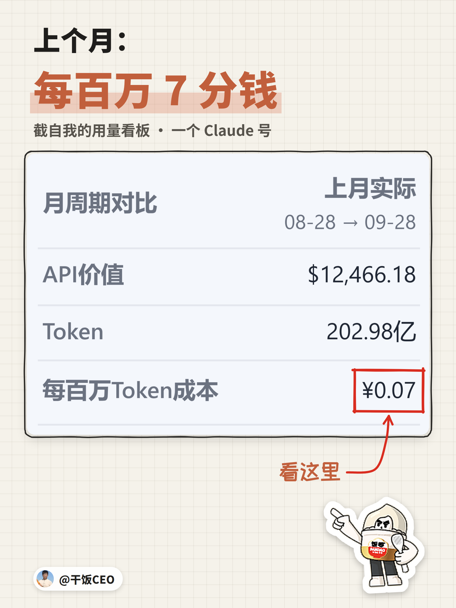
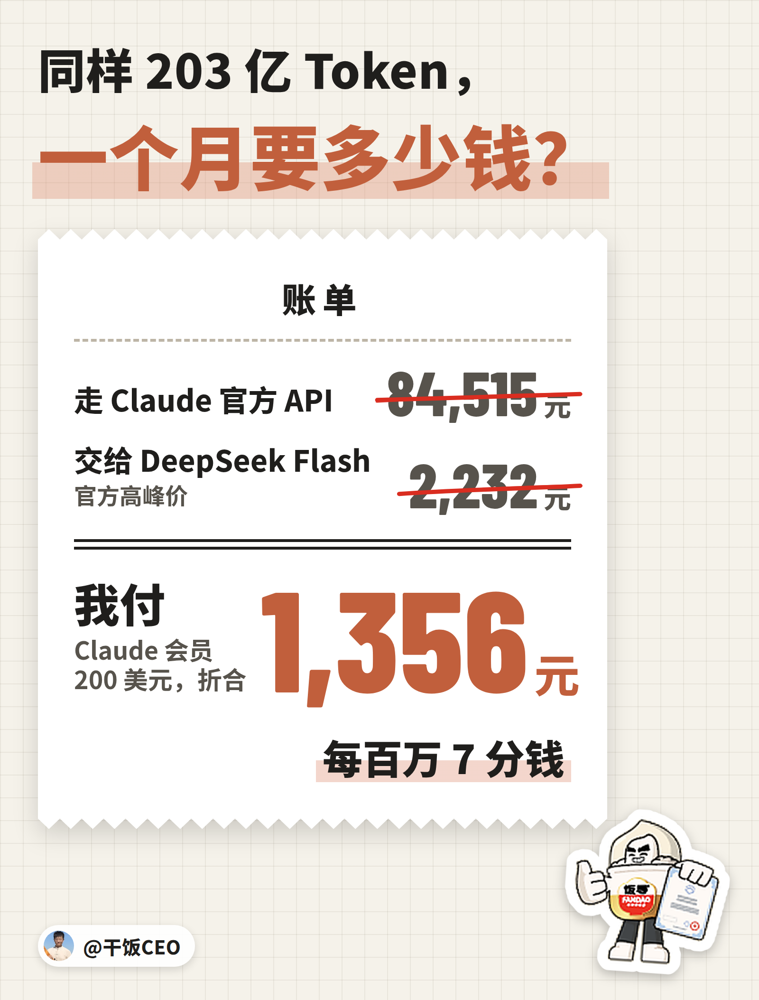
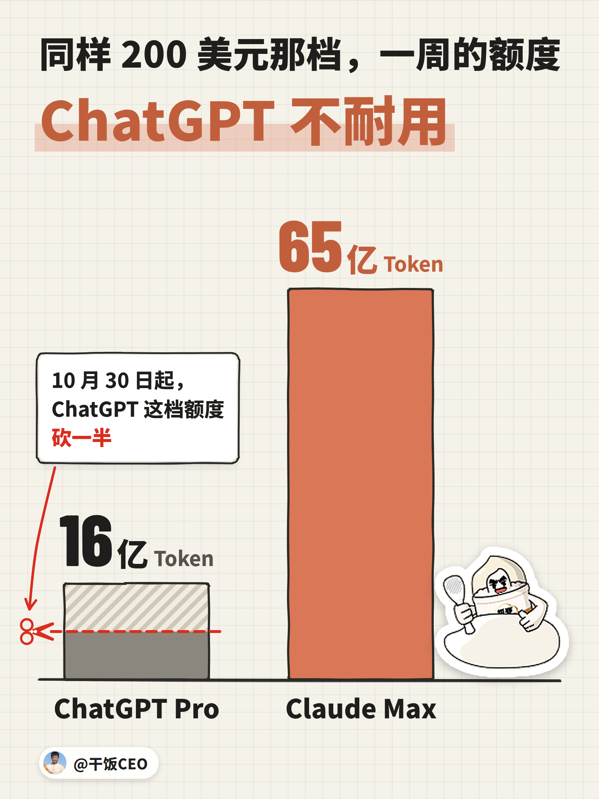
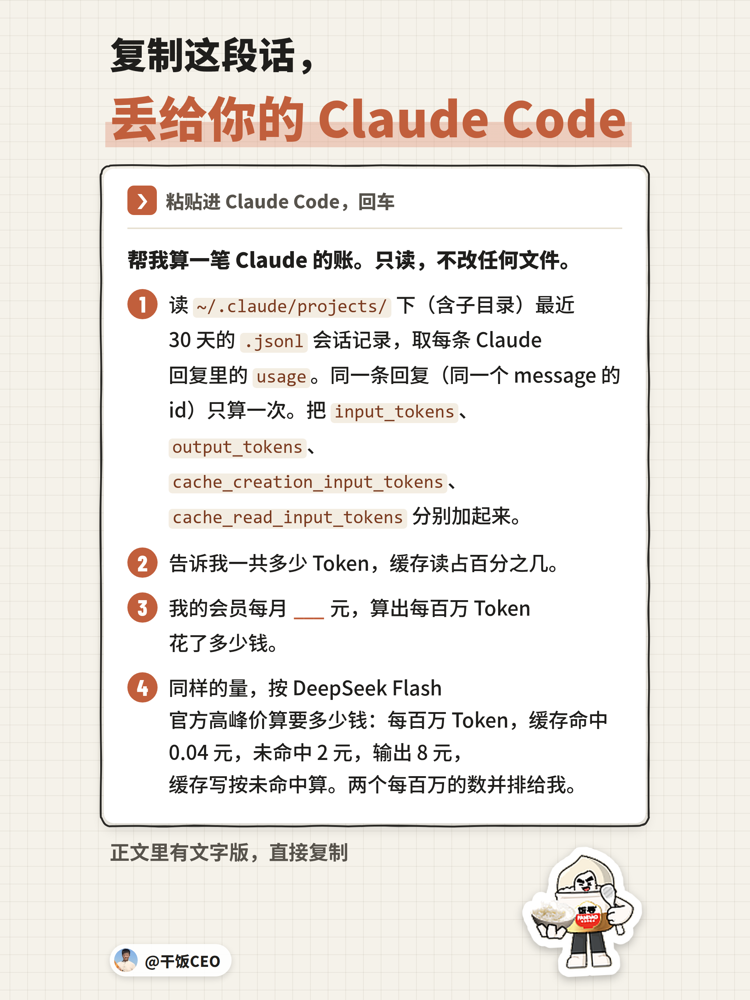

我一个月要烧掉近千亿 Token。


这一周跑了 215 亿，照这个速度，一个月 921 亿。

你嫌 Claude 贵，我嫌 DeepSeek 贵。

我用的就是 Opus、Fable，世界第一的模型。额度又给得这么大方，前面拦着的事再多，我都想办法把它用上了。

## 大方到什么程度？

拿我一个 Claude 号算。上个月，它跑了 203 亿 Token，会员费 200 美元，约 1,356 元，摊下来每百万 Token 7 分钱。



截图是我用量看板上这个号的「月周期对比」，看上个月那一列。

同样这 203 亿，走 Claude 官方 API，要 84,515 元，是我实付的 62 倍。交给 DeepSeek Flash，按官方高峰价要 2,232 元，合每百万 1 毛 1。



按 API 的价要 8.5 万的用量，会员只收我 1,356 元。这谁能说不夸张？

9 月 10 日 DeepSeek 发 V4.1 Flash，公告标题写的是「更强、更快、更普惠」。普惠到每百万 1 毛 1，在我这儿还是贵。

## 凭什么这么便宜？

这 203 亿里，97.6% 是缓存读，就是同一段上下文被反复读。会员费又是包月的，跑得越多，摊得越薄。

可是，缓存读本来就便宜，算进 Token 里，不是凑数吗？

DeepSeek 那笔是按同样的结构算的：缓存读按它的缓存命中价，其余按它的未命中价和输出价，一分没少算。

摊薄也有反面。会员费一个月就这么多，Token 跑得越少，每百万越贵。说 Claude 贵的人，多半没把它用满。

## ChatGPT 不也是 200 美元？

是，ChatGPT 200 美元那档我也买了。一周的额度，它最多给过我 16.4 亿 Token，同一档的 Claude 给过 65.5 亿。



ChatGPT 那个号一个月跑了 94 亿，每百万 1 毛 4。它也就是重置频繁点：两个月重置了 4 次，8 月 29 日那次，还是它自己把用量算错了，修了 8 个 bug。

9 月 29 日 OpenAI 又宣布，10 月 30 日起，200 美元那档在 Codex 的额度砍一半，从 Plus 的 20 倍降到 10 倍，老用户 10 月 29 日前不变。OpenAI 官方社区的抗议帖底下 20 条回复，有人说这是 bait-and-switch，先拿好条件把人拉进来，再把条件换掉；还有人直接说要换 Opus 5.5。同一个价，一家在砍，一家一周给到 65.5 亿，高下立判。

## 怕封号，额度又不够用，怎么办？

我之前被 Claude 封过号，后来干脆让 Claude 去美国上班，再远程回来给我干活：以前输入 `claude`，现在输入 `vpsclaude`。怎么搭的，写在这篇：[Claude 搬到家宽 VPS，代码留在本地：我的「防封」实践](https://x.com/ganfanCEO/article/2101636234317893685)。

周额度用到多少停，我是跟号商学的：95%，不等用满。他靠卖 Claude 号吃饭，第 3 篇专门写了他，链接在文末。

额度按周给，用完了就得等下一周。一个号一周的额度能跑 46 到 66 亿 Token，扛不住我这一周 215 亿，所以我不止一个号。近 30 天，8 个订阅号实际跑了 702 亿，光两个 Claude 号就是 564 亿。

## 那我呢？

复制下面这段，丢给你的 Claude Code，第 3 步的空填你每月的会员费，它会把你近 30 天的账算出来。



文字版在这，直接复制：

```text
帮我算一笔 Claude 的账。只读，不改任何文件。
1. 读 ~/.claude/projects/ 下（含子目录）最近 30 天的 .jsonl 会话记录，取每条 Claude 回复里的 usage。同一条回复（同一个 message 的 id）只算一次。把 input_tokens、output_tokens、cache_creation_input_tokens、cache_read_input_tokens 分别加起来。
2. 告诉我一共多少 Token，缓存读占百分之几。
3. 我的会员每月 ___ 元，算出每百万 Token 花了多少钱。
4. 同样的量，按 DeepSeek Flash 官方高峰价算要多少钱：每百万 Token，缓存命中 0.04 元，未命中 2 元，输出 8 元，缓存写按未命中算。两个每百万的数并排给我。
```

两个数一对。你的比 DeepSeek 低，你已经在占这份大方的便宜；比它高，你花着世界第一的模型的钱，额度却空着一块。还在走 API 的不用算，同样的量，官方 API 的价是我实付的 62 倍。

我的账摆在这：一个号一个月 203 亿 Token，1,356 元。你的账算出来多少，要不要把额度用起来，你自己定。

——————

## 往期 ·「CEO 教你用 Claude」

这是「CEO 教你用 Claude」第 5 篇。没有人比我更会用 Claude，这个系列只讲我每天真在用的东西。

- 第 4 篇：[你的 Claude 在背书，我的在用书](https://x.com/ganfanCEO/article/2108506652681044224)。我把 6 本销售书蒸馏成 Skill，当天晚上，Claude 写的涨价话术就上线了。
- 第 3 篇：[最会用 Claude 的我，被号商上了一课](https://x.com/ganfanCEO/article/2108015840977363413)。怕封号的先看这篇：靠卖 Claude 号吃饭的号商，周额度的线划在 95%，不等用满就换号。
- 第 2 篇：[我的审计员，被 Claude 官方审计了](https://x.com/ganfanCEO/article/2107897308960743660)。我给 Claude 装的审计员，被官方新插件抓出一个藏了 5 周的毛病。
- 第 1 篇：[你的Claude也在编，我的编不下去了](https://x.com/ganfanCEO/article/2107799478258565218)。Claude 编的时候，口气跟查过一模一样。我给它装了个审计员，让它编不下去。

#FDE
